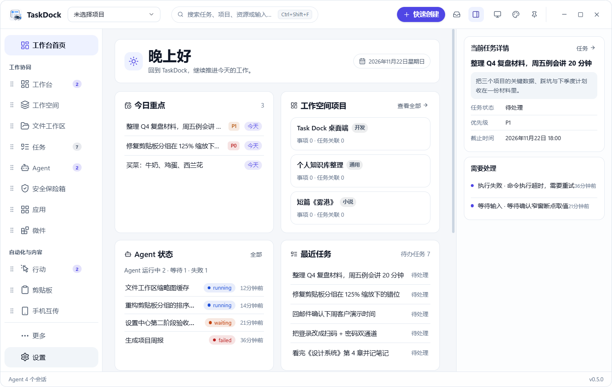
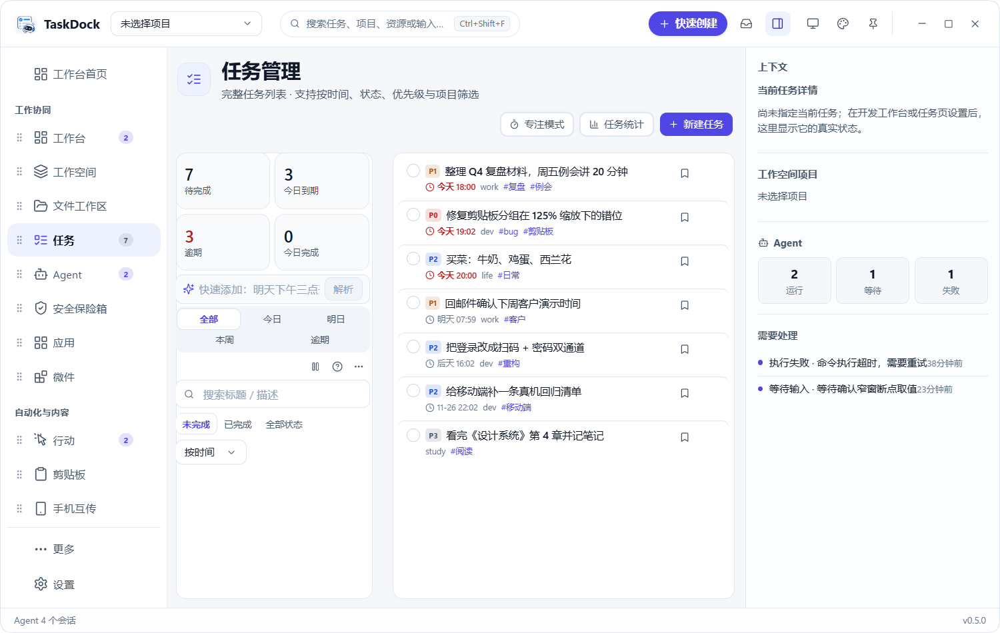
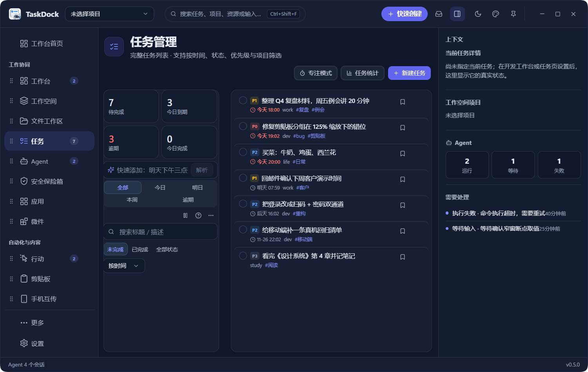
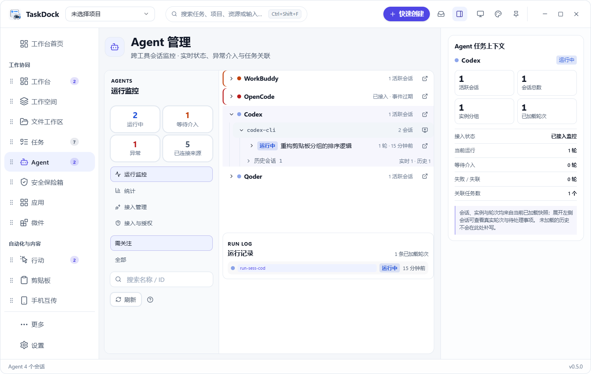
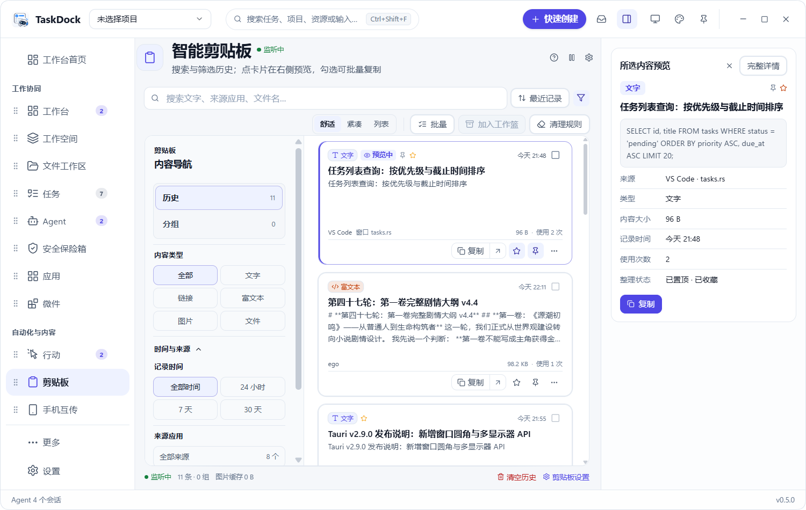
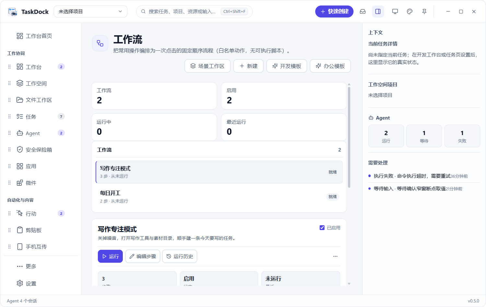
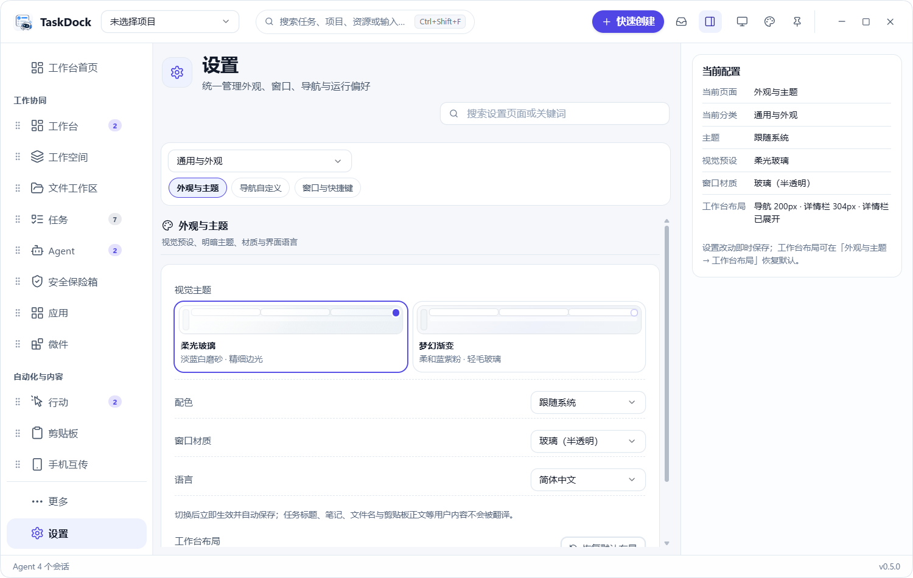

# Task Dock

**常驻 Windows 桌面的任务中枢与 AI Agent 工作台。** 任务、文件、剪贴板、收集箱和 Agent 运行状态收在一个悬浮入口里，数据默认只留在本机。


Task Dock 想解决的是桌面上的「切换成本」：记一件事要开一个 App，找文件要翻资源管理器，看 AI 干完没有要切到终端或另一个窗口。
现在它们都在同一个窗口里，窗口本身能拖到屏幕边缘缩成一条胶囊，需要时再展开成完整工作台。

它不是一个在线服务：所有业务数据保存在本机 SQLite，不上传云端。

## 界面预览

2026-11-22 从真实运行的 Task Dock 重新截取（WebView2 实例 + 隔离数据目录 + 演示数据），不是设计稿。



| **任务管理** | **任务管理（暗色）** |
|---|---|
|  |  |
| **Agent 监控（来源 → 实例 → 会话）** | **智能剪贴板（条目与内容预览）** |
|  |  |
| **工作流** | **设置 · 外观与主题** |
|  |  |

> 图中的任务、剪贴板、Agent 会话、项目与工作流均为演示数据。采集条件与边界见
> [截图说明](docs/screenshots/readme-20261122/README.md)。

## 核心能力

- **悬浮工作台**：极简 / 紧凑 / 完整三种形态，无边框透明置顶，拖近屏幕边缘自动吸附成胶囊；需要大屏作业时打开独立的大型工作台窗口。
- **任务与提醒**：中文自然语言录入（「明天下午三点交周报」）、优先级与分类、重复规则、桌面提醒、延后与撤销、完成趋势统计；还有番茄钟、快速捕获小窗和跨模块全局搜索。
- **应用启动与窗口切换**：扫描本机已安装应用并读取真实图标，支持启动、唤醒已有窗口、打开工作目录、恢复 Agent 会话；一组目标可存成「工作现场」按顺序批量启动。
- **智能剪贴板**：文字 / 链接 / 富文本 / 图片 / 文件列表，连续截图自动分组，搜索筛选、批量复制、逐项粘贴到指定窗口、本机 OCR；敏感内容有启发式过滤，日志不记正文与路径。
- **文件与项目空间**：多目录分栏、跨窗格拖拽、复制到资源管理器；开发 / 游戏 / AI 漫剧 / 通用 / 小说五类项目容器，关联任务与素材。
- **收集与沉淀**：收集箱、快速笔记、文件暂存架（引用或托管）、一键工作流、规划中心、六类桌面微件。
- **AI Agent 监控**：自动发现本机 Agent，接入 Hooks 或宿主插件后，用「来源 → 实例 → 会话 → 轮次」展示运行状态；等待介入与失败汇聚到行动中心，并有工作统计与事件时间轴。
- **移动端伴随应用**：Android 端本地优先，扫码配对后同步任务、收集箱与笔记，支持文件互传与系统分享接收。

## AI Agent 支持

只采信 Agent 真实上报的事件——「已安装」不等于「已连接」。

| 状态 | Agent |
|---|---|
| 已有真实事件联调 | Codex、WorkBuddy / CodeBuddy、Qoder、DeepSeek Harness、OpenCode |
| 适配器已实现，真实会话待验证 | Claude Code、Cursor、Gemini CLI、ZCode；Trae / Trae CN（需在 Trae 内手动开启全局 Hooks） |
| 仅安装与运行发现 | Windsurf、Cline、Roo Code、Continue、Augment、Copilot、Antigravity、Kiro、Aider、OpenHands 等 |
| 任意 Agent | 本地 HTTP Bridge（`127.0.0.1:47821`，Bearer 令牌）或向 `agent-inbox` 目录投递事件文件 |

完整矩阵见 [AGENT_COVERAGE_MATRIX.md](AGENT_COVERAGE_MATRIX.md)。

## 安装与运行

当前仅支持 **Windows x64**（开发与验收环境为 Windows 11）。仓库不托管安装包，请从源码运行或自行构建。

需要 Node.js 20.19+ / 22.12+、Rust 1.85+、Visual Studio Build Tools（含 Windows SDK）；WebView2 在 Windows 11 上已自带。

```powershell
npm install
npm run tauri dev
```

构建安装包：

```powershell
npm run tauri build      # 生成 NSIS / MSI 安装包
```

macOS / Linux 尚未支持，仅为规划项。

### 首次使用

1. 启动后主窗口以完整模式显示，并在 `%APPDATA%\com.taskdock.desktop` 建立数据库。
2. 用 `Ctrl+K` 或输入框添加第一条任务，自然语言解析结果会先给你确认。
3. 到「应用」页扫描本机应用，收藏常用项后会出现在胶囊的应用面板。
4. 需要监控 AI Agent 时，到「Agent」页运行接入向导；宿主自己的安全确认（例如 WorkBuddy 的 `/hooks`）仍需手动完成。

### 默认快捷键

| 操作 | 快捷键 | 范围 |
|---|---|---|
| 显示 / 隐藏主窗口 | `Ctrl+Alt+T` | 系统级 |
| 打开快速捕获 | `Ctrl+Shift+Space` | 系统级 |
| 快速添加任务 | `Ctrl+K` | 应用内 |
| 打开剪贴板 | `Ctrl+Shift+C` | 应用内 |
| 全局搜索 | `Ctrl+Shift+F` | 应用内 |
| 切换主要页面 | `Ctrl+1` … `Ctrl+0` | 完整模式 |

快捷键都可以在「设置 → 窗口与快捷键」里改。

## 数据与隐私

- 业务数据保存在本机 `%APPDATA%\com.taskdock.desktop`（SQLite + 本地文件），可用 `TASK_DOCK_DATA_DIR` 指向其他位置。
- Agent Bridge 只监听 `127.0.0.1` 并要求令牌；Agent 侧只上报状态与轮次元数据，不保存对话正文。
- 剪贴板采集可整体关闭；敏感过滤默认开启，但它是启发式防线，不能保证识别所有密码与密钥。
- 暂无云同步，WebDAV / 文件同步仍在规划中。

## 技术栈

Tauri 2（Rust 后端 + WebView2）／React 19 + TypeScript + Vite（自建组件层，无第三方 UI 框架）／Zustand 状态 ／SQLite（rusqlite）本地存储 ／Win32 与 WinRT 负责贴边、DWM 材质、通知、TTS 与 OCR。

## 文档与参与

- [docs/README.md](docs/README.md)：文档索引，按任务查章节
- [docs/ARCHITECTURE.md](docs/ARCHITECTURE.md) / [docs/DEVELOPMENT.md](docs/DEVELOPMENT.md)：架构与开发约定
- [docs/ROADMAP.md](docs/ROADMAP.md)：路线图；应用内「规划中心」与 [src/lib/featureCatalog.ts](src/lib/featureCatalog.ts) 同源，当前 62 项（已实现 33 / 部分实现 24 / 规划中 5）
- [AGENTS.md](AGENTS.md)：协作规范（工作树可能被多个会话共享，动手前先看这里）

## License

仓库根目录没有 `LICENSE` 文件，因此不声明开源许可证。版权与第三方依赖许可见 [NOTICE](NOTICE) 与 [docs/THIRD_PARTY.md](docs/THIRD_PARTY.md)；复制、分发或商用前请与维护者确认。
