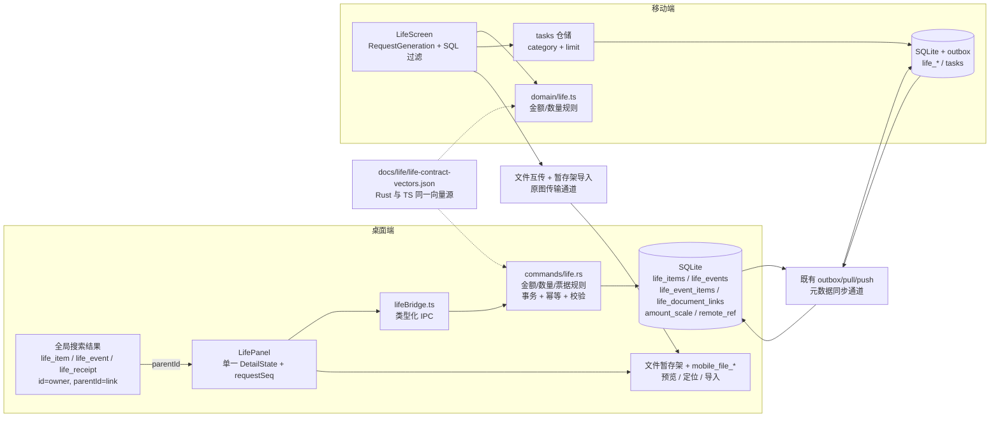

# 生活效率系统 v1：架构缺陷修复与工程验收报告

日期：2026-11-22。范围：只修复购买记录、生活待办、票据关联与跨端同步的数据闭环；
未扩展 OCR、AI 消费分析、库存、购物清单等第二阶段能力。

> 执行说明：任务按 A（`LifePanel`）/ B（`life.rs`）/ C（移动端领域契约）/ D（移动端页面与查询）/
> E（文档与验收）拆分为工作区。由于 B/C 的共享契约向量、桌面 IPC 注册与 sync 兼容路径存在写入交集，
> 本轮由主 Agent 作为唯一所有者**串行实现全部写入**，避免共享工作树冲突；最后由主 Agent 独立复核调用链、
> 双端契约、同步与迁移。工作区原有其他任务的未提交改动（styles/workbench/apps 等）未被还原、覆盖或提交。
> 实际命令与退出码见 [test-results.md](test-results.md)。

## 1. 缺陷根因与修复

| 编号 | 原根因 | 修复 |
|---|---|---|
| A1 | 详情数据拆成 `selected` / `selectedEvent` / `itemLinks` 三份状态；`openEvent` 只清 `selected` 不清 `itemLinks`，`visibleLinks` 又把事件票据与上一商品的票据拼在一起；详情读取没有代际号，旧请求成功/失败都会写 `setSelected(null)` 或覆盖数据 | 合并为单一 `DetailState`（实体 + 数据 + 关联 + 焦点）；切换即清空；`detailSeq` 使旧响应（含 finally）失效；事件票据由后端一次 SQL 合并事件级与事件内商品的商品级关联，商品详情只显示商品级关联 |
| A2 | 全局搜索票据结果只给 `target_id`(owner) 与 `parent_id`(link)，前端拿不到 `owner_type`，于是用 `try { openEvent(id) } catch { selectItem(id) }` 猜类型；而 `openEvent` 自己吞异常，回退永不触发，商品票据永远打不开 | 新增只读命令 `life_document_link_get(linkId)`；定位时先按 `parentId` 读关联拿到 `owner_type`/`owner_id`，再明确打开商品或事件并高亮该票据；缺关联 id / 已解除关联明确报错，无异常回退 |
| A3 | `receiptStateLabel` 只看 `transfer_state`，把 `transferred` 一律叫“已传输”、其余叫“待传输”；`remote_source=file`（文件已到电脑、尚未导入暂存架）被误显示成原图未传输，且无定位入口 | `receiptStateInfo(link)` 联合 `document_source`/`remote_ref`/`remote_source`/`transfer_state` 判断五类状态；`remote_source=file` 用 `mobileFileReveal(remote_ref)` 定位文件并提示需在文件互传中导入；`transferred` 缺 `remote_ref` 暴露为状态异常 |
| B1 | `life_document_link_create` 丢弃事务返回值，外层用**新生成的随机 ID** 查刚插入的行；幂等分支返回已有 ID 时，外层按新 ID 查不到 → `NotFound` | 事务返回最终 ID（`let actual_link_id = ...`），外层按它查询；重复请求返回已有行且不新增副本 |
| B2 | 创建关联只校验 owner_type/source/空引用与 byte_size 类型；负 `byte_size`、不存在的暂存架引用、非法 `transferred`、控制字符与相对文件路径都能入库 | 校验 owner 存在且未删、shelf_item 引用真实存在、byte_size ≥ 0、引用格式（无控制字符；file 必须绝对路径；shelf_item 无空白）、`transferred` 必须有远端引用（创建入口直接拒绝）；删除仍只软删且幂等 |
| B3 | Rust `parse_minor` 接受 `+1` / `.5` / `1.`；TS `parseMoneyMinor` 却用 `replace(/,/g, "")` 隐式接受千分位，且两端上限/精度不同（Rust 按 12 位整数、TS 按 1e12；TS 允许低于货币 ISO 的 amountScale） | 共享 JSON 向量固定规则；两端统一拒绝正负号、千分位、缺整数位、悬空小数点，统一 `MAX_AMOUNT_MINOR=1e12`、数量整数 ≤12 位且必须 >0；`resolve_amount_scale` 要求不得低于货币精度，历史行可沿用更细精度 |
| D1 | `LifeScreen.refresh()` 调 `listTasks()` 读全表再 JS `filter(category)` | `listTasks({category, limit})` 在 SQLite 层过滤/排序/限量（生活页 60 条），未传选项的其它页面行为不变；不新建任务仓库 |
| D2 | 移动端详情与刷新没有代际控制：旧详情失败会 `setSheet(null)` 关掉新详情，旧 `finally` 会清掉新 loading | 列表/详情各持 `RequestGeneration`，只有最新代可写状态；抽取可单测的代际辅助 |
| D3 | 生活页已有完成数量但只能看不能恢复，用户被迫跳到任务页 | 页内可展开已完成列表，恢复复用同一 `toggleLifeTask`（底层 `toggleTask`），不复制任务操作逻辑 |

## 2. 实际修改文件（按工作区）

| 工作区 | 文件 | 变更摘要 |
|---|---|---|
| A 桌面 UI | `src/components/life/LifePanel.tsx` | 单一详情状态、请求代际、票据定位、票据状态与动作、解除守卫、高亮 |
| A 桌面 UI | `src/components/life/LifePanel.test.tsx` | 新增 11 项：串用/乱序/失败/两类票据定位/关联解除/file 状态/映射 |
| A 桌面 UI | `src/components/life/life-ui.css` | 定位高亮、owner 标签、加载占位样式（复用语义 Token） |
| 桌面桥接 | `src/lib/lifeBridge.ts` | 新增 `lifeDocumentLinkGet` 类型化调用 |
| B Rust | `src-tauri/src/commands/life.rs` | 金额/数量/精度规则重写；票据创建校验与幂等返回；`life_document_link_get`；事件详情合并商品级票据；删除逻辑抽为可测事务函数 |
| B Rust | `src-tauri/src/commands/life_tests.rs` | 新增共享向量用例、票据幂等/校验/删除/事件票据合并用例 |
| B Rust | `src-tauri/src/lib.rs` | 注册 `life_document_link_get`（唯一新增 IPC） |
| B Rust | `src-tauri/src/mobile_sync/life_sync.rs` | 复制路径使用 `canonical_quantity_for_sync`，保留历史 0；新增兼容测试 |
| C 移动端领域 | `apps/mobile/src/domain/life.ts` | 与 Rust 对齐的金额/数量/精度/上限规则，导出 `resolveAmountScale` 与上限常量 |
| C 移动端领域 | `apps/mobile/src/domain/__tests__/lifeMoney.test.ts` | 改为共享向量驱动 + 展示/汇总回归 |
| C 共享契约 | `docs/life/life-contract-vectors.json` | 新增：名称、货币、精度、金额、数量、上限的唯一向量源 |
| D 移动端 | `apps/mobile/src/db/tasks.ts` | `listTasks` 选项化：SQL 层按 category 过滤、排序、限量 |
| D 移动端 | `apps/mobile/src/db/__tests__/life.test.ts` | 新增分类过滤/排序/限量与旧调用兼容用例 |
| D 移动端 | `apps/mobile/src/screens/LifeScreen.tsx` | 请求代际、SQLite 过滤查询、已完成查看与恢复入口 |
| D 移动端 | `apps/mobile/src/lib/life/requestGeneration.ts` + `__tests__` | 新增可单测的代际控制辅助（4 项测试） |
| E 文档 | `docs/LIFE_EFFICIENCY.md` | 迁移 67/12、`amount_scale` 契约、票据状态机、两条通道、待办复用、状态表 |
| E 文档 | 本报告 + `test-results.md` | 根因、行为差异、测试向量、实际命令与退出码、风险 |

## 3. 修改前后业务行为差异

- 重复关联同一商品/事件的同一文件：原来第二次请求报「票据关联不存在」，现在返回既有 ID，不产生副本。
- 事件详情：原来只显示事件级票据，且可能混入上次选择的商品票据；现在显示本事件票据 + 事件内商品的商品级票据，
  其它事件的商品票据不会出现。商品详情的「关联票据」只显示该商品自己的票据。
- 全局搜索点票据：原来商品级票据打不开（异常被吞）；现在按 parentId 回读关联后精确打开，并高亮该票据。
- 票据状态：`remote_source=file` 从「待传输」改为「已到电脑 · 待导入」，提供文件定位；
  `transferred` 缺远端引用显示状态异常，不再伪装为正常待传输。
- 金额输入：`.5`、`1.`、`+1`、`1,000` 从「一端接受一端拒绝」变为两端一致拒绝；
  金额上限统一 1e12；数量 `0` 从桌面可接受改为两端一致拒绝（历史库值不改写）。
- 生活待办：从「全表读取后 JS 过滤」改为 SQLite 过滤 + 60 条上限；新增已完成查看与恢复。
- 详情页快速切换：旧请求的成功、失败与 loading 收尾都不再影响新详情。

## 4. 新增/改写测试用例

- 桌面 `LifePanel.test.tsx`：商品 A→事件 B 不串票据；商品 A→商品 B 旧请求晚返回；事件 A→事件 B 旧请求失败；
  事件级/商品级票据定位；关联已解除明确报错；解除只删当前详情被点击的一条；`remote_source=file` 状态与定位；
  `receiptStateInfo` 五态映射。
- Rust `life_tests.rs`：共享向量（名称/货币/精度/金额/数量/上限）；票据幂等返回；不存在与已删除 owner；
  不存在的暂存架引用；负 byte_size；非法 transfer_state 与引用；删除幂等且不删原文件；事件详情只合并自己的商品票据。
- 移动端 `lifeMoney.test.ts`：读取同一份 JSON 验证全部向量；展示与多币种汇总回归。
- 移动端 `life.test.ts`：生活待办 SQL 过滤/排序/限量与无参调用兼容。
- 移动端 `requestGeneration.test.ts`：代际唯一性、旧成功/失败丢弃、旧 finally 不清新 loading、实例隔离。
- Rust `life_sync.rs`：同步复制保留历史数量 0，同时拒绝千分位/科学计数法。

## 5. 实际测试命令与结果

见 [test-results.md](test-results.md)。摘要：根端 4 条命令退出码均 0（typecheck / LifePanel 16 项 /
build / arch:guard）；移动端 5 条命令退出码均 0（typecheck / 12+12+14+3+4 项通过）；
Rust `commands::life` 29 项通过，实际同步过滤器 2 项通过。

任务书要求的 `cargo test mobile_sync::life_sync` **退出 0 但匹配 0 个用例**（历史过滤器路径问题），
因此额外执行了 `mobile_sync::sync::tests::life` 与 `mobile_sync::sync::life_sync::tests`，如实记录，
未把 0 用例当作通过依据。

## 6. 未通过测试及处理

执行中出现的 3 个失败均已修复并复跑通过（JSON 字段不一致、错误断言参数、Cargo 锁竞争），
明细见 [test-results.md](test-results.md#本轮曾失败并已修复)。当前无遗留失败用例。

## 7. 双端同步兼容性

- 协议字段未改：仍为 `life_item` / `life_event` / `life_event_item` / `life_document_link` 四个实体，
  outbox/pull/push、`rev/server_rev`、墓碑语义与 `SYNC_ENTITIES` 白名单不变。
- 新增 `life_document_link_get` 是只读本地 IPC，不进入同步协议，旧客户端无感知。
- 输入收紧不影响历史行：`amount_scale` 旧行仍按原精度解释；同步复制用 `canonical_quantity_for_sync`
  保留历史 `0`；`parse_money` 的 1e12 上限只对新输入生效，复制路径仍接受库内既有值。
- 票据状态机兼容：`remote_source=file` 早于本轮已存在于迁移 66，本轮只修正展示与创建校验，
  不重写已有行；`transferred` 的新约束只在创建入口生效，旧数据原样展示并可提示异常。

## 8. 数据迁移与备份影响

- **未新增迁移**：`MIGRATION_67`（桌面 `amount_scale`）与 `MIGRATION_12`（移动端 `amount_scale` +
  `life_sync_deferred`）已在库中，本轮仅为文档补全与规则对齐，历史迁移未修改。
- 备份 manifest 与 `BACKUP_TABLES` 未改；四张 life 表和 `amount_scale` / `remote_ref` / `remote_source`
  列仍在原注册路径中，已有备份的恢复字段集合不变。
- 新 IPC 是只读查询，不写库、不写 outbox，不产生同步变更。

## 9. 剩余风险

1. 全局搜索结果结构没有 `owner_type`，票据定位需要一次额外 IPC；数据量大时 `life_document_link_get`
   按主键查询很快，但多一次往返。后续可在搜索结果补字段（需评估跨端协议兼容）。
2. 移动端 LifeScreen 未做屏幕级渲染测试（仓库无现成 RN 屏幕夹具）；代际控制仅单测 + 代码审查覆盖。
3. Release 安装包、真实双设备同步与升级/卸载未执行，本轮结论只适用于 Dev/单测范围。
4. `arch:guard` 报告的 DUP-001（`src-tauri/components`、`src-tauri/boot`）为既存问题，本轮未处理。
5. 旧桌面客户端可能存过数量 0；新输入拒绝但库内值保留，界面若编辑该行会被要求改成正数（迁移未重写历史）。

## 10. 更新后的架构图

关键分层不变：UI 不直接访问数据库、React 不直接调用 Win32；生活待办不新建任务表；
票据只存引用；同步与原图传输是两条独立数据通道。
