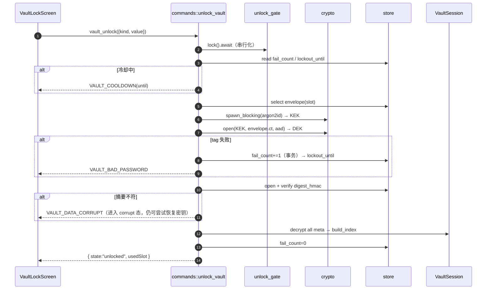

# 安全保险箱 · API 与方法设计

- 日期：2026-11-18
- 阶段：P0（接口契约；实现与测试在 P1）
- 上游：[data-model.md](data-model.md)、[security-architecture.md](security-architecture.md)

> 命名遵循仓库现状：Rust 模块 `crate::secure_vault`，IPC 命令 `vault_*`（camelCase 参数由
> Tauri 自动转换，前端调用见 `src/lib/vault.ts`）。**不照搬任何"通用密码管理器"的命名**。

---

## 1. 模块划分

```text
src-tauri/src/secure_vault/
├── mod.rs              # 对外导出；VaultState 定义；初始化
├── crypto/
│   ├── mod.rs
│   ├── kdf.rs          # Argon2id / HKDF
│   ├── envelope.rs     # 信封序列化、封装、解封装
│   ├── aead.rs         # AES-256-GCM seal/open（统一 AAD 构造）
│   ├── secret_bytes.rs # Base32、NFKC、字节保真编码
│   └── password_gen.rs # 生成与强度
├── store/
│   ├── mod.rs           # VaultStore：打开/迁移/事务
│   ├── schema.rs        # VAULT_MIGRATIONS
│   ├── meta.rs          # vault_meta 读写
│   ├── records.rs       # records / categories / tags / settings CRUD（只碰密文）
│   └── digest.rs        # HMAC 清单摘要
├── session.rs           # VaultSession：DEK、内存索引、活动时间、锁定
├── policy.rs            # 纯函数：给定事件与设置 → 是否锁定（可单测）
├── backup.rs            # .tdvault 导出/检查/导入
├── clipboard.rs         # 复制、指纹、定时清除
├── audit.rs             # vault_audit + 诊断事件
└── commands.rs          # 全部 #[tauri::command]（薄层）

src-tauri/src/commands/secure_vault.rs   # 仅 re-export commands.rs（保持 commands/ 目录惯例）
src/lib/vault.ts                        # 类型化前端封装（invoke 唯一入口）
src/lib/vaultBridge.ts                  # 由 bridge.ts 末尾 re-export（避免 bridge.ts 继续膨胀）
src/store/useVaultStore.ts              # UI 状态（不含密钥/明文）
src/components/vault/…                  # 页面（P1）
```

**分层铁律**：`commands.rs` 只做"参数校验 → 会话门禁 → 调 core → 组装 DTO"；业务规则只在
`session/store/backup`；`crypto` 不依赖 Tauri 类型（可独立单测）。

---

## 2. 状态对象

```rust
pub struct VaultState {
    pub session: Arc<RwLock<VaultSession>>,   // parking_lot::RwLock
    pub store:   Arc<Mutex<Option<VaultStore>>>, // 未建库时为 None
    pub unlock_gate: tokio::sync::Mutex<()>,  // 串行化解锁尝试
    pub ticker:  Mutex<Option<JoinHandle<()>>>, // 单一定时器
    pub app:     AppHandle,                    // 仅用于 emit 事件
}

pub struct VaultSession {
    dek: Option<Zeroizing<[u8; 32]>>,
    dek_ver: u32,
    vault_id: String,
    vault_salt: [u8; 16],
    index: VaultIndex,             // 只含 meta
    last_activity: Instant,
    background_since: Option<Instant>,
    pending_copy: Option<PendingCopy>,
    reveal_epoch: u64,             // 每次锁定 +1，用于丢弃迟到的响应
    state: VaultRuntimeState,      // Locked{reason} | Unlocked | Corrupt
}
```

`VaultState` 由桌面 `lib.rs` 在 `setup` 中 `app.manage(...)`。**CLI / MCP / REST 进程不 manage
此状态**，因此相关命令在这些入口里根本不存在（结构性隔离，见 §9）。

---

## 2.5 核心内部方法（非 IPC，crypto / store / policy / session）

这些方法**不暴露给前端**，是命令层与测试直接调用的实现层接口。签名用简化记法：
`fn name(args) -> Result<T, VaultError>`。

| 方法 | 模块 | 签名要点 | 关键约束 | 错误 | 测试 |
|---|---|---|---|---|---|
| `derive_master_kek` | crypto::kdf | `(password: &str, salt: &[u8;16], p: &Argon2Params) -> Result<Zeroizing<[u8;32]>>` | 先 NFKC + 去首尾空白；参数全部来自信封 | `KdfFailed` | T-CRY-09/10 |
| `derive_recovery_kek` | crypto::kdf | `(bytes: &[u8;20]) -> Result<Zeroizing<[u8;32]>>` | 固定 `info`，不做 Argon2 | `KdfFailed` | T-REC-01 |
| `wrap_dek` | crypto::envelope | `(kek: &[u8;32], dek: &[u8;32], aad: &str) -> Result<Wrap>` | 12B 随机 nonce；`ct` = 32B+16B tag | `Io`（随机源失败） | T-CRY-01 |
| `unwrap_dek` | crypto::envelope | `(kek: &[u8;32], w: &Wrap, aad: &str) -> Result<Zeroizing<[u8;32]>>` | tag 失败一律 `BadPassword`/`BadRecoveryKey`（由调用方按 slot 映射） | 见 api §11 | T-CRY-03 |
| `derive_record_key` | crypto::kdf | `(dek, salt, id: &str, purpose: Purpose, dek_ver: u32) -> Result<Zeroizing<[u8;32]>>` | `info` 逐字拼接，含版本 | `KdfFailed` | T-CRY-06/09 |
| `encrypt_payload` | crypto::aead | `(key, plaintext: &[u8], aad: &str) -> Result<(nonce12, ct)>` | 每次调用新 nonce；明文用 `Zeroizing` | `Io` | T-CRY-01 |
| `decrypt_payload` | crypto::aead | `(key, nonce, ct, aad) -> Result<Zeroizing<Vec<u8>>>` | 失败不返回部分明文 | `DataCorrupt` | T-CRY-02/04/05 |
| `verify_payload` | crypto::aead | `(key, nonce, ct, aad) -> Result<()>` | **只验 tag 不返回明文**（用于导入前全量自检） | `DataCorrupt` | T-BKP-04 |
| `compute_digest` | store::digest | `(dek, salt, rows: &[(id, rev)]) -> Result<[u8;32]>` | 排序稳定；只覆盖 id/rev | `KdfFailed` | T-DATA-05 |
| `verify_digest` | store::digest | `(expected, actual) -> Result<()>` | `ConstantTimeEq` | `DataCorrupt` | T-DATA-05 |
| `should_lock` | policy | `(now: Instant, last_activity: Instant, bg_since: Option<Instant>, s: &LockSettings, ev: Event) -> Option<LockReason>` | **纯函数**，无 IO、无全局 | — | T-LOCK-01/02/05 |
| `on_app_background` | session | `(&mut self, now: Instant)` | 记 `background_since`；按策略可能立刻锁 | — | T-LOCK-02 |
| `on_system_lock` | session | `(&mut self, reason: LockReason)` | 等价 `lock()`，不可忽略 | — | T-LOCK-04 |
| `clear_sensitive_memory` | session | `(&mut self)` | 清 DEK / 索引 / pending_copy / reveal_epoch+1 | — | T-LOCK-06/07 |
| `redact_sensitive_logs` | audit | `(ev: &VaultAuditEvent) -> SafeMeta` | 只输出 6 个白名单 key；不含 id/标题/搜索词 | — | T-DATA-03、T-ISO-06 |
| `clear_clipboard_if_unchanged` | clipboard | `(pending: &PendingCopy) -> ClearOutcome` | 持 `ACCESS_LOCK` 比对指纹；不匹配不写 | — | T-CLP-02/03/05 |
| `validate_backup` | backup | `(path, passphrase) -> Result<BackupPlan>` | 只读 + 全量解密到内存 + 校验，不写库 | `BackupInvalid`/`BadPassword` | T-BKP-03/04/05 |
| `restore_backup` | backup | `(plan: BackupPlan, strategy) -> Result<ImportResult>` | staging + 原子替换 + `.pre-restore` | `Io`/`Partial` | T-BKP-06/11 |
| `encrypt_backup` / `decrypt_backup` | backup | `(payload, passphrase, backup_id) -> Result<FileLayout>` / 反向 | 独立 `file_key`；两个不同 AAD | 同上 | T-BKP-01/10 |

### 2.5.1 与需求中"建议方法名"的对应

需求文档给了一组通用命名；本项目按现有命名习惯落为下表。**不是照搬，也不是丢项**：

| 需求建议名 | 本项目落点 |
|---|---|
| `createVault` / `unlockVault` / `lockVault` / `isVaultUnlocked` / `getVaultStatus` | `vault_create` / `vault_unlock` / `vault_lock` / `session.is_unlocked()` / `vault_status` |
| `deriveMasterKey` / `wrapVaultKey` / `unwrapVaultKey` | `derive_master_kek` / `wrap_dek` / `unwrap_dek` |
| `generateRecoveryKey` / `verifyRecoveryKey` / `recoverVault` / `changeMasterPassword` | `regenerate_recovery_key` / `unwrap_dek(slot=recovery)`（AEAD 即校验）/ `recover_with_recovery_key` / `change_master_password` |
| `encryptRecord` / `decryptRecord` | `encrypt_payload` + `derive_record_key` / `decrypt_payload` |
| `encryptBackup` / `decryptBackup` / `verifyEncryptedPayload` | `encrypt_backup` / `decrypt_backup` / `verify_payload` |
| `createRecord` / `updateRecord` / `getRecord` / `listRecords` / `deleteRecord` / `searchRecords` / `toggleFavorite` | `vault_record_create` / `vault_record_update` / `vault_record_get` / `vault_record_list` / `vault_record_delete` / `vault_search_records` / `vault_record_toggle_favorite` |
| `generatePassword` / `evaluatePasswordStrength` | `vault_generate_password` / `vault_evaluate_password_strength` |
| `copySecret` / `clearClipboardIfUnchanged` | `vault_copy_secret` / `clear_clipboard_if_unchanged` |
| `scheduleAutoLock` / `handleAppBackground` / `handleSystemLock` | `vault_state.ticker`（单一循环）/ `on_app_background` / `on_system_lock` |
| `clearSensitiveMemory` / `redactSensitiveLogs` | `clear_sensitive_memory` / `redact_sensitive_logs` |
| `exportEncryptedBackup` / `importEncryptedBackup` / `validateBackup` / `restoreBackup` | `vault_export_backup` / `vault_backup_import` / `validate_backup` / `restore_backup` |

## 3. DTO（前后端契约）

```ts
// src/lib/vault.ts
export type VaultRuntimeState = 'noVault' | 'locked' | 'unlocked' | 'corrupt';

export interface VaultStatus {
  state: VaultRuntimeState;
  hasRecoveryKey: boolean;
  // 锁定态不返回记录数、不返回最近使用时间
  cooldownUntil?: string;
  lockReason?: 'manual' | 'idle' | 'background' | 'session_lock'
            | 'suspend' | 'window_hidden' | 'process_exit' | 'error';
  kdfHint?: { mCostKib: number; tCost: number };  // 仅解锁页用于显示"本机参数"
}

export interface RecordSummary {   // 列表项：只有 meta
  id: string; rev: number; type: RecordType; title: string;
  username?: string; urlHost?: string; categoryId?: string;
  tagIds: string[]; favorite: boolean;
  updatedAt: string; lastUsedAt?: string;   // lastUsedAt 来自 record_usage，不来自 meta
}

export interface RecordDetail extends RecordSummary {
  url?: string; email?: string; platform?: string; note?: string;
  fields: Array<{ id: string; label: string; kind: FieldKind; revealed: boolean; value?: string }>;
}
```

`RecordDetail.fields[].value` **只在 `reveal` 里请求过的字段出现**；未请求的只有 `label/kind`。

---

## 4. 生命周期方法

### 4.1 `create_vault`

| 项 | 内容 |
|---|---|
| 签名 | `pub async fn create_vault(state: State<'_, VaultState>, password: String) -> AppResult<CreateVaultDto>` |
| 输入 | `password`（8–128 字符，NFKC 后计）；不允许空白全空格 |
| 返回 | `{ vaultId, recoveryKey: String, recoveryKeyGroups: [String;8], kdf: {...}, createdAt }` |
| 错误 | `VAULT_ALREADY_EXISTS`、`VAULT_VALIDATION`、`VAULT_KDF_FAILED`、`VAULT_IO` |
| 前置 | `state == noVault`；`secure-vault.db` 不存在 |
| 后置 | 库建立（v1 schema）、`master` + `recovery` 两个信封、`state == unlocked`（建完即解锁） |
| 读数据 | 无 |
| 写数据 | `vault_meta`（11 个 key）、`key_envelopes`（2 行）、`settings`（默认值 7 项） |
| 密钥 | 生成 DEK(32B)、salt(16B)、恢复密钥(20B)；派生的 KEK 用后即 drop |
| 明文 | 主密码在栈上；恢复密钥返回给前端**一次**（不落盘、不进日志） |
| 并发 | 持 `unlock_gate`，防双击重复建库 |
| 调用者 | `VaultOnboarding.tsx` |
| 测试 | `T-GEN-01`（建库后 status=unlocked、文件存在）、`T-REC-01`（恢复密钥可解） |

**恢复密钥必须由后端生成并只在这一次响应里返回**；前端展示 8 组 4 字符，要求用户勾选"已抄写"
后才允许进入下一步（`vault_create_confirm_recovery(ack: bool)`）。

### 4.2 `unlock_vault`

```rust
pub async fn unlock_vault(
    state: State<'_, VaultState>,
    credential: UnlockCredential,   // { kind: "password"|"recovery", value: String }
) -> AppResult<UnlockDto>;          // { state, usedSlot, kdfUpgraded: bool }
```

| 项 | 内容 |
|---|---|
| 前置 | `state ∈ {locked, corrupt}`；`cooldown_until` 未到则直接拒绝 |
| 步骤 | ① 取 `unlock_gate` → ② 读 `fail_count/lockout_until` → ③ 定位信封 → ④ Argon2id（`spawn_blocking`）→ ⑤ 解封装 DEK → ⑥ 打开 store + 校验 digest → ⑦ 解密全部 meta 建索引 → ⑧ 清失败计数 → ⑨ `ensure_ticker()`（ticker 在应用启动时已创建，只确保在跑，**不新建**） |
| 错误 | `VAULT_BAD_PASSWORD`、`VAULT_BAD_RECOVERY_KEY`、`VAULT_COOLDOWN`、`VAULT_DATA_CORRUPT`、`VAULT_FORMAT_UNSUPPORTED`、`VAULT_KDF_FAILED` |
| 后置 | `state == unlocked`；`session.dek` 有值；索引就绪；`last_activity = now` |
| 密钥 | DEK 进 `Zeroizing`；KEK 用后 drop |
| 明文 | 主密码/恢复密钥输入；解密出的 meta 明文进索引（**这是设计允许的**，见 threat R-10） |
| 并发 | `unlock_gate` 保证同时只有 1 次尝试；失败计数在**同一事务**里 +1 并写 `lockout_until` |
| 调用者 | `VaultLockScreen.tsx` |
| 测试 | `T-CRY-03`（错密码必失败）、`T-LOCK-08`（冷却生效）、`T-DATA-01`（解锁后可列记录） |

失败冷却（写进 `vault_meta`，重启仍生效）：

| 连续失败 | 冷却 |
|---|---|
| 1–2 | 无 |
| 3 | 5 s |
| 4 | 30 s |
| 5 | 120 s |
| ≥6 | 300 s（不再递增） |

> 冷却只防"应用内暴力尝试"，不能防离线。文案不夸大。

### 4.3 `lock_vault`

```rust
pub fn lock_vault(state: State<'_, VaultState>, reason: LockReason) -> AppResult<()>;
```

前置：任意状态（`locked` 时幂等返回 `Ok`）。后置：§security-architecture 9.3 的六步全部完成，
`reveal_epoch += 1`，广播 `vault-status-changed`。

**唯一锁定入口**：定时器、锁屏、休眠、隐藏、退出、手动全部调它。禁止任何地方直接改
`session.state`。

### 4.4 `vault_status` / `vault_touch`

| 方法 | 签名 | 说明 |
|---|---|---|
| `vault_status` | `fn(app: AppHandle) -> AppResult<VaultStatus>` | 只读状态；**锁定态不含条数/标题** |
| `vault_touch` | `fn(state) -> AppResult<()>` | 刷新 `last_activity`；前端节流 10 s；锁定态直接 `Ok`（不泄漏状态差异） |

### 4.5 `change_master_password`

```rust
pub async fn change_master_password(
    state: State<'_, VaultState>,
    current: String, new_password: String,
) -> AppResult<()>;
```

步骤：`require_unlocked` → 用当前信封解封装 DEK（验证 `current`）→ 新 salt + Argon2id →
新 `master` 信封 → **单事务**替换 → 审计 → 广播。DEK 不变，记录零重写。

错误：`VAULT_BAD_PASSWORD`（当前密码错）、`VAULT_VALIDATION`（新密码不合规）、`VAULT_IO`。
测试：`T-REC-06`（改后旧密码失败、新密码成功、记录全部可读）。

### 4.6 `regenerate_recovery_key`

```rust
pub async fn regenerate_recovery_key(state, current: String) -> AppResult<RecoveryKeyDto>;
```

要求**已解锁 + 输入当前主密码**（防"人离开时被换掉恢复密钥"）。生成新 20B → 覆盖
`slot=recovery` 信封 → 返回新密钥（一次）。旧密钥立即失效。
测试：`T-REC-05`（旧恢复密钥必须失败）。

### 4.7 `recover_with_recovery_key`

```rust
pub async fn recover_with_recovery_key(state, recovery_key: String) -> AppResult<RecoverDto>;
// RecoverDto { state: "unlocked", mustSetNewPassword: true }
```

成功后进入"恢复态"：可读记录，但**除改主密码外禁止写**（`session.recovery_mode = true`，
写命令返回 `VAULT_RECOVERY_READONLY`）。强制走 `change_master_password` 后解除。

### 4.8 `delete_vault`

```rust
pub async fn delete_vault(state, confirm: String) -> AppResult<()>;
```

`confirm` 必须逐字等于 `"DELETE VAULT"`；要求已解锁。步骤：锁会话 → 关闭连接 → 删
`secure-vault.db` / `-wal` / `-shm` → 审计（写在主库 diagnostic，不在被删库）→ 状态 `noVault`。

---

## 5. 记录方法

| 方法 | 签名 | 前置 | 后置 / 说明 | 错误 | 测试 |
|---|---|---|---|---|---|
| `record_list` | `(state, filter: ListFilter) -> AppResult<RecordListDto>` | unlocked | 只读内存索引（索引含 usage 缓存）；分页 50；`filter`: type/category/tag/favorite | `VAULT_LOCKED` | `T-ACC-01` |
| `record_get` | `(state, id: String, reveal: Vec<String>) -> AppResult<RecordDetail>` | unlocked | 解密 meta（必） + 仅 reveal 的 secret 字段；更新 `record_usage`（**不改 `rev`**，异步，失败不影响返回） | `VAULT_LOCKED`、`VAULT_NOT_FOUND`、`VAULT_DATA_CORRUPT` | `T-ACC-03`、`T-CRY-05` |
| `record_create` | `(state, draft: RecordDraft) -> AppResult<IdDto>` | unlocked | 生成 id/rev，加密两 blob，更新 digest，插索引 | `VAULT_VALIDATION`、`VAULT_IO` | `T-DATA-01`、`T-CRY-01` |
| `record_update` | `(state, id, patch: RecordPatch) -> AppResult<RevDto>` | unlocked | `rev+1`；`expectedRev` 不符 → `VAULT_CONFLICT`（防并发覆盖） | 同上 + `VAULT_CONFLICT` | `T-DATA-02` |
| `record_delete` | `(state, id) -> AppResult<()>` | unlocked | `tombstone=1`、`rev+1`、从索引移除 | `VAULT_NOT_FOUND` | `T-DATA-04` |
| `record_restore` | `(state, id) -> AppResult<()>` | unlocked | `tombstone=0`，重新入索引 | `VAULT_NOT_FOUND` | `T-DATA-04` |
| `record_toggle_favorite` | `(state, id) -> AppResult<bool>` | unlocked | 只改 meta | `VAULT_NOT_FOUND` | `T-ACC-04` |
| `record_mark_used` | `(state, id) -> AppResult<()>` | unlocked | 更新 `record_usage`（新 nonce + 重新加密 `{last_used_at, use_count}`），**不改变 `rev`**；复制时自动调用 | — | `T-ACC-05` |
| `search_records` | `(state, query: String) -> AppResult<SearchDto>` | unlocked | 只搜 meta；上限 200；见 security-architecture §11 | `VAULT_LOCKED` | `T-SRCH-01..04` |

`RecordDraft` / `RecordPatch` 字段与 [data-model.md](data-model.md) §6.2 的 schema 一一对应；
**服务端校验长度与数量上限**（不信任前端）。

### 5.1 分类与标签

| 方法 | 签名 | 说明 |
|---|---|---|
| `category_list` | `(state) -> AppResult<Vec<CategoryDto>>` | 解密名称 |
| `category_create` | `(state, name: String, sortOrder: Option<i64>) -> AppResult<CategoryDto>` | 名称 ≤ 40 字符 |
| `category_rename` | `(state, id, name) -> AppResult<()>` | 只改一行 |
| `category_delete` | `(state, id) -> AppResult<DeleteCategoryDto>` | 返回 `affectedRecords` 条数；需 `confirmAffected: bool` 二次确认；删后遍历相关记录把 `category_id` 置空（分批 100 条/事务） |
| `tag_list` / `tag_create` / `tag_rename` / `tag_delete` | 同上结构 | 标签名 ≤ 24 字符；删除只从 `meta_blob.tag_ids` 移除 |

**批量重写约束**：分类删除可能触及大量记录 → 必须分批事务，每批提交后更新索引；中途失败
返回 `VAULT_PARTIAL`（带已完成条数），允许重试（幂等：已置空的跳过）。

---

## 6. 密码工具

### 6.1 `generate_password`

```rust
pub fn generate_password(req: GenerateOptions) -> AppResult<GeneratedDto>;
// GenerateOptions { length: u8, upper: bool, lower: bool, digit: bool, symbol: bool, excludeAmbiguous: bool }
// GeneratedDto { password: String, charset: String, entropyBits: u16 }
```

| 项 | 内容 |
|---|---|
| 校验 | `8 ≤ length ≤ 64`；至少 2 类；`length ≥ 类别数` |
| 随机 | `OsRng`（`getrandom`）；**拒绝采样**避免取模偏置 |
| 明文 | 返回值是明文密码（用户要求生成就是要看）；**不落盘、不进日志、不写剪贴板** |
| 测试 | `T-GEN-02`（多样性/长度/字符集）、`T-GEN-03`（1000 次无重复且每类至少 1 个） |

### 6.2 `evaluate_password_strength`

```rust
pub fn evaluate_password_strength(password: String) -> AppResult<StrengthDto>;
```

**为什么放后端**：前端若引第三方强度库会增加打包体积与供应链面；后端纯函数无状态。
代价：明文过 IPC 一次（不落盘）。可接受，且比在前端内存里多留一份更可控。
测试：`T-GEN-04`（已知弱口令必须 ≤ fair；长度收益单调）。

---

## 7. 剪贴板

| 方法 | 签名 | 说明 |
|---|---|---|
| `copy_secret` | `async (state, recordId: String, fieldId: String, clearAfterSecs: Option<u16>) -> AppResult<CopyReceiptDto>` | 解密单字段 → `clipboard` 受控写入 → 记指纹 → 起定时器（默认取设置 30 s，范围 10–300） |
| `clipboard_clear_now` | `(state) -> AppResult<ClearResultDto>` | 立即尝试清除（仅当仍是我们写的） |

`CopyReceiptDto { clearedAfterSecs, token }`。清除逻辑见 security-architecture §10。
测试：`T-CLP-01..06`（含"用户中途复制了别的内容，不得被删"）。

---

## 8. 备份与恢复

| 方法 | 签名 | 说明 |
|---|---|---|
| `export_backup` | `async (state, req: ExportRequest) -> AppResult<BackupSummaryDto>` | `ExportRequest { path, passphrase, mode: Full|Subset{ids}, includeSettings }`；先写 `*.tmp` 再原子 rename |
| `backup_inspect` | `async (state, path: String) -> AppResult<BackupInspectDto>` | **只解头部**：版本、条数、创建时间、vault_id；不需要导出口令 |
| `backup_import` | `async (state, req: ImportRequest) -> AppResult<ImportResultDto>` | `ImportRequest { path, passphrase, strategy: Replace|Merge }`；流程见 [backup-and-recovery.md](backup-and-recovery.md) §4 |
| `backup_list_local` | `(state) -> AppResult<Vec<LocalBackupDto>>` | 只扫**保险箱自己的**备份目录（`vault-backups/`），**绝不扫 `<数据目录>/backups`** |

**禁止**：`export_plaintext`。P1 不提供任何明文导出命令；若未来提供，必须是独立命令 + 二次确认 +
显著警告（见 backup 文档 §8）。

---

## 9. 隔离相关的"不存在"

以下**有意不实现**，并在测试中断言其不存在：

| 不存在的东西 | 断言方式 |
|---|---|
| `mcp` 能力位 `vault.*` | `CAPABILITIES` 快照测试不含 `vault` |
| MCP 工具 `vault_*` | 工具清单快照 |
| CLI 子命令 `taskdock vault` | CLI `--help` 快照 + 调用返回未知命令 |
| REST `/vault/*` | 路由表快照 |
| `global_search` 的 vault 源 | 搜索结果断言 |
| 任何 `AppHandle` 之外的全局单例持有 DEK | 代码审查 + `grep` 检查 |

---

## 10. 完整调用链与时序

### 10.1 创建保险箱

```mermaid
sequenceDiagram
  autonumber
  participant UI as VaultOnboarding
  participant CMD as commands::create_vault
  participant CR as crypto::kdf/envelope
  participant ST as store::VaultStore
  participant S as VaultSession

  UI->>CMD: vault_create(password)
  CMD->>CMD: validate(password) → NFKC、长度
  CMD->>CR: generate DEK(32) + salt(16) + recovery(20)
  CMD->>CR: argon2id(password, salt) → MK → HKDF → KEK_master
  CMD->>CR: seal(KEK_master, DEK, aad=master) → envelope_master
  CMD->>CR: HKDF(recovery) → KEK_rec → seal(KEK_rec, DEK, aad=recovery)
  CMD->>ST: open_or_create(path) + migrate(v1)
  CMD->>ST: BEGIN; insert vault_meta × 11; insert envelopes × 2; insert settings × 7; COMMIT
  CMD->>S: init(dek, vault_id, salt) + build_index(empty)
  CMD->>S: ensure_ticker()（启动时已创建）
  CMD-->>UI: { vaultId, recoveryKey(32字符), kdf }
  Note over UI: 强制展示恢复密钥并要求"已抄写"确认
```

### 10.2 解锁



### 10.3 记录写入（含密钥访问）

```text
record_create(draft)
└─ commands::record_create
   ├─ state.session.read() → require_unlocked()?         // 读锁，短暂
   ├─ validate(draft)                                     // 长度/字段/类型
   ├─ id = Uuid::new_v4(); rev = store.next_rev()
   ├─ rk_meta  = HKDF(DEK, salt=vault_salt, info="…/record/{id}/meta/v{dek_ver}")
   ├─ meta_ct  = AES-GCM.seal(rk_meta,  meta_json,  aad="tdrec|{id}|meta|v{dek_ver}|d{data_ver}")
   ├─ rk_sec   = HKDF(…/{id}/secret/v{dek_ver})
   ├─ secret_ct= AES-GCM.seal(rk_sec, secret_json, aad="tdrec|{id}|secret|…")
   ├─ store.tx(|tx| { insert records; update vault_meta(next_rev, digest_hmac) })
   ├─ session.index.insert(summary)                        // 写锁，仅内存
   └─ Ok(IdDto{id, rev})
```

**密钥访问**：全程只读 `session.dek`，派生出的 `rk_*` 为 `Zeroizing`，函数结束即 drop。
**明文**：`meta_json` / `secret_json` 是 `Zeroizing<Vec<u8>>`，不进日志、不返回。

### 10.4 复制密码

```text
vault_copy_secret(id, fieldId)
└─ require_unlocked → decrypt secret → filter field
   → clipboard.write_text_notifying(text)      // ACCESS_LOCK 内登记自写序列
   → session.pending_copy = Some(PendingCopy{token, sha256(text), deadline})
   → spawn timer(clear_after_secs)
   → audit(clipboard_copy, ok, count=1)
   → Ok({clearedAfterSecs})
```

### 10.5 导出备份

```text
export_backup(req)
├─ require_unlocked
├─ file_key = random32()
├─ payload = JSON{ vault, categories, tags, records(all meta+secret), settings, checksums }
├─ payload_ct = AES-GCM.seal(file_key, payload, aad="tdbkp|{backup_id}|payload|v1")
├─ kek_export = Argon2id(passphrase, salt_export) → HKDF → KEK_exp
├─ wrap = AES-GCM.seal(KEK_exp, file_key, aad="tdbkp|{backup_id}|header|v1")
├─ header = { format, version, backup_id, vault_id, created_at, mode, record_count, kdf, wrap, nonce, sha256 }
├─ write(path + ".tmp") → flush → rename(path)
└─ audit(backup_export, ok, count)
```

> 备份载荷里是**明文 JSON**（在内存中），但落盘前整体加密；`file_key` 独立于 DEK，
> 因此"备份口令泄露"不等于"DEK 泄露"，反之亦然。

---

## 11. 错误分类

```rust
pub enum VaultError {
    Locked, Cooldown { until: DateTime<Utc> },
    BadPassword, BadRecoveryKey, RecoveryReadonly,
    DataCorrupt { record_id: Option<String> },
    FormatUnsupported { found: u32, supported: u32 },
    BackupInvalid { reason: BackupReason }, BackupVersionUnsupported,
    Conflict { expected: i64, actual: i64 },
    NotFound, Validation { field: &'static str, rule: &'static str },
    KdfFailed, KeyStoreUnavailable, Io, MigrationFailed, Partial { done: usize },
}
```

| 错误码 | 触发 | 用户文案（中文） | 日志 reason | 可重试 |
|---|---|---|---|---|
| `VAULT_LOCKED` | 未解锁调用读/写 | "保险箱已锁定，请先解锁" | `locked` | 解锁后 |
| `VAULT_COOLDOWN` | 失败次数过多 | "尝试过于频繁，请 N 秒后再试" | `cooldown` | 是 |
| `VAULT_BAD_PASSWORD` | 主密码解封装失败 | "主密码不正确" | `bad_password` | 是 |
| `VAULT_BAD_RECOVERY_KEY` | 恢复密钥解封装失败 | "恢复密钥无效，请检查是否抄写完整" | `bad_recovery_key` | 是 |
| `VAULT_RECOVERY_READONLY` | 恢复态下写 | "请先设置新主密码" | `recovery_readonly` | 设置后 |
| `VAULT_DATA_CORRUPT` | AEAD 或摘要失败 | "数据校验失败，可能已损坏或被修改" | `data_corrupt` | 否 |
| `VAULT_FORMAT_UNSUPPORTED` | 版本更高 | "请升级 Task Dock 后打开" | `format_unsupported` | 否 |
| `VAULT_BACKUP_INVALID` | 备份结构/校验失败 | "备份文件无效或不完整" | `backup_invalid` | 否 |
| `VAULT_BACKUP_VERSION` | 备份版本不支持 | "备份版本不受支持" | `backup_version` | 否 |
| `VAULT_CONFLICT` | `expectedRev` 不符 | "该记录已被修改，请刷新后重试" | `conflict` | 是 |
| `VAULT_NOT_FOUND` | id 不存在/已删 | "记录不存在" | `not_found` | 否 |
| `VAULT_VALIDATION` | 长度/必填 | 按 `field+rule` 给出具体提示 | `validation` | 是 |
| `VAULT_KDF_FAILED` | Argon2 内部错误 | "密钥派生失败，请重试" | `kdf_failed` | 是 |
| `VAULT_KEYSTORE_UNAVAILABLE` | P2 生物识别/Keystore 不可用 | "系统安全存储不可用，请用主密码解锁" | `keystore_unavailable` | 降级 |
| `VAULT_IO` | 文件/DB 读写失败 | "本地存储读写失败" | `io` | 是 |
| `VAULT_MIGRATION_FAILED` | 迁移失败 | "升级失败，数据未被修改" | `migration_failed` | 否 |
| `VAULT_PARTIAL` | 批量操作中途失败 | "已完成 N 条，剩余未处理" | `partial` | 是（幂等） |

**铁律**：
1. 错误消息**绝不回显输入**（不能出现"密码 xxx 不正确"）。
2. `reason` 只允许上表枚举；不得把 `record_id` 写进诊断（可写进返回值给 UI）。
3. 所有 `Display` 实现只输出文案 + 枚举，不 `{:?}` 打印参数。

---

## 12. 审计事件枚举

| event | 何时 | metadata |
|---|---|---|
| `vault_create` | 建库 | — |
| `vault_unlock` | 解锁成功/失败 | `slot`, `reason` |
| `vault_lock` | 锁定 | `reason` |
| `password_changed` | 改主密码 | — |
| `recovery_generated` | 生成/重生成恢复密钥 | — |
| `recovered` | 用恢复密钥解锁 | — |
| `record_write` | 增/改/删/恢复 | `count` |
| `backup_export` | 导出 | `count`, `mode` |
| `backup_import` | 导入 | `count`, `strategy` |
| `clipboard_copy` | 复制 | `kind` |
| `clipboard_clear` | 清除 | `outcome` |
| `vault_delete` | 删库 | — |
| `digest_repair` | 摘要修复 | `count` |

---

## 13. 前端 API 封装（`src/lib/vault.ts`）

```ts
export const vaultApi = {
  status: () => invoke<VaultStatus>('vault_status'),
  create: (password: string) => invoke<CreateVaultDto>('vault_create', { password }),
  confirmRecovery: (ack: boolean) => invoke<void>('vault_create_confirm_recovery', { ack }),
  unlock: (kind: 'password' | 'recovery', value: string) =>
    invoke<UnlockDto>('vault_unlock', { credential: { kind, value } }),
  lock: (reason?: LockReason) => invoke<void>('vault_lock', { reason }),
  touch: () => invoke<void>('vault_touch'),
  list: (filter?: ListFilter) => invoke<RecordListDto>('vault_record_list', { filter }),
  get: (id: string, reveal: string[] = []) => invoke<RecordDetail>('vault_record_get', { id, reveal }),
  createRecord: (draft: RecordDraft) => invoke<IdDto>('vault_record_create', { draft }),
  updateRecord: (id: string, patch: RecordPatch, expectedRev: number) =>
    invoke<RevDto>('vault_record_update', { id, patch, expectedRev }),
  deleteRecord: (id: string) => invoke<void>('vault_record_delete', { id }),
  restoreRecord: (id: string) => invoke<void>('vault_record_restore', { id }),
  search: (query: string) => invoke<SearchDto>('vault_search_records', { query }),
  copySecret: (recordId: string, fieldId: string, clearAfterSecs?: number) =>
    invoke<CopyReceiptDto>('vault_copy_secret', { recordId, fieldId, clearAfterSecs }),
  generate: (o: GenerateOptions) => invoke<GeneratedDto>('vault_generate_password', { req: o }),
  exportBackup: (req: ExportRequest) => invoke<BackupSummaryDto>('vault_export_backup', { req }),
  importBackup: (req: ImportRequest) => invoke<ImportResultDto>('vault_backup_import', { req }),
  // …
};
```

**所有** `invoke` 只在此文件出现；组件不得直接 `invoke('vault_…')`（可用 ESLint 规则约束）。

---

## 14. 单元测试要求（方法级）

| 方法 | 必须有的测试 |
|---|---|
| `derive_master_kek` | 同输入同输出；salt 变则输出变；NFKC 归一（全角/半角同口令等价）；参数序列化往返 |
| `wrap/unwrap_dek` | 正确 KEK 成功；错 KEK 失败；AAD 改一字节失败；密文改一字节失败 |
| `encrypt/decrypt_record` | 同明文两次密文不同（nonce 随机）；跨记录搬移失败；跨 purpose 失败 |
| `build_index` | 1000 条 meta 解密耗时与内存上限；损坏一条 → 整体报错而非静默跳过 |
| `search` | 大小写/中文/标签/URL host；不超过 200；锁定后返回错误 |
| `policy::should_lock` | 纯函数表驱动：闲置/后台/锁屏/隐藏/恢复/时钟跳变 |
| `password_gen` | 字符集覆盖、长度、排除易混淆、1000 次无重复 |
| `password_strength` | 弱口令分级、单调性、常见词根惩罚 |
| `backup_inspect` | 只读头部不触解密；损坏/版本不符分别报错 |
| `backup_import` | 校验失败不写库；中断可回滚；旧库保留 `.pre-restore` |
| `clipboard_clear` | 内容相同才清；内容已变不清；读取失败重试后 `unverified` |

---

## 15. 评审清单

- [ ] 没有第二个地方能改 `session.state`（锁定唯一入口）
- [ ] 没有 `vault_*` 命令在 `mcp`/`cli`/`rest` 被注册
- [ ] 所有命令在入口第一行做 `require_unlocked`（读也要）
- [ ] 所有错误 `Display` 不含用户输入
- [ ] `reveal` 为空时**不**解密 `secret_blob`
- [ ] `expectedRev` 在更新路径上强制校验
- [ ] 备份只写 `vault-backups/` 或用户选择路径，绝不写 `backups/`
