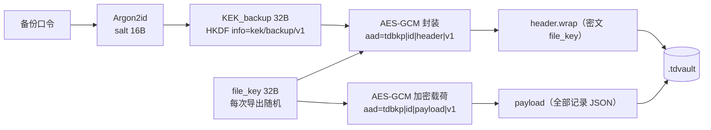
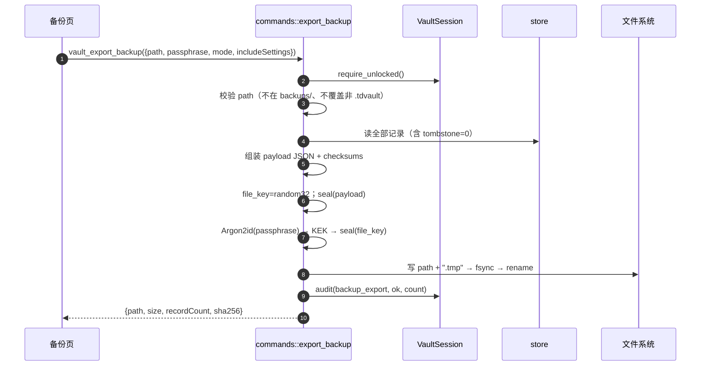
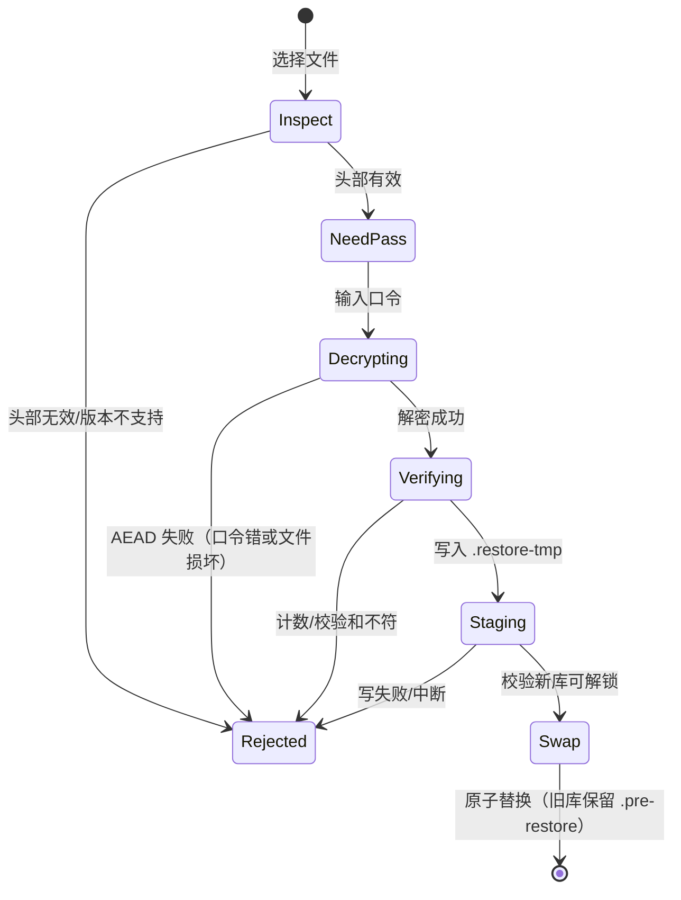

# 安全保险箱 · 备份与恢复

- 日期：2026-11-18
- 阶段：P0（格式与流程定稿；实现在 P1）
- 上游：[security-architecture.md](security-architecture.md)、[data-model.md](data-model.md)

---

## 1. 三种"钥匙"的区别（最容易混淆，必须先讲清）

| 名称 | 是什么 | 能做什么 | 丢失后果 | 泄露后果 |
|---|---|---|---|---|
| **主密码** | 用户设置的字符串 | 解锁本机保险箱 | 可用恢复密钥 | 攻击者可解锁本机库（若有文件） |
| **恢复密钥** | 建库时生成的 20B 随机（32 字符） | 绕过主密码解锁本机保险箱 | 主密码忘记时无法恢复 | 攻击者可解锁本机库 |
| **备份口令** | 导出时设置的口令（默认预填主密码，可改） | 解密某个 `.tdvault` 文件 | 该备份无法打开（本机库不受影响） | 攻击者可解开**那一个备份文件** |

> 恢复密钥**不能**解密备份文件；备份口令**不能**解锁本机库（除非用户把它设成与主密码相同）。
> 这是刻意的密钥分离：备份文件可能被复制到别处，不能让它成为"库的第二把钥匙"。

---

## 2. 备份容器格式 `.tdvault`

### 2.1 文件布局

```text
┌──────────────────────────────────────────────┐
│ header（单行 UTF-8 JSON，以 \n 结束）          │
├──────────────────────────────────────────────┤
│ payload（AES-256-GCM 密文，原始字节，无 base64）│
└──────────────────────────────────────────────┘
```

- 不用"全 JSON + base64"：大备份（几十 MB）base64 会膨胀 33% 且解析占内存。
- 头部单行便于 `head -c` 快速读取与 `backup_inspect` 只读头。
- **P1 只实现 `mode="full"`**；`subset`（按 id 导出部分记录）在接口字段里预留，但命令层对
  `subset` 直接返回 `VAULT_VALIDATION`（"P1 不支持部分导出"），避免出现"半份备份"被当成完整备份。

### 2.2 头部字段

```json
{
  "format": "tdv-vault-backup",
  "version": 1,
  "backup_id": "5a1e…",
  "vault_id": "0f7c…",
  "created_at": "2026-11-18T09:12:33Z",
  "mode": "full",
  "record_count": 42,
  "payload_len": 183920,
  "payload_sha256": "9f2c…",
  "kdf": {
    "alg": "argon2id", "m_cost_kib": 65536, "t_cost": 3, "p_cost": 1,
    "salt_b64": "…16B…"
  },
  "wrap": {
    "alg": "aes-256-gcm", "nonce_b64": "…12B…", "ct_b64": "…48B（file_key+tag）…",
    "aad": "tdbkp|5a1e…|header|v1"
  },
  "payload_nonce_b64": "…12B…",
  "payload_aad": "tdbkp|5a1e…|payload|v1"
}
```

**头部明文可见的信息**：备份时间、条数、来源 `vault_id`、KDF 参数。这些必须可见，否则无法
"不解密就判断是不是我要的备份"。它们不泄漏任何记录内容。

### 2.3 加密层次



要点：
- `file_key` 每次导出**重新随机**，不复用 DEK → 同一份数据导出两次，密文完全不同。
- 载荷里是完整明文 JSON（内存中），落盘前整体加密；**不产生明文临时文件**。
- 头部与载荷用**不同 AAD**，防止"拿 A 备份的头配 B 备份的载荷"。

### 2.4 载荷内容

见 [data-model.md](data-model.md) §6.2。包含：vault 元信息、分类、标签、全部记录（meta+secret）、
设置、校验和。不含：DEK、信封、主密码、恢复密钥、审计。

> **为什么不导出信封**：信封是"本机解锁方式"，与备份口令无关；导出它只会扩大攻击面。
> 恢复后由新库重新生成信封。

---

## 3. 导出流程



规则：

| # | 规则 |
|---|---|
| 1 | 目标路径不得在 `<数据目录>/backups/`（会被主备份保留策略误删） |
| 2 | 默认目录 `<数据目录>/vault-backups/`；用户可改到任意可写路径 |
| 3 | 覆盖同名文件必须二次确认（Dialog）；不存在则直接写 |
| 4 | 先写 `.tmp` 再 `rename`，中断不会留下半个"看起来正常"的文件 |
| 5 | 导出中不允许锁定？**允许**：锁定会取消导出（返回 `VAULT_LOCKED`），已写的 `.tmp` 删除 |
| 6 | 导出量上限：5000 条或 200 MB，超出提示分批（P1 不做分批，直接拒绝并说明） |

---

## 4. 导入（恢复）流程



### 4.1 分步说明

| 步 | 动作 | 失败处理 |
|---|---|---|
| 1 `inspect` | 只读头部：格式/版本/条数/来源/时间；**不解密** | `VAULT_BACKUP_INVALID` / `VAULT_BACKUP_VERSION` |
| 2 口令 | 用户输入；默认不预填（导入是低频高风险操作，强制手输） | — |
| 3 解密 | Argon2id → KEK → 解 `file_key` → 解载荷（全在内存） | AEAD 失败 → "口令错误或文件损坏"（**不区分**，避免 oracle） |
| 4 校验 | `checksums.count`、`records_sha256`、每条记录 AEAD 自检 | 任一不符 → 拒绝，原库不动 |
| 5 预检 | 版本兼容、id 冲突（Replace 忽略；Merge 见 §5） | 拒绝并说明 |
| 6 写 staging | 新建 `secure-vault.db.restore-tmp`，按 v1 schema 写入并生成**新**信封（用当前主密码） | 写失败 → 删 tmp |
| 7 验证 staging | 用当前主密码解锁 staging，抽查 10 条 + 全量 digest | 失败 → 删 tmp，原库不动 |
| 8 替换 | 关闭原库连接 → `secure-vault.db` → `.pre-restore` → tmp → `secure-vault.db` → 重开 | 替换失败 → 回滚 `.pre-restore` |
| 9 完成 | 锁定 → 要求重新解锁 → 审计 `backup_import` | — |

### 4.2 为什么用 staging 而不是"直接写进现有库"

- 直接写：中途失败会留下"一半旧、一半新"的库，且无法回滚。
- staging：失败即丢弃；成功才替换。这是仓库 `commands/restore.rs` 已验证的状态机范式
  （P1 复用其"临时目录 + 原子替换 + 保留旧数据"的思路，不复用其代码）。

### 4.3 旧库保留

- 替换后旧库改名 `secure-vault.db.pre-restore`（**仍是密文**）。
- 保留 7 天或下一次成功导入时删除；设置页显示"上次恢复的旧库副本（可删除）"。
- 保留期内用户可以"回滚到恢复前"（需解锁 + 二次确认）。

---

## 5. 覆盖与合并策略

| 策略 | P1 | 规则 |
|---|---|---|
| **导入为新库** | ✅ | 仅当本机尚无保险箱时可用；导入后重新生成主密码与恢复密钥信封，不覆盖任何已有库 |
| **Replace（替换已有库）** | ❌ P2 | 需要“删除现有 N 条记录”二次确认 + 旧库 `.pre-restore` 回滚副本 |
| **Merge（合并）** | ❌ P2 | 规则预设计：按 `id` 匹配；同 id 比 `rev`，高者胜；`rev` 相同但内容不同 → 进“冲突待处理”列表（不自动选） |

P1 的实际实现比设计更保守：`vault_backup_import` 检测到已有库直接返回 `VAULT_ALREADY_EXISTS`，
不会清空或覆盖。合并/替换需要冲突 UI、回滚副本与更强的二次确认，MVP 不做的半成品。

---

## 6. 版本兼容

| 备份 `version` | 当前支持 | 行为 |
|---|---|---|
| 1 | ✅ | 正常 |
| 0 / 缺失 | ❌ | 明确"不是有效的保险箱备份" |
| 2+ | ❌ | "请升级 Task Dock"（**不尝试解析**） |

库 `schema_version` 与备份 `vault.schema_version` 分开：备份里的是"导出时源库版本"，导入时
按**当前**库 schema 重建，不要求源库版本一致（因为载荷是明文 JSON，由导入方重新加密）。

---

## 7. 失败与损坏处理

| 现象 | 判定 | 用户可见 | 数据影响 |
|---|---|---|---|
| 头部 JSON 解析失败 | 文件损坏/不是本产品格式 | "不是有效的保险箱备份" | 无 |
| `payload_len` 与实际不符 | 截断 | "备份文件不完整（可能传输中断）" | 无 |
| `payload_sha256` 不符 | 传输损坏/被改 | 同上 | 无 |
| AEAD 解 `file_key` 失败 | 口令错或头被改 | "口令不正确，或文件已损坏" | 无 |
| AEAD 解载荷失败 | 载荷被改 | 同上 | 无 |
| 计数/校验和不符 | 内容被改 | "备份内容校验失败" | 无 |
| staging 写入失败（磁盘满） | 环境 | "磁盘空间不足" | 原库不动 |
| 替换时进程被杀 | 崩溃 | 下次启动检测到 `.pre-restore` 与缺失主库 → 提示"上次恢复未完成，是否回滚" | 可回滚 |
| 导入成功但解锁失败 | 逻辑错误 | "恢复失败，已回滚" | 自动回滚 |

**原则**：**宁可恢复失败，也不接受"部分恢复"**。任何不确定状态都回滚到原库。

---

## 8. 明文导出（默认不提供）

- P1 **没有**任何"导出为 CSV/JSON/明文"的命令与菜单。
- 若未来提供（P3 评估）必须满足：
  1. 独立命令 `export_plaintext`，不在备份页，藏在"高级/危险"区；
  2. 二次确认：输入记录条数 + 勾选"我知道文件可能被其他程序读取"；
  3. 输出目录必须是用户显式选择，且**默认建议加密盘**；
  4. 导出后立即提示"请尽快转移到安全位置并删除原文件"；
  5. 审计记录 `export_plaintext`（这是高风险操作）。
- 本阶段结论：**不做**。理由：绝大多数用户不需要，做了就是给"把密码明文扔桌面"提供一键入口。

---

## 9. 自动备份（P2 可选，默认关闭）

| 项 | 设计 |
|---|---|
| 触发 | 已解锁状态下，距上次成功备份 ≥ N 小时（默认 24） |
| 位置 | `<数据目录>/vault-backups/auto-<yyyymmdd>.tdvault` |
| 口令 | 用户在设置里显式设置"自动备份口令"，**加密存进 `settings`**（用 DEK 加密） |
| 风险 | 该口令与库同存 → 库被解则备份也可解（但那时数据已泄露，边际影响有限） |
| 保留 | 最近 7 份，超出删最旧 |
| 关闭 | 默认关闭；开启需用户显式设口令并确认 |

> 不把自动备份做成"用主密码当口令"：主密码可能被改，历史备份会突然打不开。

---

## 10. 恢复密钥与备份的关系（再强调）

- 恢复密钥**只**能解本机信封，不能解 `.tdvault`。
- 备份口令**只**能解 `.tdvault`，不能解本机信封。
- 因此"三重灾难"（主密码丢 + 恢复密钥丢 + 备份口令丢）→ **数据不可恢复**。
- UI 在恢复密钥页与备份页都要写清这两句话，避免用户以为"有备份就万事大吉"。

---

## 11. 测试映射

| 用例 | 覆盖 |
|---|---|
| `T-BKP-01` | 导出 → 检查 → 导入 → 全量记录逐字段一致（含 SSH 私钥字节保真） |
| `T-BKP-02` | 备份文件二进制中检索不到任何哨兵明文 |
| `T-BKP-03` | 错口令导入 → `VAULT_BACKUP_INVALID`，原库不变 |
| `T-BKP-04` | 头部改 1 字节 / 载荷改 1 字节 → 失败且原库不变 |
| `T-BKP-05` | 截断文件 → `payload_len` 检测失败 |
| `T-BKP-06` | 导入中途 kill → 重启提示回滚，原库可用 |
| `T-BKP-07` | `version=2` → 明确拒绝，不写库 |
| `T-BKP-08` | 目标路径在 `backups/` → 拒绝并说明原因 |
| `T-BKP-09` | 主备份（`backup_now`）不含 `secure-vault.db`（按表枚举，不遍历目录） |
| `T-BKP-10` | 导出两次 → 两个文件密文不同（file_key 随机） |
| `T-BKP-11` | 恢复后 `.pre-restore` 存在且可回滚 |
| `T-BKP-12` | 5000 条以上/200MB 以上 → 明确拒绝并提示 |

---

## 12. 验收清单

- [ ] 备份文件能在另一台机器上用同口令导入（跨机验证）
- [ ] 备份文件用 `strings` 检索不到密码/标题/邮箱
- [ ] 任何失败路径都不会修改原库（逐条构造）
- [ ] 导入后记录数、字段值、字节内容完全一致
- [ ] `.pre-restore` 保留与回滚可用
- [ ] 主备份 `backup_now` 产物中不含保险箱数据
