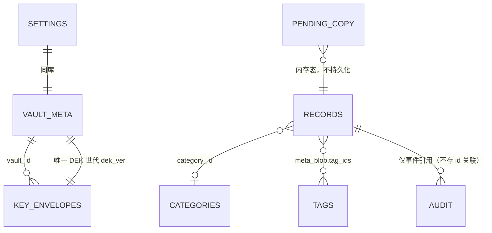

# 安全保险箱 · 数据模型

- 日期：2026-11-18
- 阶段：P0（模型定稿；表创建在 P1）
- 上游：[security-architecture.md](security-architecture.md)　下游：[api-and-method-design.md](api-and-method-design.md)

---

## 1. 存储位置与库边界

| 项 | 值 | 说明 |
|---|---|---|
| 库文件 | `<数据目录>/secure-vault.db` | 与主库 `task-dock.db` **完全独立** |
| WAL | `secure-vault.db-wal` / `-shm` | 页内只有密文（见 §7.3） |
| 连接 | 1 个写连接（`Mutex<Connection>`），**不建读连接池** | 读写都走同一连接：保险箱数据量小，读池会放大内存与文件句柄 |
| PRAGMA | `journal_mode=WAL`、`synchronous=FULL`、`foreign_keys=ON`、`temp_store=MEMORY`、`secure_delete=ON`、`busy_timeout=5000` | `synchronous=FULL` 换更好的崩溃安全；`temp_store=MEMORY` 防排序落临时文件 |
| 迁移 | 独立 `VAULT_MIGRATIONS` + `vault_meta.schema_version` | **不复用** `db::MIGRATIONS`（那是主库契约） |
| 备份 | 不进 `BACKUP_TABLES` / `EXTENDED_TABLES` / `EXPORT_VERSION` | 由 `.tdvault` 独立格式负责 |
| 删除 | 只由用户在"删除保险箱"流程中删除（二次确认 + 需解锁） | 应用卸载不自动删（用户数据优先） |

> **命名说明**：仓库里 `commands/restore.rs` 有一个名为 `vault` 的**恢复暂存目录**（备份恢复用），
> 与本模块无关。为避免混淆，本模块代码目录用 `secure_vault/`，库文件用 `secure-vault.db`。

---

## 2. 为什么必须是独立库（四条硬理由）

| # | 理由 | 证据 |
|---|---|---|
| 1 | 主库所有表**必须**登记 `BACKUP_TABLES`，否则测试 panic → 会被迫进明文 JSON 备份 | `commands/backup.rs:4742-4777` |
| 2 | 主库 `application_settings` 进备份且 `get_settings` 全量返回 | `backup.rs:383`；`db/mod.rs:2722+` |
| 3 | 无令牌 CLI 等同 UI 权限，且硬编码 `task-dock.db` | `agent_access/permissions.rs:43-46`；`cli.rs:151` |
| 4 | 全局搜索直接持主库读连接 | `global_search/mod.rs` 各 `search_*` |

独立库 = **物理隔离**，不依赖"每个入口都记得别查"。

---

## 3. 实体关系



> 注：审计**不**保存 `record_id`（避免日志与审计成为记录索引），只存事件枚举与计数。

---

## 4. 明文列白名单（唯一允许不加密的列）

| 表.列 | 类型 | 为什么可以明文 | 泄漏的是什么 |
|---|---|---|---|
| `vault_meta.key` | TEXT | 配置键名（固定枚举） | 库存在与版本 |
| `vault_meta.value` | BLOB/TEXT | 见 §5.1，均为非秘密元数据 | 版本、计数、失败次数 |
| `key_envelopes.id` | TEXT | UUID | 槽数量 |
| `key_envelopes.slot` | TEXT | `master`/`recovery`/`device:<uuid>` | 是否有恢复密钥/几台设备 |
| `key_envelopes.envelope_json` | TEXT | 只有盐、KDF 参数、密文 | KDF 参数（可公开） |
| `key_envelopes.dek_ver` | INTEGER | 世代号 | 是否轮换过 |
| `records.id` | TEXT | UUID v4 | 记录条数 |
| `records.rev` | INTEGER | 单调修订号 | 编辑总量 |
| `records.dek_ver` | INTEGER | 世代号 | — |
| `records.alg_ver` | INTEGER | 算法版本 | — |
| `records.data_ver` | INTEGER | 载荷 schema 版本 | — |
| `records.tombstone` | INTEGER | 0/1 | 有过删除 |
| `records.meta_nonce/meta_ct` | BLOB | 密文与 nonce | 无 |
| `records.secret_nonce/secret_ct` | BLOB | 密文与 nonce | 无 |
| `categories.id` | TEXT | UUID | 分类数 |
| `categories.sort_order` | INTEGER | 排序 | 分类数 |
| `record_usage.record_id` | TEXT | 记录 id | 使用过的记录数 |
| `record_usage.alg_ver/dek_ver` | INTEGER | 版本号 | — |
| `record_usage.used_nonce/used_ct` | BLOB | 密文与 nonce | 无 |
| `tags.id` | TEXT | UUID | 标签数 |
| `settings.key` | TEXT | 配置键名（固定枚举） | 有哪些设置项 |
| `audit.at/event/outcome/reason_code/count` | TEXT/INT | 枚举与计数 | 使用频率 |

**除此之外一律加密。** 新增列必须回答："这一列会不会让攻击者知道某条记录的标题/账号/用途？"
只要答案是"可能"，就必须进 `meta_blob`。

---

## 5. 表结构（P1 目标形态）

### 5.1 `VaultMetadata` → `vault_meta`（键值表，单行语义）

| 字段 | 类型 | 可空 | 加密 | 持久化 | 敏感 | 用途 / 约束 | 版本 |
|---|---|---|---|---|---|---|---|
| `key` | TEXT PK | 否 | 否 | 是 | 否 | 固定枚举，见下 | 1 |
| `value` | TEXT | 否 | 否 | 是 | 否 | 值语义由 key 决定 | 1 |

允许的 key（**闭集**，新增必须改迁移 + 文档）：

| key | 值示例 | 含义 | 敏感 |
|---|---|---|---|
| `schema_version` | `1` | 库结构版本 | 否 |
| `vault_id` | UUID | 库身份（进信封 AAD） | 否 |
| `vault_salt` | base64(16B) | 记录子密钥 HKDF 的盐 | 否 |
| `next_rev` | `42` | 下一个修订号 | 否 |
| `generation` | `7` | 世代计数（检测整库回滚） | 否 |
| `digest_hmac` | base64(32B) | 记录清单摘要 | 否 |
| `fail_count` | `0` | 连续解锁失败次数 | 否 |
| `fail_last_at` | ISO8601 / null | 最近一次失败时间 | 否 |
| `lockout_until` | ISO8601 / null | 冷却截止 | 否 |
| `created_at` | ISO8601 | 建库时间 | 否 |
| `master_reforged_at` | ISO8601 / null | 最近重封装时间 | 否 |

> `fail_count` / `lockout_until` 明文落盘的代价：攻击者能看出"有人在试"。换来的收益是**重启后冷却
> 仍然生效**（纯内存计数一重启就清零）。这是有意取舍（threat-model R-09）。

### 5.2 `VaultKeyEnvelope` / `RecoveryKeyEnvelope` → `key_envelopes`

> 两者**同一张表**，用 `slot` 区分：`master` / `recovery` / `device:<uuid>`。
> 不拆两张表的原因：结构 100% 相同、解密路径相同、未来设备槽可直接扩展；拆表会产生三份几乎相同的
> 校验代码。实体名保留是为了在需求与接口层能分别指代。

| 字段 | 类型 | 可空 | 加密 | 持久化 | 敏感 | 用途 / 约束 | 版本 |
|---|---|---|---|---|---|---|---|
| `id` | TEXT PK | 否 | 否 | 是 | 否 | UUID | 1 |
| `slot` | TEXT | 否 | 否 | 是 | 否 | `master`/`recovery`/`device:<uuid>`；`UNIQUE(slot)` | 1 |
| `envelope_json` | TEXT | 否 | **是（内含密文 DEK）** | 是 | **是** | 见 security-architecture §4.3 | 1 |
| `dek_ver` | INTEGER | 否 | 否 | 是 | 否 | 该信封封装的 DEK 世代 | 1 |
| `created_at` | TEXT | 否 | 否 | 是 | 否 | UTC | 1 |
| `updated_at` | TEXT | 否 | 否 | 是 | 否 | UTC | 1 |

索引：`UNIQUE(slot)`；`INDEX(dek_ver)`。

约束：`master` 槽必须恰好 1 行；`recovery` 槽 0..1 行；`device:*` 槽 0..N 行（P2）。

### 5.3 `VaultRecord` → `records`

| 字段 | 类型 | 可空 | 加密 | 持久化 | 敏感 | 用途 / 约束 | 版本 |
|---|---|---|---|---|---|---|---|
| `id` | TEXT PK | 否 | 否 | 是 | 否 | UUID v4；同时是 AAD 的一部分 | 1 |
| `rev` | INTEGER | 否 | 否 | 是 | 否 | 单调递增（来自 `next_rev`）；冲突检测 | 1 |
| `dek_ver` | INTEGER | 否 | 否 | 是 | 否 | 记录用哪一代 DEK | 1 |
| `alg_ver` | INTEGER | 否 | 否 | 是 | 否 | 算法组合版本 | 1 |
| `data_ver` | INTEGER | 否 | 否 | 是 | 否 | 明文 schema 版本 | 1 |
| `meta_nonce` | BLOB(12) | 否 | — | 是 | 否 | GCM nonce | 1 |
| `meta_ct` | BLOB | 否 | 是 | 是 | **是** | 加密的 `meta_blob` | 1 |
| `secret_nonce` | BLOB(12) | 否 | — | 是 | 否 | GCM nonce | 1 |
| `secret_ct` | BLOB | 否 | 是 | 是 | **是** | 加密的 `secret_blob` | 1 |
| `tombstone` | INTEGER | 否 | 否 | 是 | 否 | 0=正常，1=已删除（保留 30 天后物理删） | 1 |

**没有** `title`、`username`、`category_id`、`tags`、`created_at`、`updated_at` 列——它们全在
`meta_blob` 里（这是与"普通表 + 加密列"方案最大的区别）。

索引：`PRIMARY KEY(id)`；`INDEX(tombstone, rev)`（同步与垃圾回收用）。

#### 5.3.1 使用记录 → `record_usage`

| 字段 | 类型 | 可空 | 加密 | 持久化 | 敏感 | 用途 / 约束 | 版本 |
|---|---|---|---|---|---|---|---|
| `record_id` | TEXT PK | 否 | 否 | 是 | 否 | 外键语义指向 `records.id`（SQLite 不建外键） | 1 |
| `used_nonce` | BLOB(12) | 否 | — | 是 | 否 | GCM nonce | 1 |
| `used_ct` | BLOB | 否 | 是 | 是 | **是** | 加密的 `{last_used_at, use_count}` | 1 |
| `alg_ver` | INTEGER | 否 | 否 | 是 | 否 | — | 1 |
| `dek_ver` | INTEGER | 否 | 否 | 是 | 否 | — | 1 |

- 与 `records` **分表**的原因：使用时间每次复制/打开都变，若塞进 `meta_blob` 会推动 `rev`、
  重写整块 meta、并在多设备同步时产生大量伪冲突。分表后更新 usage **不改变** `rev`。
- 泄漏面：库里有"哪些 id 被用过"，但**没有**时间明文（时间在密文里）；条数与 `records` 同步。
- 清理：记录物理删除时一并删该行；`tombstone=1` 时保留（回收站仍可见"上次使用"）。

### 5.4 `VaultRecordType`（枚举，不是表）

| 值 | 中文 | 主要字段（在 `secret_blob` 内） |
|---|---|---|
| `password` | 账号密码 | `username`(meta) + `password`(secret) |
| `api_key` | API 密钥 | `api_key` / `secret_key` / `access_token` / `refresh_token` |
| `license` | 软件许可证 | `license_key` / `activation_code` / `expires_on` |
| `recovery` | 账户恢复资料 | `recovery_codes` / `backup_email` / `recovery_phone` / `instructions` |
| `memo` | 私密备忘 | 自定义 `fields[]` |
| `device` | 设备凭据 | `host` / `username` / `password` / `admin_url` |
| `ssh` | SSH 私钥 | `private_key`(blob) / `passphrase` / `public_key` |

`type` 存在 `meta_blob.type`（加密），**不是**明文列——因为"这条记录是 SSH 私钥"本身就是敏感信息。

新增类型规则：只加枚举 + UI 模板 + 测试；**不改表结构**。

### 5.5 `VaultCategory` → `categories`

| 字段 | 类型 | 可空 | 加密 | 持久化 | 敏感 | 用途 / 约束 | 版本 |
|---|---|---|---|---|---|---|---|
| `id` | TEXT PK | 否 | 否 | 是 | 否 | UUID | 1 |
| `sort_order` | INTEGER | 否 | 否 | 是 | 否 | 升序展示 | 1 |
| `name_nonce` | BLOB(12) | 否 | — | 是 | 否 | GCM nonce | 1 |
| `name_ct` | BLOB | 否 | 是 | 是 | **是** | 加密的分类名 | 1 |
| `alg_ver` | INTEGER | 否 | 否 | 是 | 否 | — | 1 |
| `dek_ver` | INTEGER | 否 | 否 | 是 | 否 | — | 1 |

内置分类（不落库、按 `type` 派生）：账号密码 / API 密钥 / 软件许可证 / 恢复资料 / 私密备忘。
自定义分类落库，名称加密。删除分类时：引用它的记录在 `meta_blob` 里把 `category_id` 置空（
需要遍历并重写 meta——见 api §4 的批量约束）。

### 5.6 `VaultTag` → `tags`

| 字段 | 类型 | 可空 | 加密 | 持久化 | 敏感 | 用途 / 约束 | 版本 |
|---|---|---|---|---|---|---|---|
| `id` | TEXT PK | 否 | 否 | 是 | 否 | UUID | 1 |
| `name_nonce` | BLOB(12) | 否 | — | 是 | 否 | GCM nonce | 1 |
| `name_ct` | BLOB | 否 | 是 | 是 | **是** | 加密的标签名 | 1 |
| `alg_ver` | INTEGER | 否 | 否 | 是 | 否 | — | 1 |
| `dek_ver` | INTEGER | 否 | 否 | 是 | 否 | — | 1 |

`meta_blob.tag_ids` 只存 id 数组；标签重命名 = 改一行，不需要重写记录。

### 5.7 `VaultSecuritySettings` → `settings`

| 字段 | 类型 | 可空 | 加密 | 持久化 | 敏感 | 用途 / 约束 | 版本 |
|---|---|---|---|---|---|---|---|
| `key` | TEXT PK | 否 | 否 | 是 | 否 | 闭集键名，见下 | 1 |
| `value_nonce` | BLOB(12) | 否 | — | 是 | 否 | GCM nonce | 1 |
| `value_ct` | BLOB | 否 | 是 | 是 | **是** | 加密的 JSON 值 | 1 |
| `alg_ver` | INTEGER | 否 | 否 | 是 | 否 | — | 1 |
| `dek_ver` | INTEGER | 否 | 否 | 是 | 否 | — | 1 |

| key | 默认 | 取值 | 是否必须加密 |
|---|---|---|---|
| `auto_lock_idle_secs` | `300` | 0/60/300/600/1800 | 是（"锁多久"能推断使用习惯） |
| `auto_lock_background_secs` | `60` | 0/30/60/180/off | 是 |
| `clipboard_clear_secs` | `30` | 10–300（不支持 off） | 是 |
| `auto_backup_enabled` | `false` | bool | 是 |
| `auto_backup_interval_hours` | `24` | 1–168 | 是 |
| `auto_backup_dir` | 空 | 路径字符串 | 是（路径可能含用户名） |
| `last_backup_at` | null | ISO8601 | 是 |

> 为什么这些设置也要加密：它们虽不含秘密，但能推断"用户是否经常用保险箱、备份放哪"。
> 而且设置表若明文，就会成为"绕过解锁即可读的元数据面"。

### 5.8 `VaultBackupMetadata`（备份文件头，不是数据库表）

| 字段 | 类型 | 可空 | 加密 | 持久化 | 敏感 | 用途 | 版本 |
|---|---|---|---|---|---|---|---|
| `format` | TEXT | 否 | 否 | 是（文件头） | 否 | 固定 `tdv-vault-backup` | 1 |
| `version` | INTEGER | 否 | 否 | 是 | 否 | 容器版本 | 1 |
| `backup_id` | TEXT | 否 | 否 | 是 | 否 | UUID，进 AAD | 1 |
| `vault_id` | TEXT | 否 | 否 | 是 | 否 | 来源库身份（恢复时可比对） | 1 |
| `created_at` | TEXT | 否 | 否 | 是 | 否 | UTC | 1 |
| `mode` | TEXT | 否 | 否 | 是 | 否 | `full` / `subset` | 1 |
| `record_count` | INTEGER | 否 | 否 | 是 | 否 | 条数（可见，泄漏规模） | 1 |
| `kdf` | OBJECT | 否 | 否 | 是 | 否 | Argon2id 参数 + salt | 1 |
| `wrap` | OBJECT | 否 | 是（内含 DEK 密文） | 是 | 是 | 导出口令封装的 DEK | 1 |
| `payload_nonce` | BLOB(12) | 否 | — | 是 | 否 | 载荷 nonce | 1 |
| `payload_ct` | BLOB | 否 | 是 | 是 | 是 | 全部记录的密文载荷（见 §6.2） | 1 |
| `payload_sha256` | TEXT | 否 | 否 | 是 | 否 | 密文载荷哈希（传输/截断检测） | 1 |

### 5.9 `VaultAuditEvent` → `audit`

| 字段 | 类型 | 可空 | 加密 | 持久化 | 敏感 | 用途 | 版本 |
|---|---|---|---|---|---|---|---|
| `id` | INTEGER PK AUTOINCREMENT | 否 | 否 | 是 | 否 | 顺序号 | 1 |
| `at` | TEXT | 否 | 否 | 是 | 否 | UTC ISO8601 | 1 |
| `event` | TEXT | 否 | 否 | 是 | 否 | 枚举（见 api §12） | 1 |
| `outcome` | TEXT | 否 | 否 | 是 | 否 | `ok`/`failed`/`skipped` | 1 |
| `reason_code` | TEXT | 是 | 否 | 是 | 否 | 枚举（如 `wrong_password`） | 1 |
| `count` | INTEGER | 是 | 否 | 是 | 否 | 批量操作条数 | 1 |

**禁止**新增 `record_id` / `field_id` / `title` 列（审计不得成为记录索引）。

### 5.10 `PendingCopy`（内存态，禁止持久化）

| 字段 | 类型 | 可空 | 加密 | 持久化 | 敏感 | 用途 |
|---|---|---|---|---|---|---|
| `token` | UUID | 否 | — | **否** | 否 | 单槽令牌，新复制覆盖旧 |
| `sha256` | [u8;32] | 否 | — | **否** | **是（指纹本身不可逆但仍属敏感派生值）** | 内容比对 |
| `deadline` | Instant | 否 | — | **否** | 否 | 单调时钟截止 |
| `record_id` | TEXT | 否 | — | **否** | 否 | 审计时只用"有/无"，不落库 |

---

## 6. 加密载荷 schema

### 6.1 `meta_blob` / `secret_blob`

字段定义见 [security-architecture.md](security-architecture.md) §6.2。补充约束：

| 约束 | 值 | 超限行为 |
|---|---|---|
| `title` 长度 | ≤ 200 字符 | 校验失败（`VAULT_VALIDATION`） |
| `note` 长度 | ≤ 4000 字符 | 同上 |
| `fields` 数量 | ≤ 40 | 同上 |
| 单字段值长度 | ≤ 64 KB（文本）/ 256 KB（blob） | 同上 |
| 标签数量 | ≤ 20 | 同上 |
| 单条记录密文总量 | ≤ 512 KB | 同上 |

### 6.2 备份载荷

```json
{
  "v": 1,
  "vault": {
    "schema_version": 1,
    "vault_id": "…",
    "created_at": "…",
    "generation": 7
  },
  "categories": [ { "id":"…", "sort_order":0, "name":"…" } ],
  "tags":      [ { "id":"…", "name":"…" } ],
  "records":   [ { "id":"…", "rev":12, "meta":{…}, "secret":{…},
                   "usage":{ "last_used_at":"…", "use_count":7 } } ],
  "settings":  { "auto_lock_idle_secs":300, … },
  "checksums": { "records_sha256":"…", "count": 42 }
}
```

整个 JSON 被 `file_key` 加密；`file_key` 再被导出口令派生的 KEK 封装。恢复时先校验
`checksums.count` 与 `records_sha256`，任何一个不符 → 拒绝写入。

### 6.3 版本识别

| 读到什么 | 行为 |
|---|---|
| `version` 已知且受支持 | 正常处理 |
| `version` 更高 | 明确拒绝：`VAULT_FORMAT_UNSUPPORTED`（提示"请升级 Task Dock"） |
| `version` 更低且在兼容列表 | 走兼容解析（P1 只有 v1，暂无需兼容分支） |
| 结构损坏/字段缺失 | `VAULT_BACKUP_INVALID`，不写入 |

---

## 7. 数据库 DDL（P1 迁移 v1）

```sql
-- 迁移 1：初始结构
CREATE TABLE vault_meta (
  key   TEXT PRIMARY KEY NOT NULL,
  value TEXT NOT NULL
);

CREATE TABLE key_envelopes (
  id            TEXT PRIMARY KEY NOT NULL,
  slot          TEXT NOT NULL,
  envelope_json TEXT NOT NULL,
  dek_ver       INTEGER NOT NULL,
  created_at    TEXT NOT NULL,
  updated_at    TEXT NOT NULL
);
CREATE UNIQUE INDEX idx_envelopes_slot ON key_envelopes(slot);
CREATE INDEX idx_envelopes_dek_ver ON key_envelopes(dek_ver);

CREATE TABLE records (
  id           TEXT PRIMARY KEY NOT NULL,
  rev          INTEGER NOT NULL,
  dek_ver      INTEGER NOT NULL,
  alg_ver      INTEGER NOT NULL,
  data_ver     INTEGER NOT NULL,
  meta_nonce   BLOB NOT NULL,
  meta_ct      BLOB NOT NULL,
  secret_nonce BLOB NOT NULL,
  secret_ct    BLOB NOT NULL,
  tombstone    INTEGER NOT NULL DEFAULT 0
);
CREATE INDEX idx_records_tombstone_rev ON records(tombstone, rev);

CREATE TABLE record_usage (
  record_id   TEXT PRIMARY KEY NOT NULL,
  used_nonce  BLOB NOT NULL,
  used_ct     BLOB NOT NULL,
  alg_ver     INTEGER NOT NULL,
  dek_ver     INTEGER NOT NULL
);

CREATE TABLE categories (
  id          TEXT PRIMARY KEY NOT NULL,
  sort_order  INTEGER NOT NULL,
  name_nonce  BLOB NOT NULL,
  name_ct     BLOB NOT NULL,
  alg_ver     INTEGER NOT NULL,
  dek_ver     INTEGER NOT NULL
);

CREATE TABLE tags (
  id          TEXT PRIMARY KEY NOT NULL,
  name_nonce  BLOB NOT NULL,
  name_ct     BLOB NOT NULL,
  alg_ver     INTEGER NOT NULL,
  dek_ver     INTEGER NOT NULL
);

CREATE TABLE settings (
  key         TEXT PRIMARY KEY NOT NULL,
  value_nonce BLOB NOT NULL,
  value_ct    BLOB NOT NULL,
  alg_ver     INTEGER NOT NULL,
  dek_ver     INTEGER NOT NULL
);

CREATE TABLE audit (
  id          INTEGER PRIMARY KEY AUTOINCREMENT,
  at          TEXT NOT NULL,
  event       TEXT NOT NULL,
  outcome     TEXT NOT NULL,
  reason_code TEXT,
  count       INTEGER
);
```

### 7.1 迁移规则

1. 只在 `VAULT_MIGRATIONS` 末尾追加；不改已发布 SQL；版本号与 DDL 同事务。
2. `schema_version` 高于当前支持 → **拒绝打开**并提示升级（不"尽力打开"，避免写坏）。
3. 迁移失败 → 整事务回滚，库停在升级前状态；错误码 `VAULT_MIGRATION_FAILED`。
4. 迁移只改结构，**不迁移明文**（保险箱里没有明文可迁）。

### 7.2 为什么没有外键

`records` 与 `categories`/`tags` 的关联在**密文内**（`meta_blob.category_id` / `tag_ids`），
SQLite 无法对外键做约束。因此：
- 删除分类/标签后，记录内可能出现悬空 id → 读取时按"未知分类/已删除标签"降级展示（不报错）。
- 这是隐私与引用完整性之间的**有意取舍**；用 `vault_categories_delete` 的"批量置空"补偿。

### 7.3 WAL / SHM / 临时文件

| 文件 | 内容 | 风险 | 处置 |
|---|---|---|---|
| `secure-vault.db` | 密文 + 白名单明文列 | 被复制 → 见 T-02 | 依赖 AEAD 与 KDF |
| `-wal` | 未 checkpoint 的页（同样是密文） | 同上 | 正常 checkpoint；退出时 `PRAGMA wal_checkpoint(TRUNCATE)` |
| `-shm` | 索引共享内存 | 不含行数据 | 无需处理 |
| `temp_store=MEMORY` | 排序/临时表 | 若设 FILE 会落明文（我们从不把明文写进 SQL） | 强制 MEMORY |
| `.restore-tmp` | 导入中间库（密文） | 失败残留 | 失败即删；启动时清理超过 24h 的残留 |

> **注意**：库文件本身**不是** SQLCipher 全库加密。保密性来自"记录级 AEAD"，明文只存在于进程内存。
> 因此不要在任何文档里写"数据库已加密"这种会被误解为"整库加密"的表述，统一写
> "记录以密文形式存储"。

---

## 8. 数据生命周期

| 阶段 | 行为 | 落盘 |
|---|---|---|
| 建库 | 生成 DEK、vault_id、salt、master 信封、recovery 信封 | 密文 + 信封 |
| 新增记录 | 生成 id、分配 rev、加密 meta/secret | 密文 |
| 编辑记录 | rev+1、重新加密两个 blob、更新 digest | 密文 |
| 收藏 | 只改 `meta_blob.favorite`（`rev+1`） | 密文 |
| 最近使用 | 只改 `record_usage`（**`rev` 不变**） | 密文 |
| 删除 | `tombstone=1`、rev+1；30 天后物理删 | 密文（墓碑） |
| 恢复删除 | `tombstone=0`（垃圾箱视图内） | 密文 |
| 轮换 DEK（P2） | 新 `dek_ver`、逐条重加密、更新信封 | 密文 |
| 删除保险箱 | 关闭连接 + 删 `secure-vault.db*` + 审计 | 无 |

---

## 9. 数据模型验收清单

- [ ] 用 `sqlite3` 打开库，`SELECT` 任何表都看不到标题/账号/密码（人工 + 脚本）
- [ ] 删除一条记录后 `tombstone=1`，且原密文仍在（30 天保留）
- [ ] 未知 `schema_version` 的库被拒绝打开，且不被改写
- [ ] 分类/标签悬空引用降级展示，不崩溃
- [ ] 库文件与 WAL 内均无明文哨兵串
- [ ] `key_envelopes.slot` 唯一约束生效（不能出现两个 master）
