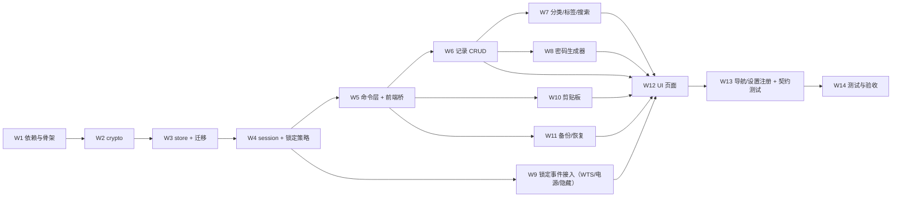

# 安全保险箱 · 开发路线图

- 日期：2026-11-18
- 阶段：P0（路线图；P1 起按本文推进）
- 上游：[product-requirements.md](product-requirements.md)、[test-and-acceptance.md](test-and-acceptance.md)

> 规模用 S/M/L 表示相对工作量（**不是工期承诺**）。所有阶段都必须遵守
> `AGENTS.md`：任务登记 → `task verify` → `task ready` → 集成快照 → 构建 → 验收。

---

## 1. 阶段总览

| 阶段 | 目标 | 关键交付 | 明确不做 |
|---|---|---|---|
| **P0（本次）** | 调研 + 设计 + 文档 | 13 篇文档 + 索引更新 | 任何代码、依赖、DDL、UI |
| **P1 MVP** | 桌面端本地保险箱可用 | 建库/解锁/锁定、四类记录、搜索、生成器、备份、隔离 | 移动端、同步、TOTP、自动填充 |
| **P2 跨设备** | 移动端 + 端到端加密同步 | 设备授权、DEK 信封、撤销轮换、生物识别 | 浏览器扩展、Agent 租约 |
| **P3 高级** | 让"用起来更省事" | 到期提醒、Agent 租约、审计增强、（评估）自动填充 | 云端明文、任何后门 |

---

## 2. P0（本次）— 已完成 / 待确认

### 2.1 交付物

| # | 交付 | 状态 |
|---|---|---|
| 1 | `current-architecture-analysis.md`（现状 + F-01..F-08） | ✅ |
| 2 | `product-requirements.md`（25 项功能矩阵 + 9 张功能卡） | ✅ |
| 3 | `threat-model.md`（T-01..T-15 + R-01..R-22） | ✅ |
| 4 | `security-architecture.md`（算法/密钥/锁定/隔离） | ✅ |
| 5 | `data-model.md`（实体字段 + DDL + 明文白名单） | ✅ |
| 6 | `api-and-method-design.md`（方法签名 + 错误码 + 调用链） | ✅ |
| 7 | `desktop-mobile-ux.md`（16 个桌面页 + 移动端） | ✅ |
| 8 | `backup-and-recovery.md`（`.tdvault` 格式 + 状态机） | ✅ |
| 9 | `multi-device-sync.md`（设备授权 + 信封 + 撤销） | ✅ |
| 10 | `test-and-acceptance.md`（14 组用例 + P1 Gate） | ✅ |
| 11 | `implementation-roadmap.md`（本文） | ✅ |
| 12 | `decision-log.md`（D-01..D-13 + P-01..P-08） | ✅ |
| 13 | `README.md`（导航 + 状态） | ✅ |
| 14 | 索引更新（根 `README.md` / `docs/ARCHITECTURE.md` / `docs/ROADMAP.md`） | ✅（追加式，不改统计） |

### 2.2 退出条件

- [x] 13 篇文档齐全且互相引用无死链
- [x] 18 张 Mermaid 图，覆盖 10 类必需图（架构、密钥层级、创建、解锁、加解密、改密、恢复、设备授权、数据流、隔离）
- [x] 需求矩阵每项都有"实现落点 + 依赖 + 测试"
- [x] 未决项以 P-01..P-08 形式列出（含方案对比与推荐）
- [x] 未写任何业务代码、未改 DDL、未装依赖

---

## 3. P1（MVP）工作包

### 3.1 工作包与依赖

| ID | 工作包 | 规模 | 依赖 | 主要产出 | 验收 |
|---|---|---|---|---|---|
| W1 | 依赖与模块骨架 | S | P-01 批准 | `Cargo.toml` 6 个 crate + 1 个 feature；`secure_vault/mod.rs` 空壳；`VaultState` 注册 | `cargo check` 通过；无未使用告警 |
| W2 | crypto | M | W1 | kdf/envelope/aead/secret_bytes/password_gen | `T-CRY-01..10`、`T-GEN-02..04` |
| W3 | store + 迁移 | M | W2 | `VAULT_MIGRATIONS` v1、事务封装、digest | `T-DATA-05/07`、迁移幂等 |
| W4 | session + policy | M | W3 | `VaultSession`、`policy::should_lock`、ticker | `T-LOCK-01/02/08/09`（纯函数部分） |
| W5 | 命令层 + 前端桥 | M | W4 | `commands.rs` 全部签名、`vault.ts`、`vaultBridge.ts` | 每个命令有 1 条 happy path |
| W6 | 记录 CRUD | L | W5 | 五类记录模板、`rev` 冲突、软删 | `T-ACC-01..05`、`T-API-01..02`、`T-MEMO-01..02` |
| W7 | 分类/标签/搜索 | M | W6 | 内存索引、批量重写、搜索 | `T-SRCH-01..04` |
| W8 | 密码生成器 | S | W6 | 生成 + 强度 | `T-GEN-02..04` |
| W9 | 锁定事件接入 | M | W4 | WTS + 电源 + 隐藏 + 退出 | `T-LOCK-03/04/05`（真机） |
| W10 | 剪贴板 | M | W5 | 受控写、指纹、定时清除 | `T-CLP-01..07` |
| W11 | 备份/恢复 | L | W5 | `.tdvault` 导出/检查/导入 + staging | `T-BKP-01..12` |
| W12 | UI 页面 | L | W7–W11 | 16 个页面/弹层 | `T-UX-01..04` |
| W13 | 注册与契约 | S | W12 | 导航/Tab/路由/设置分区 + **单独提交** featureCatalog | `T-NAV-01..04` |
| W14 | 测试与验收 | M | W13 | 全量用例 + 报告 | P1 Gate 12 条 |

### 3.2 P1 明确不做

- 移动端任何改动（`apps/mobile` 零提交）
- 同步、设备授权、DEK 轮换（只保留 `dek_ver` 字段与重加密路径）
- TOTP、自动填充、浏览器扩展、Agent 租约
- 明文导出、自动备份（P2 再评估）
- 主库 schema 任何变更（`task-dock.db` 零迁移）

### 3.3 P1 关键顺序说明

1. **W1 必须先拿到 P-01 批准**：新增 6 个 crate 是供应链变更，需要单独说明体积/许可/审计。
2. **W2 与 W3 不并行**：`crypto` 的 AAD/`info` 常量是 store 的输入，先定字符串再写库。
3. **W9 必须在 W12 之前完成真机验证**：否则 UI 做完才发现锁定事件不触发，返工大。
4. **W13 的 featureCatalog 单独提交**：该文件被其他会话修改中（D-02），必须由集成负责人
   串行合入，避免与他人冲突。

---

## 4. P2（移动端 + 同步）

| ID | 工作包 | 规模 | 依赖 | 验收 |
|---|---|---|---|---|
| P2-1 | 移动端 crypto 原生模块（JCA + Keystore） | L | P-02 拍板 | 与桌面互解信封（跨机测试） |
| P2-2 | 移动端页面（解锁/列表/详情/新建/设置） | L | P2-1 | 真机走查 + 单手可达 |
| P2-3 | 生物识别解锁 | M | P2-1、P-08 | 失败 3 次降级；关闭即删密钥 |
| P2-4 | 设备身份与配对 | L | P2-1 | `T-SYNC-01..03` |
| P2-5 | 同步协议（拉/推/冲突） | L | P2-4 | `T-SYNC-04..05` |
| P2-6 | 撤销与 DEK 轮换 | M | P2-5 | `T-SYNC-06`、旧设备解不开新数据 |
| P2-7 | `FLAG_SECURE` 原生模块 | S | P2-2 | 最近任务缩略图无内容 |

**前置**：P1 Gate 全过；`dek_ver` 重加密路径已在 P1 落地（即使没用）。

---

## 5. P3（高级能力，按需评估）

| 能力 | 价值 | 风险 | 建议 |
|---|---|---|---|
| 凭据到期提醒 | 中 | 低（本地计算） | 先做 |
| API Key 生命周期看板 | 中 | 低 | 先做 |
| 高级安全审计（趋势/异常） | 中 | 中（可能记录行为） | 只做本地聚合，不上传 |
| Agent 凭据租约 | 高 | 高（见 threat T-09/T-10） | 最后做，默认关闭 |
| 安全自动填充 | 高 | 很高（需浏览器扩展/注入） | 单独立项评估，不在本路线图内承诺 |
| 一次性凭据分享 | 中 | 高（外发通道） | 不建议 |
| TOTP | 中 | 中（新增算法与时间同步） | 按 P-04 决定 |

---

## 6. 依赖清单（P-01 待批准）

| 依赖 | 用途 | 现状 | 体积/许可 | 备注 |
|---|---|---|---|---|
| `argon2` | Argon2id | **不在 lockfile** | RustCrypto，MIT/Apache-2.0 | 必需 |
| `aes-gcm` | 记录加密 | **不在** | 同上 | 必需 |
| `hkdf` | 子密钥派生 | **不在** | 同上 | 必需 |
| `hmac` | 摘要 | **不在**（`sha2` 已有） | 同上 | 必需 |
| `base32` | 恢复密钥编码 | **不在** | MIT/Apache-2.0 | 必需（或自写 40 行，需评审） |
| `unicode-normalization` | NFKC | **不在** | MIT/Apache-2.0 | 必需（否则全角口令不等价） |
| `zeroize` | 清零 | **已在** 1.9.1 | — | 直接用 |
| `subtle` | 常量时间比较 | **已在** 2.6.1 | — | 直接用 |
| `windows-sys` + `Win32_System_RemoteDesktop` | WTS 锁屏事件 | 已有 crate，**feature 缺失** | — | 追加 feature，非新 crate |
| `p256`（P2） | ECDH | **不在** | RustCrypto | P2 再批准 |

**审批要点**：新增 6 个 crate 全部为 RustCrypto 系或小型工具库，无 C 依赖、无网络、无 build script
（`base32`/`unicode-normalization` 需逐一确认）。批准后 `cargo deny`/许可检查一并跑。

---

## 7. 风险与缓解

| 风险 | 影响 | 缓解 |
|---|---|---|
| Argon2 在低端机过慢 | 解锁体验差 → 用户调低参数 | 基准定档 + 下限保护 + 显示"本机参数" |
| WTS/电源事件在某些 Windows 版本不触发 | 锁定失效 | 三条兜底：闲置超时、隐藏锁定、唤醒 gap 检测；真机矩阵覆盖 |
| 前端误缓存明文 | 泄漏 | 组件局部 state + ESLint 禁 `invoke` 直调 + code review 清单 |
| 备份口令弱 | 备份被破 | 默认预填主密码 + 强度提示 + 文案 |
| 他人会话正在改注册中心文件 | 冲突 | D-02：P0 不改；P1 由集成负责人串行提交 |
| 依赖引入供应链风险 | 高危 | 只用 RustCrypto 系 + 许可扫描 + 最小版本 |
| 内存明文无法清零 | 无法根治 | 缩短生命周期 + 文档诚实声明 |

---

## 8. 里程碑检查点

| 检查点 | 条件 | 谁验收 |
|---|---|---|
| M0 | P0 文档通过用户评审 | 用户 |
| M1 | W1–W4 完成，`cargo test` 绿 | 任务负责人 + 集成 |
| M2 | W5–W8 完成，端到端可增删改查 | 集成 |
| M3 | W9–W11 完成，锁定/剪贴板/备份真机通过 | 集成 + 真机 |
| M4 | W12–W14 完成，P1 Gate 12 条全过 | 验收 Agent |
| M5 | P2-1..P2-4 完成，跨机信封互解 | 验收 Agent |
| M6 | P2-5..P2-7 完成，撤销后旧设备失效 | 验收 Agent |

---

## 9. 下一阶段的第一步（等用户确认后执行）

1. 用户拍板 P-01（依赖）与 P-03（默认锁定时长）。
2. 建任务：`npm run integrate -- task add --id secure-vault-p1-crypto --module secure_vault --paths src-tauri/src/secure_vault/crypto/**`
3. 从 W1 开始，**先只加依赖与空模块**，跑 `cargo check`，再进 W2。
4. 不在本轮开始任何 P1 代码。
