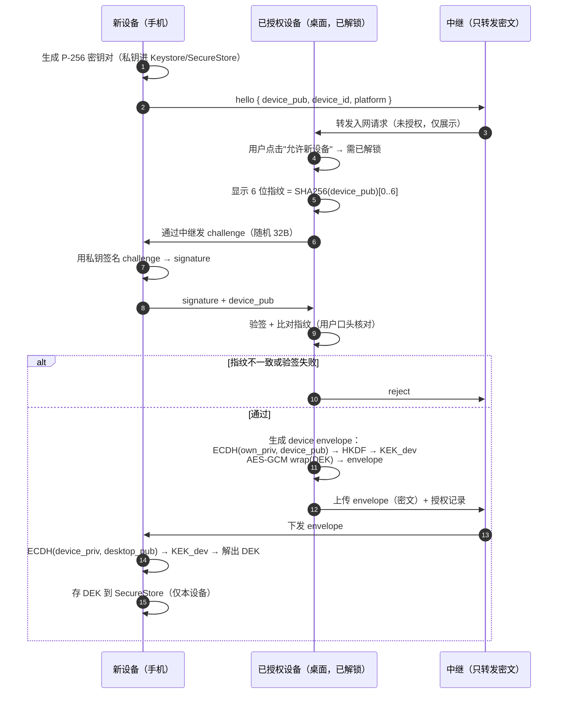
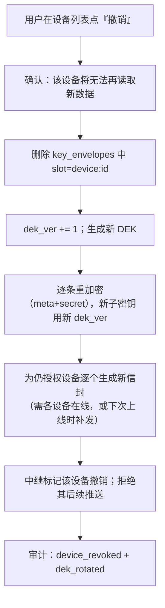

# 安全保险箱 · 多设备同步架构（P2 规划）

- 日期：2026-11-18
- 阶段：P0（只做架构与接口预留；**不实现同步**）
- 上游：[security-architecture.md](security-architecture.md)、[backup-and-recovery.md](backup-and-recovery.md)

> 本阶段结论：**第一阶段只做可靠本地存储**。同步是 P2，且必须满足"服务端只接触密文"。
> 本文给出协议骨架、密钥传递方式、撤销与轮换规则，供 P2 直接进入实现设计。

---

## 1. 为什么不能复用现有 `mobile_sync`

| 现状（已读代码） | 问题 | 结论 |
|---|---|---|
| `mobile_sync/sync.rs:62-121` 用 XSalsa20-Poly1305，密钥 = `SHA-512("taskdock-sync-v1:" + token_hash)` | 桌面端持有 token 即可派生密钥 → **服务端/中继可解**；且无口令 KDF | 不能用于保险箱 |
| 配对 token 是"连接凭据" | 令牌泄露 = 通道被冒用 | 不能当"设备身份" |
| TLS + SPKI 固定（`apps/mobile/modules/secure-http`） | 只解决传输机密性 | **可以复用**作为传输层 |
| 现有配对是"一次性连接授权" | 没有长期设备身份、没有撤销列表 | 需新建"设备身份 + 授权"模型 |

**原则**：保险箱同步的信任根是**设备密钥对**，不是配对 token。

---

## 2. 威胁假设与目标

| 目标 | 说明 |
|---|---|
| G-1 | 中继/服务端**不能**读取任何记录内容、DEK、主密码 |
| G-2 | 中继只能看到：设备 id、记录 id、`rev`、密文长度、时间戳 |
| G-3 | 新设备入网必须由**已授权且已解锁**的设备当场批准 |
| G-4 | 撤销设备后，被撤销设备**无法**解密后续数据 |
| G-5 | 离线修改可在恢复连接后合并，不丢数据 |
| G-6 | 设备丢失可按"撤销 + 轮换"处理，不要求改主密码 |

**非目标**：不防"已授权设备作恶"（它本来就能读全部数据）；不防流量分析（中继能看到同步频率）。

---

## 3. 设备授权流程



关键约束：

1. **批准必须发生在已解锁的桌面端**（手机上"自己批准自己"不算）。
2. 指纹必须**用户肉眼比对**，不能自动通过（防中继中间人）。
3. `challenge` 一次性、有效期 60 秒。
4. envelope 的 AAD 绑定 `vault_id + 双方 device_id + dek_ver`，防止跨库/跨设备重放。
5. 新设备只拿到**当前** `dek_ver` 的 DEK；历史世代不补发。

---

## 4. 密钥传递

```text
# 设备长期密钥
desktop: (sk_d, pk_d) P-256，私钥用 DPAPI 封装后落盘（本机便捷）
mobile : (sk_m, pk_m) P-256，私钥进 Android Keystore（不可导出）

# 每次授权
shared   = ECDH(sk_owner, pk_new)            # 32B
kek_dev  = HKDF-SHA256(shared, salt=vault_salt,
                       info="taskdock-vault/kek/device/{device_id}/v{dek_ver}", len=32)
env_ct   = AES-256-GCM(kek_dev, DEK,
                       aad="tdenv|{vault_id}|device:{device_id}|v1")
```

- **DEK 从不出设备**（除了以信封密文形式经中继）。
- 每个设备一个 `slot=device:<id>` 信封，存在 `key_envelopes`（见 data-model §5.2）。
- 撤销设备 = 删该槽 + 轮换 `dek_ver`（§6）。

> 为什么不直接传 DEK 明文走 TLS：TLS 终止在中继上，中继就能看到。必须端到端信封。

---

## 5. 同步协议（记录级）

### 5.1 同步单元

```json
{
  "record_id": "…",
  "rev": 42,
  "dek_ver": 1,
  "tombstone": 0,
  "meta_nonce": "…", "meta_ct": "…",
  "secret_nonce": "…", "secret_ct": "…",
  "updated_at": "…", "device_id": "…"
}
```

所有字段都是**源设备加密后的原样密文**；中继不做任何解密或转换。

### 5.2 增量同步

1. 客户端发 `since = last_sync_cursor`（服务端单调序号）。
2. 服务端返回 `changes[] + next_cursor`。
3. 客户端本地应用变更：按 `record_id` 比对 `rev`。
4. 客户端把本地未同步变更（`rev > last_pushed_rev`）推送上去。

### 5.3 冲突

| 情况 | 规则 |
|---|---|
| 同 id，远端 `rev` 更高 | 接受远端（本地若也有更高未推送 → 见下） |
| 双方都改过（`rev` 不同且都 > 上次同步点） | **LWW + 冲突副本**：较新 `updated_at` 者生效；另一份以 `(冲突副本) 标题` 新建一条记录保留，并在 UI 提示 |
| 一方删除（tombstone=1），另一方修改 | 修改优先（避免误删数据）；删除标记丢弃 |
| `dek_ver` 不同 | 用当前世代的 DEK 重新封装后再入库 |

> 为什么不做 CRDT：保险箱是"低频、单人、多设备"场景；CRDT 的复杂度换不来收益，而且字段级
> 合并会把"密码"这种不可合并字段搞乱。LWW + 副本是更安全的选择（宁可多一条，不可丢一条）。

### 5.4 离线

- 本地队列：`outbox(record_id, rev, op, attempted_at, last_error)`。
- 恢复连接后按 `rev` 升序推送；失败保留指数退避（上限 5 分钟）。
- 队列里**只有密文**，不含明文。

---

## 6. 设备撤销与密钥轮换



| 项 | 规则 |
|---|---|
| 撤销是否立即生效 | 对新数据立即（新 DEK 不给他）；旧数据他已读过，无法收回（R-20） |
| 重加密成本 | N 条 × 2 次 AEAD；1000 条约几十毫秒到几百毫秒（P2 实测），可接受 |
| 离线设备 | 下次上线才拿到新信封；在此之前它只能读到旧数据（且旧世代已作废） |
| 全部设备撤销 | 等于"只保留本机"，DEK 仍轮换一次（避免旧密文被离线分析） |
| 撤销后是否要改主密码 | 不要求；主密码与设备授权是两层 |

---

## 7. 中继可见性（诚实表）

| 数据 | 中继可见 | 说明 |
|---|---|---|
| 设备 id / 平台 | ✅ | 用于路由 |
| `vault_id` | ✅ | 用于多库区分（可选哈希化） |
| 记录 id | ✅ | 同步主键 |
| `rev` / `tombstone` / `dek_ver` | ✅ | 冲突与增量 |
| 密文长度 | ✅ | 可推断记录大小（标题长度等） |
| 时间戳 | ✅ | 同步时间 |
| 标题/账号/密码/密钥 | ❌ | 全部在密文内 |
| DEK / 主密码 / 恢复密钥 | ❌ | 从不上传 |
| 记录条数 | ✅（可由 id 计数得出） | 元数据泄漏，接受 |

**缓解**：不传明文字段；可选"填充到固定大小档位"（P3 评估，代价是流量）。

---

## 8. 接口预留（P2 实现，P1 不写）

```rust
// secure_vault/sync/mod.rs（P2）
pub struct DeviceIdentity { pub device_id: String, pub public_key: P256PublicKey, /* 私钥不在此结构 */ }

pub fn device_identity_load_or_create() -> Result<DeviceIdentity, VaultError>;
pub fn device_pair_begin(req: PairRequest) -> Result<PairChallenge, VaultError>;
pub fn device_pair_approve(challenge_id: &str, fingerprint: &str) -> Result<DeviceEnvelope, VaultError>;
pub fn device_pair_finish(envelope: &DeviceEnvelope) -> Result<(), VaultError>;
pub fn device_list() -> Result<Vec<DeviceInfo>, VaultError>;
pub fn device_revoke(device_id: &str) -> Result<RotateProgress, VaultError>;
pub fn sync_pull(cursor: Option<i64>) -> Result<PullResult, VaultError>;
pub fn sync_push(changes: Vec<EncryptedRecord>) -> Result<PushResult, VaultError>;
```

传输层：复用 `apps/mobile/modules/secure-http` 的 TLS + SPKI 固定（P2 只加"同步"路由，
不改其安全模型）。

---

## 9. 平台实现路线（待决策 P-02）

| 方案 | 桌面 | 移动 | 优点 | 缺点 | 评价 |
|---|---|---|---|---|---|
| A. 项目内原生模块（JCA + Keystore） | Rust `p256` + DPAPI | Android `KeyPairGenerator(EC)` + `KeyAgreement` | 私钥不可导出、无第三方密码学 | 需写原生模块（已有 6 个模块先例） | **推荐** |
| B. 纯 JS（`@noble/curves`） | — | JS 内生成/保存密钥 | 无需原生代码 | 私钥进 JS/SecureStore，强度依赖 JS 运行时；需新依赖 | 备选 |
| C. 复用 tweetnacl（X25519） | Rust `x25519-dalek` | tweetnacl | 已有依赖 | Keystore 不支持 X25519；私钥只能存 SecureStore | 不推荐 |

> 决策依据：Android Keystore 支持 EC P-256 的 `KeyAgreement`，**不支持** X25519。选 A 可让
> 私钥永不出安全硬件。

---

## 10. 设备丢失处置手册（用户视角）

| 场景 | 步骤 |
|---|---|
| 手机丢了，但桌面还在 | 桌面 → 设备列表 → 撤销该手机 → 自动轮换 DEK → 手机上的旧数据仍在其本地（无法远程擦除） |
| 桌面丢了，手机还在 | 手机 → 撤销桌面（P2 需手机也能批准/撤销）→ 轮换 |
| 全部设备丢了 | 用 `.tdvault` 备份在新设备重建（需备份口令）；否则不可恢复 |
| 怀疑被复制 | 撤销所有设备 + 轮换 + 考虑改主密码 + 检查备份文件去向 |

**明确不承诺**：远程擦除被撤销设备上的既有数据。

---

## 11. P2 验收前置条件

1. 本地库与备份在 P1 已稳定（无数据丢失事故）。
2. `dek_ver` 机制在 P1 已落地（即使 P1 不用轮换，字段与重加密路径必须先存在）。
3. 移动端密码学路线（P-02）已拍板。
4. 中继的最小可见性表（§7）通过安全评审。
5. 设备授权的"指纹人工比对"流程有真机走查。

---

## 12. 未决问题

| ID | 问题 | 影响 |
|---|---|---|
| S-01 | 中继是自建还是复用现有 Relay 仓库 | 部署与合规 |
| S-02 | 是否支持"仅局域网直连同步"（不经中继） | 隐私更好，但 NAT 穿透复杂 |
| S-03 | 冲突副本的命名与清理策略 | UX |
| S-04 | 是否对密文做固定长度填充 | 元数据泄漏 vs 流量 |
| S-05 | 多用户共享保险箱（家庭）是否在范围内 | 当前定位是"个人"，建议不做 |
