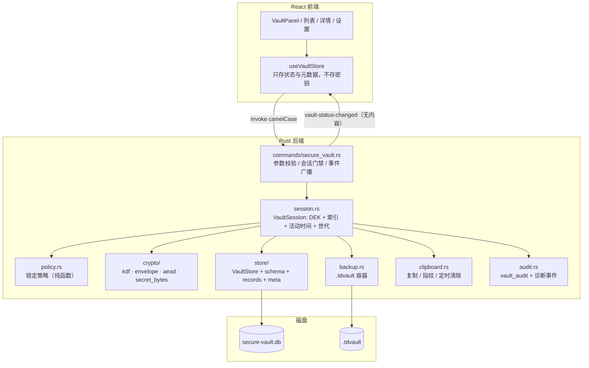
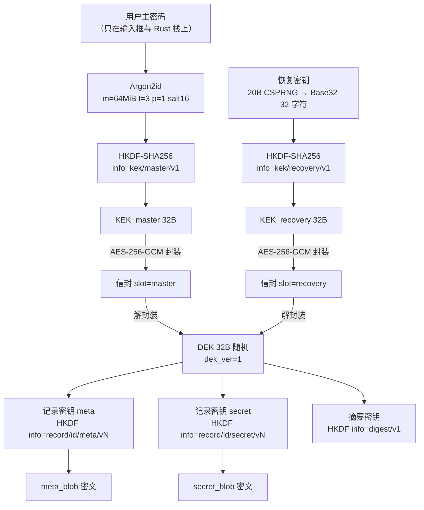
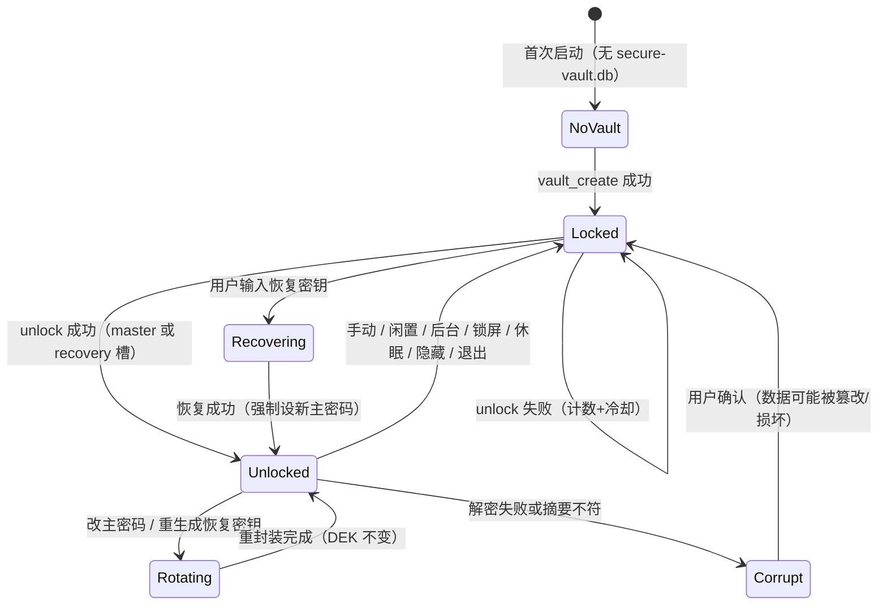
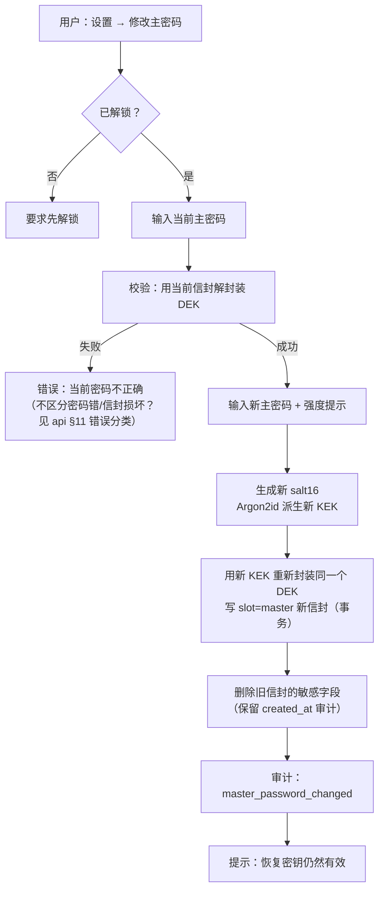
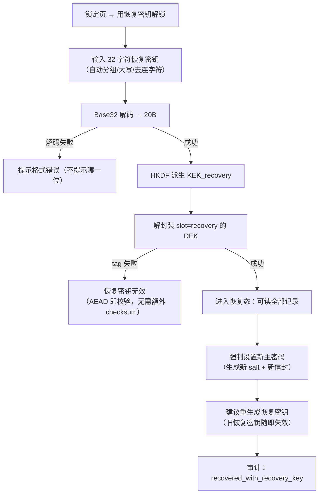
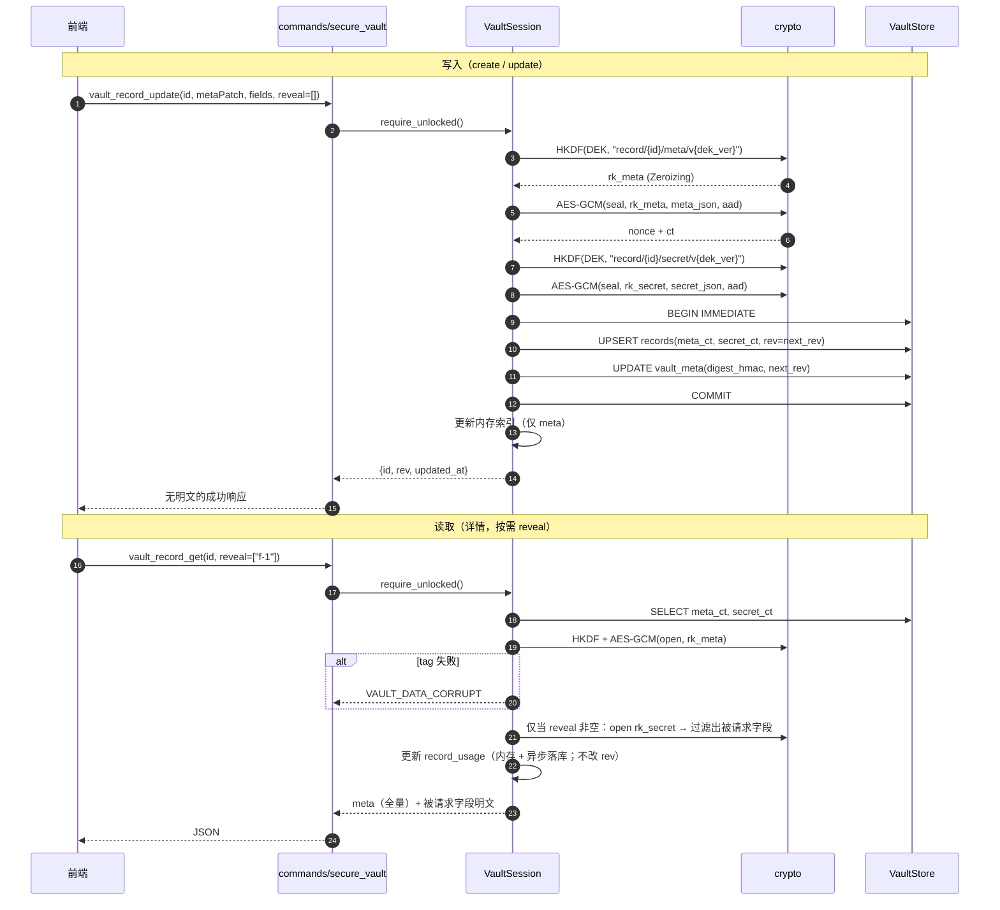
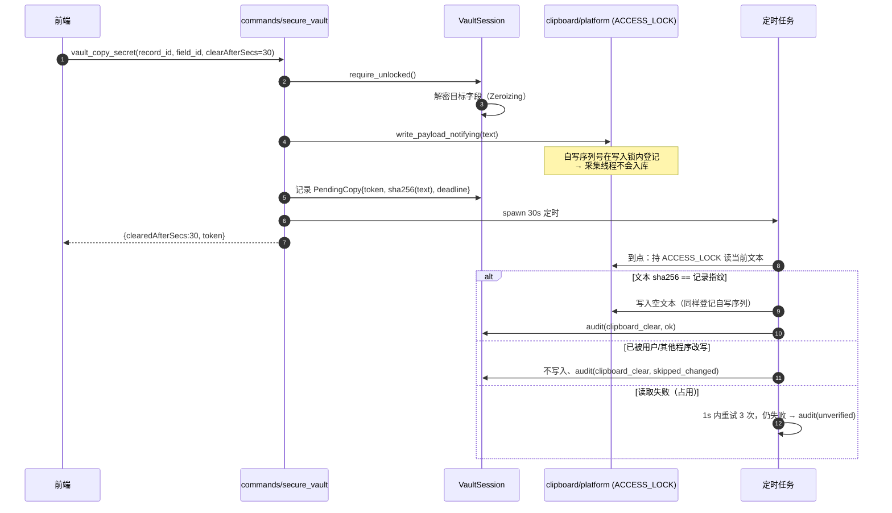
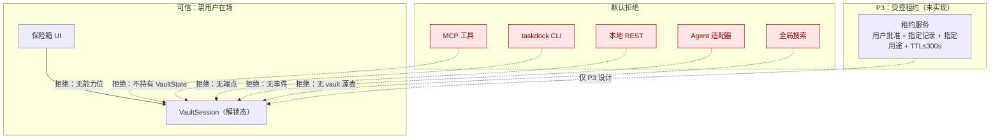

# 安全保险箱 · 安全架构

- 日期：2026-11-18
- 阶段：P0（架构定稿；实现与实测在 P1）
- 上游：[threat-model.md](threat-model.md)　下游：[data-model.md](data-model.md)、
  [api-and-method-design.md](api-and-method-design.md)

---

## 1. 安全不变量（实现必须满足，评审逐条核对）

| ID | 不变量 | 如何被强制 |
|---|---|---|
| I-1 | 主密码明文**永不落盘、永不进日志、永不出 Rust 函数作用域** | 入参 `String` 立即规范化并派生，随后 `Zeroizing` drop；错误信息不含输入 |
| I-2 | **DEK 只存在于 Rust 进程内存**（解锁期），从不出现在 IPC 响应 | `VaultSession` 私有字段；命令层不暴露 |
| I-3 | 主密码**不直接**加密任何记录 | 记录密钥由 DEK 经 HKDF 派生 |
| I-4 | 每条记录的每个载荷使用**独立子密钥**，密钥不跨记录复用 | `HKDF(DEK, info=record/{id}/{purpose}/v{dek_ver})` |
| I-5 | 所有密文都带 AEAD 认证，AAD 绑定 `id + purpose + 版本` | `aes-gcm` + 显式 AAD 字符串（§6.3） |
| I-6 | 锁定 = 丢弃 DEK、内存索引、待清除剪贴板指纹 | `VaultSession::lock()` 统一入口 |
| I-7 | 锁定后任何读接口返回 `VAULT_LOCKED`，**不返回条数/标题** | 命令层先查状态再读 |
| I-8 | 保险箱数据**不在** `task-dock.db`、主备份、全局搜索、MCP、CLI 可见面内 | 独立库 + 无能力位 + 无 CLI 子命令 |
| I-9 | 恢复密钥与主密码是**两条独立路径**，都能解同一个 DEK | 两个信封槽 |
| I-10 | 改主密码**只重封装 DEK**，不重加密记录 | §4.5 |
| I-11 | 任何 KDF 参数随信封持久化，升级不改历史信封语义 | §5.4 |
| I-12 | 明文只在"用户此刻要求看"的字段上产生，且不缓存 | `reveal` 白名单 + 不写 store |

---

## 2. 组件架构



分层职责（与 `AGENTS.md` §4.1 一致：UI 不碰数据库、不碰 Win32）：

| 层 | 允许做 | 禁止做 |
|---|---|---|
| `components/vault/*` | 渲染、表单、复制按钮、显示/隐藏切换 | 解密、拼 SQL、直接读文件 |
| `lib/vault.ts` + `store/useVaultStore.ts` | 类型化调用、状态机、错误映射 | 缓存密钥/密码、把明文写进全局 store |
| `commands/secure_vault.rs` | 校验、门禁、调用 core、广播事件 | 含业务规则、直接 `Connection` |
| `secure_vault/*` | 全部加密与存储逻辑 | 依赖 Tauri `AppHandle`（除事件发射适配器外） |

---

## 3. 算法选型

### 3.1 最终选择

| 用途 | 算法 | 参数/说明 |
|---|---|---|
| 口令派生 | **Argon2id** | m=64 MiB, t=3, p=1, salt=16B, out=32B（§5） |
| 记录/信封/备份加密 | **AES-256-GCM** | 96-bit 随机 nonce；AAD 显式绑定 |
| 子密钥派生 | **HKDF-SHA-256** | extract+expand，`info` 做用途分离 |
| 完整性清单 | **HMAC-SHA-256** | 密钥由 DEK 派生 |
| 随机源 | **OS CSPRNG** | Rust `getrandom`/`OsRng`；移动 `SecureRandom` |
| 常量时间比较 | `subtle::ConstantTimeEq` | 用于指纹/摘要比较 |
| 内存清零 | `zeroize` | 密钥与明文缓冲 |
| 恢复密钥编码 | Crockford Base32（无填充） | 20B → 32 字符，显示为 8 组 × 4 |
| 口令规范化 | Unicode NFKC + 去首尾 ASCII 空白 | 防止 IME/全角差异导致"同一口令不同密钥" |

### 3.2 为什么是 AES-256-GCM（而不是 XChaCha20-Poly1305）

| 维度 | AES-256-GCM | XChaCha20-Poly1305 | 判定 |
|---|---|---|---|
| 桌面 Rust 实现 | `aes-gcm`（RustCrypto，AES-NI 加速） | `chacha20poly1305` | 平手（都需新依赖） |
| **移动端可行性** | Android JCA 原生 `AES/GCM/NoPadding`，Keystore 支持 | JCA **无** XChaCha20；需引 libsodium 或纯 JS 库 | **AES 胜** |
| nonce 风险 | 96-bit 随机，多消息同密钥有生日界 | 192-bit 随机，几乎无碰撞 | XChaCha 胜 |
| 本设计的 nonce 用量 | **每条载荷一把独立子密钥，只加密 1 条消息** → 生日界不构成风险 | 同 | 抵消 |
| 硬件加速 | AES-NI（几乎全部 x86/ARM） | 软件实现（通常也够快） | AES 略胜 |
| 合规/审计熟悉度 | 极常见，FIPS 可用 | 常见但非 FIPS 首选 | AES 胜 |

**结论**：在本设计"每载荷独立子密钥"的前提下，XChaCha 的 nonce 优势被结构性消除，而 AES 换来
移动端**零第三方密码学依赖**。因此选 AES-256-GCM。若未来单密钥多消息场景出现（例如批量导出
共用一个 key），必须改用 XChaCha 或强制计数器 nonce——这条写进评审清单。

### 3.3 明确放弃的方案

| 方案 | 放弃原因 |
|---|---|
| 自研/异或/Base64/混淆 | 不是加密；`AGENTS.md` 明令禁止 |
| SQLCipher 全库加密 | 新依赖 + 许可 + 与"记录级最小暴露"目标不同；且无法阻止主库备份带走 |
| DPAPI 作为主保护 | 绑定用户+机器，换机不可恢复（F-08） |
| 复用 `mobile_sync` 的 XSalsa20 密钥派生 | 桌面端可派生（F-06），破坏"服务端不可读" |
| PBKDF2 / scrypt | Argon2id 抗 GPU/ASIC 更好，且 RFC 9106 推荐 |
| 单一 DEK 直接加密所有记录（无子密钥） | 无密钥分离，nonce 复用面变大，且无法按记录轮换 |
| 把 DEK 存进 `application_settings` | 进备份（F-01） |

---

## 4. 密钥层级

### 4.1 层级图



要点：
- **DEK 是唯一的"数据钥匙"**；主密码与恢复密钥只是两种"开钥匙的方式"（信封槽）。
- 新增设备（P2）会加第三个槽 `slot=device:<id>`，用 ECDH 派生的 KEK 封装同一个 DEK。
- 改主密码 = 只换 `slot=master` 的信封与盐，DEK 与所有记录不动（I-10）。

### 4.2 派生公式（实现必须逐字使用，不得改 info 字符串）

```text
# 1) 主密码 → MK
mk        = Argon2id(password_nfkc, salt_master, m_cost, t_cost, p_cost)   # 32B
kek_master= HKDF-SHA256(ikm=mk,  salt="", info="taskdock-vault/kek/master/v1", len=32)

# 2) 恢复密钥 → KEK（无需 Argon2：输入已是 160-bit 随机）
kek_recovery = HKDF-SHA256(ikm=recovery_bytes(20B), salt="",
                           info="taskdock-vault/kek/recovery/v1", len=32)

# 3) 信封封装（slot ∈ {master, recovery, device:<uuid>}）
aad_env   = "tdenv|{vault_id}|{slot}|v1"
dek_ct    = AES-256-GCM(key=kek_slot, nonce=random12, plaintext=DEK(32B), aad=aad_env)

# 4) 记录子密钥
rk_meta   = HKDF-SHA256(ikm=DEK, salt=vault_salt(16B),
                        info="taskdock-vault/record/{record_id}/meta/v{dek_ver}", len=32)
rk_secret = ... 同上，但 "secret" ...

# 5) 记录载荷
aad_rec   = "tdrec|{record_id}|{purpose}|v{dek_ver}|d{data_ver}"
ct        = AES-256-GCM(key=rk, nonce=random12, plaintext=payload_json, aad=aad_rec)

# 6) 完整性摘要
digest_key= HKDF-SHA256(ikm=DEK, salt=vault_salt,
                        info="taskdock-vault/digest/v1", len=32)
digest    = HMAC-SHA256(digest_key, canonical("id:rev" 列表升序))
```

> **为什么恢复密钥不做 Argon2**：Argon2 的作用是把**低熵**输入变贵；20 字节 CSPRNG 已是 160-bit
> 熵，再做 Argon2 只增加解锁延迟，不增加安全性。这条与"口令必须硬化"不矛盾。

### 4.3 信封格式（落 `key_envelopes.envelope_json`）

```json
{
  "format": "tdv-key-envelope",
  "version": 1,
  "vault_id": "0f7c…",
  "slot": "master",
  "kdf": {
    "alg": "argon2id",
    "lib_version": 19,
    "m_cost_kib": 65536,
    "t_cost": 3,
    "p_cost": 1,
    "salt_b64": "…16B…"
  },
  "wrap": {
    "alg": "aes-256-gcm",
    "nonce_b64": "…12B…",
    "ct_b64": "…48B（32B DEK + 16B tag）…",
    "aad": "tdenv|0f7c…|master|v1"
  },
  "dek_ver": 1,
  "created_at": "2026-11-18T…Z",
  "updated_at": "2026-11-18T…Z"
}
```

- `recovery` 槽的 `kdf` 为 `{"alg":"hkdf-sha256","salt_b64":"…"}`（记录原样，便于未来换算法）。
- `device:<uuid>` 槽的 `kdf` 为 `{"alg":"ecdh-p256+hkdf-sha256","peer_pub_b64":"…"}`（P2）。
- **信封里没有主密码、没有 MK、没有明文 DEK。**

### 4.4 密钥生命周期



### 4.5 主密码修改流程



**关键**：全过程 **DEK 不变**，所以 N 条记录不需要重加密，耗时与记录数无关（毫秒级 + 一次 Argon2）。

### 4.6 恢复密钥恢复流程



**主密码与恢复密钥都丢失时**：UI 与文档必须明确——**数据不可恢复**。不提供任何"客服重置/后台
绕过/开发者后门"。唯一出路是从 `.tdvault` 备份恢复（若备份口令还记得）。

---

## 5. KDF 参数

### 5.1 参数表（基线，P1 实测后定档）

| 参数 | 基线 | 下限 | 上限 | 说明 |
|---|---|---|---|---|
| 算法 | Argon2id | — | — | RFC 9106 推荐变体 |
| `m_cost` | 65536 KiB（64 MiB） | 32768 | 262144 | 低端机可降到 32 MiB |
| `t_cost` | 3 | 2 | 6 | 与 m 联动：m 减半时 t 可 +1 |
| `p_cost` | 1 | 1 | 4 | 固定 1：跨设备结果确定、内存占用可控 |
| `salt` | 16 B | 16 | 32 | 每信封独立随机 |
| 输出长度 | 32 B | 32 | 32 | AES-256 密钥长度 |
| 解锁目标耗时 | ≤ 1.2 s（参考机） | — | ≤ 2.5 s（低端机） | **目标，不是实测结论** |

> P1 已完成**单机参考机初步基准**（5 轮，p50 95.48 ms / p95 96.09 ms，见
> `tmp/acceptance/secure-vault-p1/kdf-bench.md`）；低端机、峰值 RSS 与 15 轮样本仍未覆盖，
> 不能据此完成 §5.3 定档。

### 5.2 参数选择理由

- OWASP 口令存储建议的下限（19 MiB / t=2 / p=1）之上取一档，兼顾桌面应用可接受的 1 秒级延迟。
- `p=1`：避免在 4 核以下设备上因并行度过高导致内存峰值叠加；也避免不同平台调度差异造成
  "同一参数不同耗时"的验收争议。
- 不上 1 GiB：Task Dock 是常驻托盘应用，解锁瞬时 1 GiB 峰值会让低内存机器触发 OOM
  （参见 `AGENTS.md` §5.1 对 OOM 的处理要求）。

### 5.3 基准协议（P1 必须执行并留证）

1. 构建 `--release`，在同一台机器空闲 60 s 后执行。
2. 每次测量 = 一次完整 `derive_master_kek`（含盐生成后的固定盐），重复 15 次，取 **p50 / p95**。
3. 至少两台机器：参考机（≥8 代 i5 / 16 GB）与低端机（4 核 / 8 GB，或受限 VM）。
4. 记录：二进制 sha256、构建模式、`m/t/p`、p50/p95、峰值 RSS、机器型号、时间、命令与退出码。
5. 判定：参考机 p95 ≤ 1.2 s 且低端机 p95 ≤ 2.5 s → 基线定档；否则按 §5.1 下限调整并重测。
6. 报告写入 `tmp/acceptance/secure-vault-p1/kdf-bench.md`（`tmp/` 不入库）。

### 5.4 参数升级与迁移

- 每条信封自带参数（I-11）。升级策略：`KdfPolicy::baseline()` 提升后，**已存在信封不自动改**。
- 解锁成功后若信封参数低于基线 → 后台重封装（用新盐 + 新参数），DEK 不变，写回信封并记
  `reforged_at`。**不重加密记录**。
- 若设备性能不足（基准失败）→ 不降级已存信封（会让安全性倒退且不可逆），只在**新建**信封用下限参数，
  并在设置页显示"本机派生参数低于推荐值"的诚实提示。

---

## 6. 加密范围与格式

### 6.1 加密范围（全部进 `meta_blob` 或 `secret_blob`）

- 记录标题、站点名、URL（含端口与路径）、用户名、邮箱、账号所属平台、分类名、标签、备注。
- 密码、API Key、Secret、Access/Refresh Token、SSH 私钥、许可证/激活码、恢复码。
- 自定义字段的**字段名**与字段值、字段顺序。
- 创建/更新/最近使用时间（用于展示与排序）。
- 恢复说明、备用邮箱、恢复电话。

**不加密但必须"不敏感"的列**：`id`（UUID v4）、`rev`、`dek_ver`、`alg_ver`、`data_ver`、
`tombstone`、`sort_order`（分类排序）、`settings.key`（配置键名）、审计枚举。白名单见
[data-model.md](data-model.md) §4。

### 6.2 载荷结构（明文 JSON，加密前）

`meta_blob`（解锁即解密，供列表/搜索）：

```json
{
  "v": 1,
  "title": "某某云控制台",
  "type": "password",
  "url": "https://console.example.com/login",
  "username": "admin@example.com",
  "email": "admin@example.com",
  "platform": "example.com",
  "category_id": "cat-…",
  "tag_ids": ["tag-…"],
  "favorite": true,
  "note": "只有内网可访问",
  "created_at": "2026-11-18T…Z",
  "updated_at": "2026-11-18T…Z",
  "linked_record_id": null
}
```

> `last_used_at` **不在** `meta_blob` 里：它变化频繁（每次复制/打开），若放进 meta 会导致
> 每次读取都重写 `meta_ct` 并推动 `rev`，既放大写入又制造无意义的同步冲突。它单独存在
> 加密的 `record_usage` 表（[data-model.md](data-model.md) §5.3.1），更新它**不改变** `rev`。

`secret_blob`（按需解密）：

```json
{
  "v": 1,
  "fields": [
    {"id":"f-1","label":"密码","kind":"password","encoding":"utf8","value":"…"},
    {"id":"f-2","label":"SSH 私钥","kind":"blob","encoding":"base64","value_b64":"…"},
    {"id":"f-3","label":"恢复码","kind":"secret_multiline","encoding":"utf8","value":"A\nB\nC"}
  ]
}
```

`kind` 枚举：`text` / `password` / `secret` / `secret_multiline` / `blob` / `date`。
`encoding`：`utf8`（默认）或 `base64`（字节保真，SSH 私钥/二进制）。

### 6.3 AAD 规则（防搬移/防降级）

| 对象 | AAD 字符串（逐字） |
|---|---|
| 信封 | `tdenv|{vault_id}|{slot}|v1` |
| 记录 meta | `tdrec|{record_id}|meta|v{dek_ver}|d{data_ver}` |
| 记录 secret | `tdrec|{record_id}|secret|v{dek_ver}|d{data_ver}` |
| 备份头 | `tdbkp|{backup_id}|header|v1` |
| 备份载荷 | `tdbkp|{backup_id}|payload|v1` |

任何一项被改动（换记录 ID、换用途、改版本）→ tag 校验失败 → 返回"数据损坏"（不是"空记录"）。

### 6.4 算法与格式版本

| 版本字段 | 含义 | 当前值 | 升级触发 |
|---|---|---|---|
| `alg_ver` | 加密算法组合 | 1 = AES-256-GCM + HKDF-SHA256 | 算法被攻破或换算法 |
| `dek_ver` | DEK 世代（密钥轮换） | 1 | 设备撤销（P2）/ 主动轮换 |
| `data_ver` | 明文 JSON schema 版本 | 1 | 字段结构破坏性变更 |
| `format version`（信封/备份头） | 容器结构版本 | 1 | 容器字段变更 |

读取规则：**只接受已知版本**；未知版本 → `VAULT_FORMAT_UNSUPPORTED`，绝不"尽力解析"。

---

## 7. 记录加解密时序



**为什么 meta 全量返回、secret 按需**：列表与搜索需要 meta；secret 只在用户打开详情/复制时返回，
减少明文在 JS 堆的暴露面（threat-model R-10）。

---

## 8. 内存安全与明文生命周期

### 8.1 Rust 侧

| 对象 | 类型 | 清零 | 说明 |
|---|---|---|---|
| DEK | `Zeroizing<[u8; 32]>` | drop 时 | 只在 `VaultSession` 内 |
| 各 KEK / 子密钥 | `Zeroizing<[u8; 32]>` | drop 时 | 每次操作临时生成 |
| 明文 JSON 缓冲 | `Zeroizing<Vec<u8>>` | drop 时 | 解密后立即解析，不保留 |
| 主密码 | `Zeroizing<String>` | drop 时 | 规范化后立即派生 |
| 恢复密钥字节 | `Zeroizing<[u8; 20]>` | drop 时 | 同上 |
| 字段明文 `SecretField.value` | `Zeroizing<String>` | drop 时 | 2026-11-21 起；未揭示字段不进入 DTO，drop 即清零 |
| 复制到剪贴板的文本 | 局部 `String` | 写入后显式 `zeroize()` | 只保留 SHA-256 指纹用于清理比对 |

**不能保证的事**（必须写进评审与文档）：
1. Rust 编译器/分配器可能在移动、重分配时留下旧副本；
2. 传给 Tauri IPC 的 `String` 由 serde 序列化，会产生我们无法清零的副本；
3. `SecureRandom`/`Argon2` 内部实现可能有自己的缓冲（依赖库行为，不承诺）。

### 8.2 前端（JS）侧

- **JS 字符串不可清零**（不可变、GC 管理）。因此：
  - 明文只放**组件局部 state**，不进 `useVaultStore`、不进 `localStorage`、不进 URL、不进日志。
  - 详情页离开、锁定事件、窗口隐藏 → 立即 `setState(null)`。
  - 不实现"复制后仍保留在输入框"的便利行为。
- 明确声明：**前端无法保证内存中明文被彻底抹除**；能保证的是"不再主动持有 + 不持久化"。

### 8.3 临时文件与崩溃

- 不使用临时明文文件（导出走内存 + 直接写密文文件）。
- 导入用 `secure-vault.db.restore-tmp`（写的是密文），失败即删。
- panic 信息不得包含明文：错误类型只带枚举与长度，不带内容（api §11）。
- 不生成含密钥的 crash dump（Rust 默认 panic hook 不含局部变量；WebView 崩溃转储由系统管理，
  应用不额外写）。

---

## 9. 自动锁定

### 9.1 事件 → 动作矩阵

| 事件 | 来源 | 默认动作 | 可配置 | 说明 |
|---|---|---|---|---|
| 用户点"锁定" | 前端命令 | 立即锁定 | 否 | — |
| 闲置超时 | 后端 5 s tick | 300 s 后锁定 | 是（0/60/300/600/1800） | `0` = 立即（每次操作后立刻锁，仅调试用） |
| 窗口失焦（应用进后台） | `WindowEvent::Focused(false)` | 60 s 宽限后锁定 | 是（0/30/60/180/off） | 给"复制→切到浏览器粘贴"留时间 |
| 窗口隐藏（关闭到托盘） | `CloseRequested → hide` | 立即锁定 | 否 | 用户以为"关了"就必须锁 |
| 系统锁屏 | `WTS_SESSION_LOCK` | 立即锁定 | 否（强制） | 需 `Win32_System_RemoteDesktop` feature |
| 系统解锁 | `WTS_SESSION_UNLOCK` | 保持锁定 | — | 不自动恢复 |
| 休眠/待机 | `WM_POWERBROADCAST` / `PBT_APMSUSPEND` | 立即锁定 | 否 | — |
| 唤醒 | `PBT_APMRESUMEAUTOMATIC` | 保持锁定；若单调时钟间断 ≥10 s 也视为"可能休眠过"→ 锁 | — | 复用 `focus/core.rs` 的 gap 判定思路 |
| 进程退出 | `request_exit` / `RunEvent::Exit` | 清零 + 锁定 | 否 | 无落盘 |
| 恢复/导入完成 | 备份流程 | 保持锁定 | 否 | 恢复后必须重新解锁 |

> **P1 实际实现（2026-11-18）**：未订阅 `WTS_SESSION_LOCK` 事件，也未接 `WM_POWERBROADCAST`。
> 2 s ticker 调用 `WTSQuerySessionInformationW` 读取当前会话 `SessionFlags`，等于
> `WTS_SESSIONSTATE_LOCK` 即锁；休眠用墙钟跳变 >10 s 判定。窗口 `Focused(false)` 只记
> `background_since`，由 ticker 到点锁定；`CloseRequested`/`Resized(minimized)`/`Destroyed`
> 立即锁。查询失败按未锁处理，因此存在最坏约 2 秒检测窗口和查询失败不锁的风险，已记入
> `test-and-acceptance.md` 的未验证项。

### 9.2 实现要点

- **单一后端定时器**：`VaultState` 持有 `JoinHandle` + `AtomicBool` 停止位；启动时创建一次，
  退出时 `stop()`。**不得**每次解锁都新建定时器（AGENTS §4.8）。
- `last_activity: Instant`（单调时钟，不受系统时间调整影响）。任何触碰数据的命令都刷新它；
  前端另有 `vault_touch`（节流 10 s）用于"只是滚动列表"这类不触发命令的活动。
- 后台宽限用独立 deadline（`background_since: Option<Instant>`），用户回到前台时清空。
- 锁定动作在 `RwLock<VaultSession>` 的**写锁**内完成：等所有在飞读操作结束，再替换为 `Locked`
  → 保证"锁定返回后不可能再有明文响应"。
- 事件广播：`vault-status-changed { state, reason }`，不含任何内容。

### 9.3 锁定后必须做的事（顺序固定）

实现入口唯一：`VaultState::lock(reason)`（手动 / 空闲 / 后台 / 锁屏 / 休眠 / 窗口隐藏全部汇聚到它）。

1. **同一把写锁内**取出 `session.pending_copy`、`session.generation += 1`、`session.clear(reason)`
   （DEK 丢弃、索引清空、状态置 `Locked`）；
2. 会话清空后，把待清除指纹转成独立的 `ScrubTicket` 搬到 `VaultState.scrub`（**不随会话销毁**）；
3. 剪贴板：先同步尝试一次（非阻塞），忙则后台在 `SCRUB_BUDGET`（5 s）内退避重试；
4. 删除 `secure-vault.session.json` marker；
5. 写 `vault_audit(clipboard_clear, ok|skipped|failed, lock_scrub|changed_by_user|write_failed|clipboard_busy)`；
6. 广播 `vault-locked` 与 `vault-status`（不含任何内容）。

> **更正记录（2026-11-21）**：此前 `VaultSession::clear()` 直接把 `pending_copy` 置空，
> 但**没有任何代码在锁定时清理系统剪贴板**——30 s 定时任务回来只看到 `token` 已不存在，
> 返回 `superseded` 后静默放弃。结果是复制密码后立即锁定 / 空闲锁定 / 锁屏锁定，
> 密码会无限期留在系统剪贴板上（T-CLP-04 实际未通过）。本节第 1–3 步是修复后的真实顺序。

### 9.4 会话世代（epoch）

- `VaultSession.generation: u64`，解锁与锁定各自 `+1`。
- `require_unlocked()` / `require_writable()` 返回 `(DEK, generation)`；凡是「解密后要把明文交出去」
  或「要把明文写进剪贴板」的命令，在返回/写入前用 `still_current(generation)` 复核一次。
- `vault_record_get`：解密在锁外进行，解密后复核世代；失配返回 `VAULT_LOCKED`，明文随
  `Zeroizing` 丢弃。
- `vault_copy_secret`：**登记 `pending_copy` 与世代复核在同一把写锁内**。失配时剪贴板里已经有明文，
  立即按指纹清除；清不掉则登记 `ScrubTicket` 交给后台退避重试，并返回 `VAULT_LOCKED`（不谎称成功）。
- 前端 `useVaultStore` 另有独立 `epoch`：`resetAfterLock()` 递增，`selectRecord` / `copyField` /
  `refreshList` 在响应到达时比对；失配直接丢弃（不写 `detail`、不写 `lastCopied`）。
- 锁定/状态事件订阅挂在 store 模块级（`ensureVaultWatch()`），不再依赖 `VaultPanel` 挂载：
  面板卸载后锁定同样会清空 store 里的明文。

---

## 10. 剪贴板安全

### 10.1 流程



### 10.2 硬规则

1. **只有用户点击才写剪贴板**；不得"打开详情就自动复制"。
2. 走 `clipboard/platform.rs` 的受控写入（登记自写序列），**不得**用 WebView Clipboard API
   （会绕开登记，见 `src/lib/clipboard.ts` 注释）。
3. 清除前必须比对**内容指纹**；不匹配一律不写（T-CLP-03）。
4. 锁定、退出、窗口隐藏时，若剪贴板仍是本次写入 → 立即尝试清除。
5. 单槽 `PendingCopy`：新的复制覆盖旧的定时任务（旧任务到点发现 token 不匹配即放弃）。
6. **不承诺**能从 Windows 剪贴板历史、云剪贴板、第三方管理器中删除副本；复制时一次性提示。

### 10.3 与现有剪贴板模块的接口需求

需要 `clipboard` crate 暴露（P1 改造，最小侵入）：
- `read_text_for_compare() -> Option<String>`（只读，不写库、不记日志）
- `write_text_empty_notifying()`（复用现有写路径）
- 复用 `ACCESS_LOCK` 与自写序列登记，**不新增锁，不新开线程**。

> **实现现状（2026-11-21 收敛）**：不再需要上面两个独立接口。锁定清理与「立即清除」共用
> `platform::try_scrub_text_if_digest(digest, self_write) -> ScrubOutcome`：一次 `try_lock` 内完成
> 「读文本 → 比对 SHA-256 → `EmptyClipboard` + 写空文本 → 登记自写序列」，忙则立即返回 `Busy`
> 而不是等待访问锁。返回值区分 `Cleared / NothingToClear / ContentChanged / Busy / Unavailable`，
> 调用方据此决定「结束 / 退避重试 / 如实记失败」。
>
> 约束仍然成立：Win32 剪贴板访问只在 `clipboard/platform.rs`；保险箱层只传指纹，不碰句柄。

### 10.4 锁定清理的状态机

```
pending_copy (session)                       scrub ticket (VaultState)
      │  lock()：同锁内取出 + generation+1 + clear()
      └──────────────► ScrubTicket{digest, deadline=now+5s}
                              │
                    同步试一次（try_lock，非阻塞）
                    ├─ Cleared / NothingToClear / ContentChanged / Unavailable → 结束（记审计）
                    └─ Busy → 后台退避 120/300/700/1200/2000 ms
                              ├─ 任一次终结 → 清票据
                              └─ 预算耗尽 → 清票据 + audit(clipboard_clear, failed, clipboard_busy)
```

- 票据带 `digest` + `deadline`；新锁定替换票据后，旧任务在下一轮发现 `digest/deadline` 不匹配即退出，
  不会清掉别人的内容。
- 「预算耗尽」只代表**没能证明已清除**，审计里必须如实写 `clipboard_busy`，不能记成功。

---

## 11. 搜索安全

| 规则 | 实现 |
|---|---|
| 不建 FTS / 不写索引表 | 搜索遍历内存 `VaultIndex` |
| 不落盘查询缓存 | 无 `last_query` 持久化 |
| 锁定即清 | `index.clear()` |
| 只搜 meta | `secret_blob` 不解密、不参与匹配 |
| 不返回秘密 | 响应结构体不含 secret 字段（类型层保证） |
| 不进日志 | 诊断只记 `query_len_bucket`（0/1-8/9-32/33+）与 `result_count` |
| 结果上限 | 200 条，超出给 `truncated=true` |

匹配规则：NFKC 归一 + 小写；对 `title/username/email/url_host/tags/note` 做子串匹配；
中文按字符匹配（不做分词，避免引入词典依赖）。排序：精确前缀 > 收藏 > `last_used_at` > `updated_at`。

---

## 12. Agent / MCP / CLI 隔离

### 12.1 隔离图



### 12.2 五条结构性阻断（不是"约定"，是代码结构）

| 入口 | 阻断方式 | 需要保持的测试 |
|---|---|---|
| MCP | `mcp::permissions::CAPABILITIES` 无 `vault.*`；工具清单不注册；无对应 `mcp_*` 工具函数 | `T-ISO-02`：能力枚举快照不含 vault；工具清单快照不含 vault |
| CLI | `agent_access::cli` 无 `vault` 分组；保险箱命令签名要求 `State<VaultState>`，CLI 进程不 `manage` | `T-ISO-01`：`taskdock vault …` 返回"未知子命令" |
| REST | `agent_access::rest` 无 `/vault` 路由 | `T-ISO-03`：请求 404 |
| Agent 文件 | `mcp_workspace_roots` 只允许用户选定目录；数据目录不默认授权 | `T-ISO-04`：授权根不包含数据目录 |
| 全局搜索 | `global_search` 各 `search_*` 源表固定，无 `vault_*` | `T-ISO-05`：搜索结果不含保险箱记录 |

### 12.3 若未来开放（P3 设计边界，本轮不实现）

**允许**：用户在场、已解锁、逐次批准。
**必须**：

| 要求 | 设计 |
|---|---|
| 用户主动授权 | 桌面弹窗需显示：Agent 名、记录标题、字段名、用途、有效期 |
| 指定具体记录 | 租约绑定 `record_id + field_id`，不接受"全部记录"授权 |
| 指定用途 | `purpose` 字符串进审计与租约 |
| 最小权限 | 一次租约只能取一个字段；不能列记录、不能搜索 |
| 一次性/短时 | `one_time=true` 或 `ttl ≤ 300s`；兑换即失效 |
| 可撤销 | `vault_lease_revoke`，撤销立即失效 |
| 可审计 | `lease_issued` / `lease_redeemed` / `lease_revoked` |
| 不进模型上下文 | 兑换结果只回到**工具进程**；工具不得把明文写进对话；UI 明确警告"该 Agent 将能读取此凭据" |

**仍存在的风险**：只要能读明文的进程，就可能外发。因此 P3 的默认仍是**关闭**，并优先做
"不显示明文的使用方式"（如由用户在目标应用中粘贴），而不是给模型喂密钥。

---

## 13. 诊断与审计

### 13.1 诊断事件（`diagnostics/privacy.rs` 需新增的白名单 key）

新增 key：`outcome`（枚举）、`reason`（枚举）、`slot`（枚举）、`count`（整数）、
`duration_bucket`（枚举）、`alg`（枚举）。**禁止**新增 `record_id`、`title`、`query`、`password`、
`recovery_key` 等 key。

允许的事件（`module=vault`）：

| action | metadata | 触发 |
|---|---|---|
| `create` | `outcome`, `duration_bucket` | 建库 |
| `unlock` | `outcome`, `reason`, `slot`, `duration_bucket` | 解锁（成功/失败） |
| `lock` | `reason` | 锁定 |
| `record_write` | `outcome`, `count` | 写入/删除 |
| `backup_export` | `outcome`, `count`, `duration_bucket` | 导出 |
| `backup_restore` | `outcome`, `count`, `duration_bucket` | 导入 |
| `clipboard_clear` | `outcome`, `reason` | 清除 |

**message 禁止**包含记录标题、字段名、搜索词、路径（路径用 `path_kind` 枚举代替）。

### 13.2 审计表（`vault_audit`）

- 只存：`id, at(UTC ISO8601), event(枚举), outcome(枚举), reason_code(枚举), count`。
- 保留最近 500 条（超出按时间裁剪）；可手动清空（二次确认）。
- **审计不加密**（内容是枚举，不含秘密），但会泄漏"使用频率"——已在 threat-model R-09 记录。

---

## 14. 密码生成与强度

### 14.1 生成

```text
输入：length(8..64), use_upper, use_lower, use_digit, use_symbol, exclude_ambiguous
1. 校验：至少选 2 类；length ≥ 已选类别数
2. 每个类别先各取 1 个字符（拒绝采样，无取模偏差）
3. 剩余 length - k 个字符从合并字符集取（拒绝采样）
4. Fisher–Yates 洗牌（随机源同上）
5. 返回字符串 + 使用的字符集快照（供 UI 显示"包含大写/数字/符号"）
```

- 字符集：大写 `A-Z`；小写 `a-z`；数字 `0-9`；符号 `!@#$%^&*()-_=+[]{};:,.?/`
- 易混淆集：`0 O o 1 l I |`（开启排除时从此集合剔除）
- 随机：`rand::rngs::OsRng`（`getrandom`）。**禁止** `thread_rng`（非密码学保证的场景也不允许用于此处）。
- 拒绝采样：对 `256 % charset.len() != 0` 的字节丢弃重取，避免偏置。

### 14.2 强度（启发式，不是结论）

- 熵估计：`len * log2(charset_size)`（按字符类别加权）。
- 惩罚：连续重复 ≥3、键盘序列（`qwerty`/`asdf`/`1234`）、日期形态（`19xx/20xx`）、
  常见词根（password/admin/welcome/iloveyou/abc123）、全小写单词形态。
- 输出：`score(0-100)` + `level(weak|fair|good|strong)` + `reasons[]`（如"长度不足"、"含常见词根"）。
- UI 文案固定包含：**"强度为启发式估计，不代表密码一定安全。"**

---

## 15. 需要写进产品文案的三句话

1. "保险箱的数据只保存在本机，主密码与恢复密钥不会被上传。"
2. "复制密码后 30 秒会自动清除，但 Windows 剪贴板历史或第三方剪贴板工具可能已保存副本。"
3. "如果主密码和恢复密钥都丢失，数据将无法恢复——我们没有任何后门可以绕过加密。"

---

## 16. 安全架构评审清单（P1 开工前逐条打勾）

- [ ] 信封/记录/备份的 AAD 字符串与 §6.3 完全一致（逐字）
- [ ] HKDF `info` 与 §4.2 完全一致（逐字，含版本后缀）
- [ ] 所有密钥与明文缓冲使用 `Zeroizing`
- [ ] 锁定路径单一（`session.lock()`），无第二条清理路径
- [ ] 无 `thread_rng` / 无 `Math.random` 参与安全随机
- [ ] 无明文进日志、无明文进临时文件、无明文进 `application_settings`
- [ ] 五条隔离路径各有测试（T-ISO-01..05）
- [ ] 备份文件不含明文（哨兵串测试）
- [ ] 错误码枚举化，错误消息不回显输入
