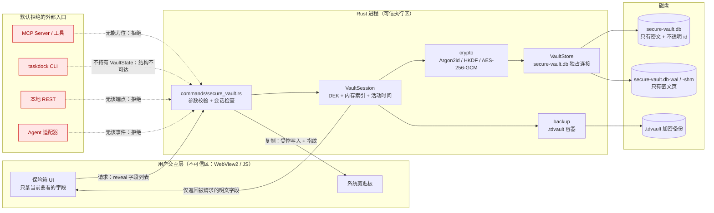

# 安全保险箱 · 威胁模型

- 日期：2026-11-18
- 阶段：P0（模型与对策设计；不含实现与实测）
- 配套：[security-architecture.md](security-architecture.md)（对策的技术细节）、
  [test-and-acceptance.md](test-and-acceptance.md)（每条对策的验证用例）

> 本文不声称"任何加密可以解决所有安全问题"。**如果设备已被恶意软件完全控制，或用户被实时
> 按键记录/屏幕录制，本产品无法保证明文不被窃取**——这一点在 §5 明确写出，并作为产品文案的一部分。

---

## 1. 信任边界与数据流

### 1.1 数据流向图（含信任边界）

读法：
- **唯一能拿到 DEK 的是 `VaultSession`**；`UI` 与磁盘都不持有密钥。
- 剪贴板是"必然离开信任边界"的一环，因此有独立威胁（T-08）与明确局限。
- 外部入口（MCP/CLI/REST/Agent）是**结构性不可达**，不是"靠代码记得别查"。

### 1.2 信任边界清单

| 边界 | 内侧（可信） | 外侧（不可信） | 跨越方式 |
| B1 | Rust 进程内存 | WebView2 JS | IPC（只传被请求的明文字段） |
| B2 | Rust 进程内存 | `secure-vault.db` | 只写密文与不透明元数据 |
| B3 | 应用 | 系统剪贴板 | 用户显式点击复制 |
| B4 | 应用 | 其他进程/其他用户 | 无通道（不监听、不导出、不自动填充） |
| B5 | 本机 | 同步中继（P2） | 只传密文信封 |
| B6 | 本机 | Agent / MCP / CLI | 默认无通道；P3 需显式租约 |

### 1.3 攻击者分类

| ID | 攻击者 | 典型能力 | 对应场景 |
|---|---|---|---|
| A1 | 拿到已开机设备的人 | 可看到屏幕、可点 UI | T-01、T-08 |
| A2 | 拿到关机设备/硬盘/备份文件的人 | 可复制文件、可离线分析 | T-02、T-03、T-04、T-11 |
| A3 | 本机恶意程序（非管理员） | 读用户目录文件、读剪贴板、读部分进程内存 | T-05、T-06、T-07、T-08 |
| A4 | 管理员级恶意程序 / 内核级 | 读写任意内存、注入、键盘记录 | §5 明确不设防 |
| A5 | 被入侵或被诱导的 Agent / MCP / CLI | 调用本地 API、读写主库 | T-09、T-10 |
| A6 | 网络攻击者（P2 同步） | 中间人、重放、伪造设备 | T-14 |
| A7 | 用户误操作 | 把秘密粘到别处、截图外发 | T-15 |

---

## 2. 十五类攻击场景

> 每节固定 7 个字段：**攻击者能力 / 攻击目标 / 可能路径 / 防御方案 / 防御局限 / 剩余风险 / 验证方式**。
> 剩余风险编号 `R-xx` 与 §5 汇总表对应。

### T-01 设备丢失（设备在解锁状态下被拿走）

| 项 | 内容 |
|---|---|
| 攻击者能力 | 物理接触、可操作 UI、可重启；不知道主密码 |
| 攻击目标 | 已解锁会话中的记录、剪贴板中的密码 |
| 可能路径 | 直接打开保险箱页面 → 读记录；粘贴板残留；休眠恢复后仍解锁 |
| 防御方案 | 闲置 5 分钟锁定（默认）；后台 60 秒锁定；系统锁屏/休眠/窗口隐藏立即锁定；锁定态不渲染任何记录标题；剪贴板 30 秒清除 |
| 防御局限 | 用户正开着页面且未触发锁定事件时，攻击者可在数秒内读屏/复制 |
| 剩余风险 | R-01（解锁态物理接触）、R-02（剪贴板历史/第三方管理器留副本） |
| 验证方式 | T-LOCK-01..07（自动化）+ 真机锁屏/休眠/合盖走查；T-CLP-01..06 |

### T-02 硬盘被复制（离线拿走整块盘或数据目录）

| 攻击者能力 | 可完整复制 `secure-vault.db` + `-wal` + 备份文件；可反复尝试 |
| 攻击目标 | DEK、记录明文 |
| 可能路径 | 直接从库里取 `wrapped_dek` 猜口令；从备份文件猜导出口令；从 WAL 找残页 |
| 防御方案 | 记录级 AES-256-GCM；DEK 只以信封形式存在；主密码 Argon2id（64 MiB/3 轮）；恢复密钥 160-bit 随机；WAL 页同样只有密文 |
| 防御局限 | 口令强度不足时离线爆破可行（Argon2id 只提高单位成本）；密钥若被用户写在便签上则失效 |
| 剩余风险 | R-03（弱口令）、R-04（离线爆破的时间成本可被 GPU/ASIC 降低） |
| 验证方式 | T-CRY-01..08；`grep` 哨兵串；离线复现脚本（只读副本，隔离目录） |

### T-03 数据库文件被窃取（只拿走 `secure-vault.db` 单文件）

| 攻击者能力 | 拿到不一致快照（缺 WAL）、可篡改字节后放回 |
| 攻击目标 | 记录内容、能否伪造/删除 |
| 可能路径 | 缺 WAL 时读到旧页；篡改 `meta_blob` 或 `secret_blob`；删除整行；回滚整个文件 |
| 防御方案 | 每条载荷 AAD 绑定 `record_id + purpose + key_ver + alg_ver`（换记录/换用途即失败）；`vault_digest`（HMAC over id/rev 清单）检测删行；`generation` 计数 |
| 防御局限 | 攻击者同时回滚 `digest` 与数据则本地无法分辨（除非有外部单调存储） |
| 剩余风险 | R-05（整库回滚）、R-06（缺 WAL 造成的旧快照需重新解锁校验） |
| 验证方式 | T-CRY-04（跨记录/跨用途交换密文必须失败）；T-DATA-05（删行被 digest 发现） |

### T-04 备份文件被窃取

| 攻击者能力 | 拿到 `.tdvault` 文件，可离线爆破导出口令 |
| 攻击目标 | 全部记录（备份是完整集合） |
| 可能路径 | 猜导出口令；篡改头部版本/参数诱导降级；截断文件 |
| 防御方案 | 备份载荷独立 `file_key`；DEK 由导出口令 Argon2id 派生的 KEK 封装；头部与载荷都有 AEAD；版本白名单；导入先全量校验 |
| 防御局限 | 备份是"全量集合"，一旦口令被破，损失大于单条记录 |
| 剩余风险 | R-07（备份口令弱于主密码）、R-08（备份文件被用户放到云盘/聊天） |
| 验证方式 | T-BKP-02/03/05/07；备份文件哨兵串检索 |

### T-05 暴力破解主密码

| 攻击者能力 | 本地无限次尝试；可并行；可写脚本 |
| 攻击目标 | 解封装 DEK |
| 可能路径 | 反复调用 `vault_unlock`；直接对信封跑 Argon2id；用常见口令字典 |
| 防御方案 | Argon2id 64 MiB / t=3 / p=1（每次尝试固定成本）；失败计数 + 递增冷却（5s→30s→120s→5min）；同一时刻只允许 1 个解锁在飞；口令强度提示（不强制）；恢复密钥高熵 |
| 防御局限 | 冷却只在**应用内**生效；离线攻击者可绕过 UI 直接跑 Argon2id；参数受低端设备限制不能无限提高 |
| 剩余风险 | R-03、R-04；R-09（失败计数本身泄漏"有人在试"） |
| 验证方式 | T-CRY-03、T-LOCK-08；参数基准报告（P1 实测） |

### T-06 恶意程序读取内存

| 攻击者能力 | 同用户权限进程：可读其他进程内存（受系统缓解限制）、可 dump |
| 攻击目标 | 解锁态 DEK、明文记录、内存索引 |
| 可能路径 | 进程内存 dump；注入；读取崩溃转储；页面文件残留 |
| 防御方案 | 密钥/明文用 `Zeroizing` 包装并尽早 drop；不缓存明文；`meta` 索引只在解锁期存在；锁定即清空；不写临时文件；不产生 crash dump 含密钥（Rust panic 不打印秘密） |
| 防御局限 | **Rust 无法保证编译器不复制、无法阻止同用户进程读内存**；JS 字符串不可清零 |
| 剩余风险 | R-10（解锁期内存窥探）、R-11（页面文件/休眠文件残留） |
| 验证方式 | 只能做"减少暴露"的静态审查 + 生命周期单测；**不承诺"内存中永不存在明文"** |

### T-07 日志泄露

| 攻击者能力 | 读诊断目录、读崩溃报告、读应用日志 |
| 攻击目标 | 密码、密钥、记录标题 |
| 可能路径 | 错误信息拼接了字段值；metadata 塞入记录对象；`message` 写标题；tracing 打印参数 |
| 防御方案 | 诊断 metadata 闭集白名单（`FORBIDDEN_KEY_PARTS` 双保险）；保险箱事件只允许 6 个 key；**禁止把任何字段值/标题/搜索词传入 message**；错误码枚举化（不拼接输入） |
| 防御局限 | 白名单之外的自由文本仍靠调用方自律；第三方库日志不受控 |
| 剩余风险 | R-12（新代码写日志时疏忽） |
| 验证方式 | T-DATA-03（哨兵串检索全部 JSONL）；code review 清单；CI 脚本扫描 |

### T-08 剪贴板泄露

| 攻击者能力 | 读剪贴板（普通权限即可）、剪贴板历史/云同步、第三方管理器 |
| 攻击目标 | 刚复制的密码/密钥 |
| 可能路径 | 复制后长期停留；被历史记录保存；被其他程序轮询 |
| 防御方案 | 只在用户点击时写入；写后 30 秒（可调 10–300）自动清除；清除前比对内容指纹，用户新复制的内容不删；锁定/退出立即清除；复制即提示风险 |
| 防御局限 | **Windows 剪贴板历史、云剪贴板、第三方管理器可能在 30 秒内已保存副本**；应用无法从系统历史中删除 |
| 剩余风险 | R-02（系统/第三方留副本）；R-13（清除定时器被强杀导致未清除） |
| 验证方式 | T-CLP-01..06 + 真机打开剪贴板历史走查（记录"历史中可见"的事实，不掩盖） |

### T-09 Agent 越权

| 攻击者能力 | 已接入的 Agent（Codex/Claude/Cursor…）可读文件、可发 HTTP、可调 CLI |
| 攻击目标 | 保险箱记录/密钥 |
| 可能路径 | 读 `secure-vault.db`（若知道路径）；调用本地 REST；调用 `taskdock` CLI；通过 hooks 注入 |
| 防御方案 | 库分离（Agent 只被授权工作区根，`mcp_workspace_roots` 白名单不含数据目录）；REST 无保险箱端点；CLI 不注册 `vault` 子命令且不持有 `VaultState`；即使拿到库文件也只有密文 |
| 防御局限 | Agent 若被授予"应用数据目录"级文件权限，可拿到密文文件（但无密钥）；用户可能手动把密码贴给 Agent |
| 剩余风险 | R-14（密文外带 + 离线爆破）、T-15 用户主动泄漏 |
| 验证方式 | T-ISO-01..05（CLI/MCP/REST/文件/搜索五条路径逐一断言拒绝） |

### T-10 MCP 越权

| 攻击者能力 | 持有效 token 的 MCP 客户端，scope 可达 `project_rw` |
| 攻击目标 | 保险箱内容 |
| 可能路径 | 调 `vault_*` 工具（若被误注册）；调通用 `resources.read`；调搜索工具 |
| 防御方案 | `Capability` 枚举**不含任何 vault 项**；工具清单不注册；搜索工具只查主库；`mcp_audit_log` 记录拒绝 |
| 防御局限 | 若未来新增能力位时评审不严，可能重新打开通道（用测试锁死） |
| 剩余风险 | R-15（未来能力位扩张） |
| 验证方式 | T-ISO-02；单测断言 `CAPABILITIES` 不含 `vault*`；MCP 工具清单快照测试 |

### T-11 数据篡改

| 攻击者能力 | 可写库文件/备份文件 |
| 攻击目标 | 让用户读到被替换的密码（"把收款账号换成攻击者的"） |
| 可能路径 | 替换 `secret_blob`；跨记录搬移密文；改 `key_ver`；改备份载荷 |
| 防御方案 | AEAD + AAD 绑定 `id/purpose/ver`；`vault_digest`；导入全量校验；解密失败一律"数据损坏"而非"空值" |
| 防御局限 | 攻击者若能同时改 digest 并保持自洽（需 DEK 才能算 HMAC）→ 实际上不可行；但整库回滚可行 |
| 剩余风险 | R-05 |
| 验证方式 | T-CRY-04/05；T-DATA-05/06 |

### T-12 恢复密钥泄露

| 攻击者能力 | 拿到纸质恢复密钥（拍照/捡到） |
| 攻击目标 | 直接解封装 DEK，绕过主密码 |
| 可能路径 | 用恢复密钥恢复 → 设新主密码 → 读全部记录 |
| 防御方案 | 恢复密钥 160-bit CSPRNG；生成后只展示一次；展示页要求"我已抄写"确认；`vault_audit` 记录每次恢复；恢复后可一键重生成（旧密钥立即失效）；建议与主密码分开存放 |
| 防御局限 | 恢复密钥一旦泄露且用户未重生成，攻击者永久有效；恢复密钥不可"部分使用" |
| 剩余风险 | R-16（纸质备份被拍照）、R-17（用户把恢复密钥存进同一个密码管理器/云笔记） |
| 验证方式 | T-REC-01..05；重生成后旧密钥必须失败 |

### T-13 应用崩溃

| 攻击者能力 | 无（意外事件） |
| 攻击目标 | 数据一致性、临时明文残留 |
| 可能路径 | 写入中断留下半条记录；恢复中断留下半个库；panic 时打印局部变量 |
| 防御方案 | 单事务写记录（meta+secret+digest 同事务）；导入走 staging + 原子替换 + 旧库保留；启动恢复检查；错误不打印秘密；不写临时明文文件 |
| 防御局限 | 进程被强杀时内存明文随之消失（对机密是好事），但未提交写入会丢 |
| 剩余风险 | R-18（崩溃丢失最近一次未提交编辑，需 UI 明确"未保存"） |
| 验证方式 | T-DATA-07（写中断后库可解锁且无半条记录）；T-BKP-06（导入中断可回滚） |

### T-14 多设备同步攻击（P2）

| 攻击者能力 | 控制中继、重放旧信封、伪造新设备入网请求 |
| 攻击目标 | DEK、同步内容 |
| 可能路径 | 中继替换信封；伪造设备申请；重放旧版本覆盖新密码；撤销后继续用旧 DEK |
| 防御方案 | 设备 P-256 密钥对（私钥在 Keystore/DPAPI）；DEK 只以"设备信封"传输；入网需**已解锁设备当场批准 + 6 位指纹比对**；信封 AAD 绑定双方设备 id；撤销即轮换 DEK 世代并重加密；服务端只存密文 |
| 防御局限 | 中继仍可见元数据（记录数、大小、时间）；被撤销设备保留已读数据；用户不看指纹就点"批准"则被中间人 |
| 剩余风险 | R-19（中继元数据）、R-20（撤销前已泄漏的历史）、R-21（用户跳过指纹比对） |
| 验证方式 | T-SYNC-01..06（伪造信封失败、旧信封重放失败、撤销后新世代解不开） |

### T-15 用户误操作（把秘密放到无保护的地方）

| 攻击者能力 | 无需攻击，用户自己造成 |
| 攻击目标 | 秘密进入笔记/任务/聊天/截图 |
| 可能路径 | 把密码写进任务描述；把恢复码贴进笔记；截图发群 |
| 防御方案 | UI 明确边界（笔记页一次性提示、保险箱内"不要存到笔记"说明）；搜索与备份隔离；文档与帮助中心写入正确做法 |
| 防御局限 | **产品无法阻止用户主动外发**；一旦进入主库，就按主库的可见面（备份/MCP/搜索）扩散 |
| 剩余风险 | R-22（用户主动泄漏） |
| 验证方式 | 帮助文档走查；不在代码层做"扫描主库找密码"的侵入式检查（会制造新的隐私问题） |

---

## 3. 密码学假设（成立前提）

| 假设 | 说明 | 若不成立 |
| H-1 | OS CSPRNG 可信 | 所有随机（DEK/盐/nonce/恢复密钥/密码）都依赖它 | 全盘失效（无替代方案） |
| H-2 | AES-256 与 SHA-256 未被实际攻破 | 记录加密、HKDF、HMAC | 需整体迁移算法版本 |
| H-3 | Argon2id 实现正确（RustCrypto `argon2`） | 口令硬化 | 口令成本下降 |
| H-4 | AEAD tag 校验不可伪造 | 篡改检测 | 完整性失效 |
| H-5 | 用户主密码不是"123456" | 抗爆破 | 见 R-03 |
| H-6 | 设备本身未被管理员级恶意软件控制 | 内存/键盘安全 | §5 不设防 |

---

## 4. 明确不适用的攻击（产品不承诺防护）

1. **管理员级恶意软件 / 内核级 rootkit / 硬件键盘记录器**：可读解锁期内存与按键。
2. **屏幕录制 / 肩窥 / 摄像头**：用户点"显示密码"时可见。
3. **用户主动外发**（截图、粘贴到聊天、把恢复密钥存云笔记）。
4. **系统剪贴板历史/云剪贴板的副本**：应用无权删除。
5. **物理拆解/内存冷冻等高级硬件攻击**：超出产品边界。
6. **供应链攻击**（依赖被投毒）：靠依赖审查与最小化，不承诺零风险。

---

## 5. 剩余风险汇总

| ID | 剩余风险 | 严重度 | 谁能缓解 | 接受与否 |
|---|---|---|---|---|
| R-01 | 解锁态被物理接触者读屏/复制 | 中 | 用户（及时锁定） | 接受（有锁定兜底） |
| R-02 | 系统剪贴板历史/第三方管理器留副本 | 中 | 用户（关闭历史/不用第三方管理器） | 接受（明确告知） |
| R-03 | 弱主密码被离线爆破 | 高 | 用户（强口令）+ 产品（强度提示） | 接受（无法强制） |
| R-04 | Argon2id 参数受设备性能限制 | 中 | 产品（参数可升级 + 基准） | 接受（P1 实测后定档） |
| R-05 | 整库回滚到旧版本 | 中 | 产品（generation + digest 部分检测） | 部分接受（P3 可加 DPAPI 守卫） |
| R-06 | 缺 WAL 的旧快照 | 低 | 产品（解锁时校验 digest） | 接受 |
| R-07 | 备份口令弱于主密码 | 高 | 产品（默认预填主密码，不强制另设） | 接受（提示强度） |
| R-08 | 备份文件被放到云盘/聊天 | 高 | 用户 | 接受（文件已加密） |
| R-09 | 解锁失败计数泄漏"有人在试" | 低 | — | 接受（本地文件本来可见） |
| R-10 | 解锁期内存被同用户进程窥探 | 高 | 产品（缩短生命周期） | 接受（无法根治） |
| R-11 | 页面文件/休眠文件残留 | 中 | 用户（BitLocker/关闭休眠） | 接受（系统层） |
| R-12 | 新代码误写日志 | 中 | 产品（白名单 + CI 扫描） | 需持续治理 |
| R-13 | 剪贴板清除定时器被强杀 | 低 | 产品（锁定/退出时再清一次） | 接受 |
| R-14 | 密文文件被 Agent 带出后离线爆破 | 中 | 产品（库分离 + 权限白名单） | 接受 |
| R-15 | 未来能力位扩张误开通道 | 高 | 产品（测试锁死 + 评审清单） | 必须防止 |
| R-16 | 恢复密钥被拍照 | 高 | 用户（分开存放） | 接受（提示） |
| R-17 | 恢复密钥与主密码存同一处 | 高 | 用户 | 接受（提示） |
| R-18 | 崩溃丢失未提交编辑 | 低 | 产品（自动保存草稿？不做，避免明文落盘） | 接受 |
| R-19 | 中继可见元数据（P2） | 中 | 产品（不传标题、只传密文+计数） | 接受 |
| R-20 | 撤销前已泄漏的历史（P2） | 高 | 产品（轮换世代） | 部分接受 |
| R-21 | 用户跳过设备指纹比对（P2） | 高 | 产品（强制比对 + 文案） | 需设计约束 |
| R-22 | 用户主动外发 | 高 | 用户 | 接受（产品边界） |

**结论**：本设计能防住"离线拿文件/拿备份/拿库"这一类**最常见且最致命**的攻击，也能结构性阻断
Agent/MCP/CLI 越权；但**不能**防住解锁态的内存窥探、屏幕录制、剪贴板历史与用户主动外发。
这些限制必须写进产品文案与帮助中心，而不是藏在文档里。

---

## 6. 威胁模型维护规则

1. 新增外部入口（REST 端点、MCP 工具、CLI 子命令、同步通道）→ **必须先在本文件追加场景**。
2. 新增依赖（尤其密码学/序列化）→ 在 §3 追加假设，并说明失败影响。
3. 每次 P1/P2 验收报告必须逐条引用本表的 T-xx 与 R-xx，写明"已验证/未验证/接受"。
4. 任何"我们保证绝对安全"的文案禁止出现在 UI、帮助与 README。
