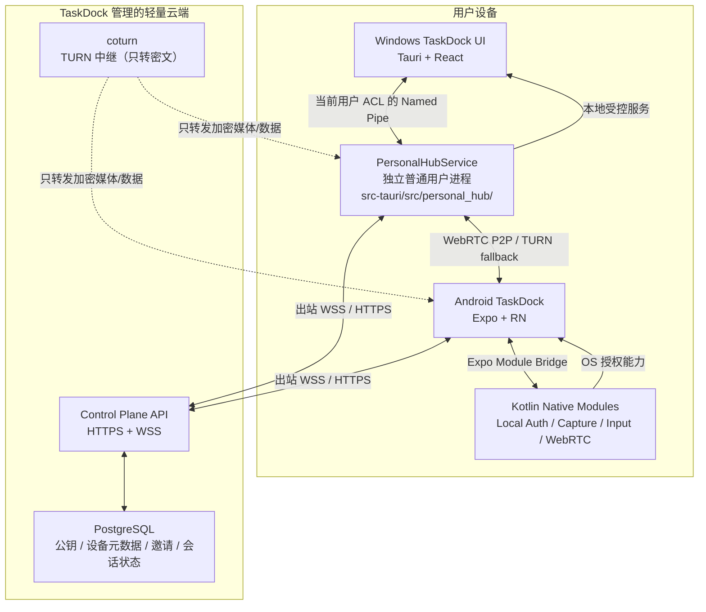

# Personal Hub · 总体架构设计

- 日期：2026-11-19
- 阶段：P0 设计，**已按架构基线与威胁模型对齐**
- 唯一架构事实源：[ARCHITECTURE_BASELINE_v1.0.md](ARCHITECTURE_BASELINE_v1.0.md)（本文与其冲突时以基线为准）
- 前置：[02-current-state-audit.md](02-current-state-audit.md)、[06-threat-model.md](06-threat-model.md)

> 修订记录：移除 WireGuardManager/虚拟网卡/手机 A↔B 独立组网（基线 D5/D12）；
> 服务形态改为独立普通用户进程 + Named Pipe ACL（D2）；组网改为 WebRTC 应用层加密覆盖（D5/D7）。

---

## 1. 架构总原则

1. **安全第一**：本机设备凭据认证是远控强制门槛；任何路径不得绕过（[07](07-local-auth-design.md)）。
2. **PC-first**：Windows 电脑是第一阶段 Personal Hub；Android 手机是接入端。**v1.0 不支持脱离电脑的手机↔手机独立组网**（基线 D1/D12，仅预留接口）。
3. **UI 与核心服务分离**：PersonalHubService 是**独立普通用户权限进程**（非 SYSTEM、非自研 Windows Service），Tauri WebView 只经受 ACL 保护的 Named Pipe 管理它（D2）。
4. **复用现有安全积木**：TLS+SPKI、配对/撤销/令牌、加密工具箱、supervisor 生命周期（[02](02-current-state-audit.md) §3）；不把 127.0.0.1 服务改成公网监听。
5. **应用层加密覆盖而非 IP VPN**：v1.0 用 HTTPS/WSS + WebRTC P2P + STUN/TURN，只开授权服务，不创建虚拟网卡、不接管全部流量（D5）。

---

## 2. 总体分层（对齐基线 §3）

---

## 3. PersonalHubService 模块职责

> 模块与命名以基线 §11.1 为准；方法级设计见 [11-windows-method-design.md](11-windows-method-design.md)。

| 模块 | 职责 | 关键约束 |
|---|---|---|
| PersonalHubService | start/stop/status/health_check/recover | 独立普通用户进程；不监听公网；关主窗口不停服 |
| DeviceManager | 设备注册/查询/列表/撤销/签名验证 | 撤销即时生效（每请求校验） |
| IdentityManager | Ed25519 身份密钥生成/加载/签名/指纹/轮换 | 私钥 DPAPI 保护、不出本机、用途分离 |
| PairingManager | 邀请创建/校验/双向身份确认/完成/撤销 | 5min TTL、一次性、最多 5 次错误尝试、PC 本机批准 |
| PermissionManager | 能力位裁决/授权校验 | 最小权限；配对不授予 REMOTE_CONTROL |
| LocalAuthManager | Windows Hello/设备 PIN 认证（真实 HWND）+ grant 签发/校验/消费 | 严格失败关闭；无 App PIN 降级 |
| SessionManager | 会话请求/身份验证/授权/创建/撤销/过期/终止 | 集中状态机；不可跳过 LOCAL_AUTH_REQUIRED |
| SignalingClient | 出站 WSS 连接/注册/在线状态/签名 SDP·ICE 交换 | 不监听公网；签名绑定防 MITM |
| WebRtcSessionManager | PeerConnection/DTLS 指纹绑定/控制与文件 DataChannel/屏幕轨道 | DTLS-SRTP 视频 + DTLS DataChannel；TURN 只转密文 |
| AuditLogger | 配对/认证/授权/会话/安全失败日志 | 禁记密码/私钥/屏幕内容/完整 grant |
| HealthMonitor（并入 PersonalHubService） | 健康检查/异常恢复/配置持久化 | 服务停止保护；休眠/注销显示离线 |

> **v1.0 不含 WireGuardManager / VpnService / 虚拟网卡地址分配**（基线 D5/D12）。相关能力仅在未来独立 ADR 中评估。

---

## 4. UI 与管理通道

- 桌面 UI 只经**当前用户 ACL 的 Named Pipe** 管理 Hub，禁止无鉴权 localhost HTTP（D2/基线 §4.3）。
- 所有 IPC 经 `src/lib/bridge.ts`；参数 camelCase；新增命令同步前端类型与 Rust 签名（`AGENTS.md` §4.2）。
- 本地 HTTP 服务如必须存在，只绑 `127.0.0.1`，使用短时 token + scope + 限流 + Origin 检查；**不把 `0.0.0.0` 作为默认监听地址**。
- 主窗口关闭不杀 Hub；用户从托盘/设置显式退出才停止服务。

---

## 5. 与现有功能的关系

- 现有 `mobile_sync`（HTTPS 数据同步）保留为数据同步面；Personal Hub 在其上新增独立的设备身份、配对与认证远控链路（D4）；不复用同步令牌作设备身份密钥（基线 §1.1）。
- 现有 ADB+scrcpy **保留为本地/开发调试能力**，不得公网暴露、不接入新远控授权链路（D4）。
- 不删除任何现有功能；冲突只通过新增与隔离解决。

---

## 6. 阶段化落地映射（基线 P0–P8）

| 阶段 | 落地模块 | 完成门槛 |
|---|---|---|
| P0 | 架构基线 + 文档决策锁定 | 文档状态统一；无 Proposed 分叉 |
| P1 | PersonalHubService 骨架 + Named Pipe + 进程生命周期 | UI/服务分离；无公网监听；异常恢复 |
| P2 | Cloud Control Plane + 设备注册/信令/TURN 凭证 | 公钥验证、限流、无密码/私钥存储 |
| P3 | 设备身份与二维码配对（PC 本机批准） | 远程分享邀请也不能绕过 PC 批准 |
| P4 | WebRTC P2P/STUN/TURN + Hub RPC/文件 DataChannel | LAN/P2P/TURN 网络矩阵真实通过 |
| P5 | Android Device Credential + Windows Hello/PIN PoC + SessionManager | 所有认证失败路径安全关闭 |
| P6 | Android/Windows 屏幕采集与输入控制 | **只有 P5 全通过才允许开发/启用** |
| P7 | 撤销/断线恢复/审计/权限细化 | 撤销即时生效；会话超时销毁 |
| P8 | 安全回归/真机测试/正式构建 | 阻断测试通过；release 签名修复 |

> **阶段门铁律（基线 §14）**：P5 本机认证未通过之前，不得开发或启用 P6 远程输入控制。见 [15-development-plan.md](15-development-plan.md)。
