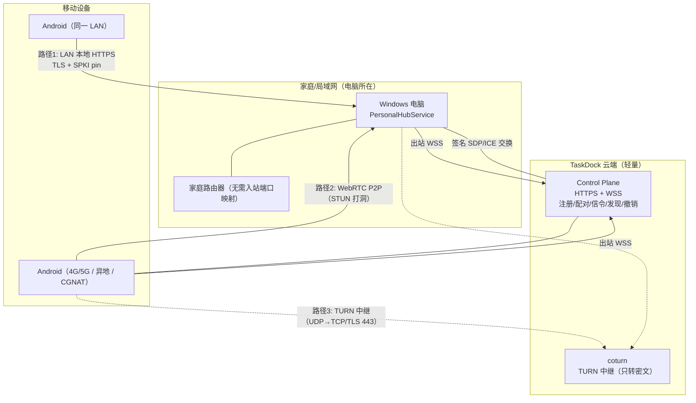

# Personal Hub · 网络拓扑与连接策略

- 日期：2026-11-19
- 阶段：P0 设计，**已按架构基线对齐**
- 唯一架构事实源：[ARCHITECTURE_BASELINE_v1.0.md](ARCHITECTURE_BASELINE_v1.0.md)
- 前置：[03-architecture.md](03-architecture.md)、[06-threat-model.md](06-threat-model.md)

> 修订记录（基线 D5/§0.1/§7）：v1.0 是 **WebRTC 应用层私有加密覆盖通道**（HTTPS/WSS + WebRTC P2P + STUN/TURN），
> **不是通用 IP VPN**：不安装 WireGuard、不创建虚拟网卡、不分配虚拟 IP、不接管全部流量。WireGuard 为 D12 未来扩展，v1.0 不实施。

---

## 1. 网络拓扑（对齐基线 §3 / §7）

**电脑不需要公网 IP，也不需要开放家庭路由器入站端口**（基线 §7.3）。

---

## 2. 连接策略（基线 §7）

| 顺序 | 路径 | 条件 | 安全 |
|---|---|---|---|
| 1 | 局域网本地 HTTPS | 同一 LAN | TLS-only + SPKI pinning + 设备身份签名；不改变 mobile_sync 协议边界 |
| 2 | WebRTC P2P（ICE/STUN） | 打洞成功 | DTLS-SRTP 视频 + DTLS DataChannel；SDP/ICE 签名绑定 |
| 3 | TURN 中继 | P2P 失败 | 优先 UDP，失败尝试 TCP/TLS 443；**只转发密文，无 DTLS/会话密钥** |

- 普通用户只需：PC 点「启用 Hub」→ 手机扫码 → PC 本机批准 → 手机按系统提示授权 → 完成（基线 §7.1）。
- 不得要求用户手动设置公网 IP / DDNS / 路由器端口 / VPN 配置 / TURN 凭证。
- 严禁把现有只监听 `127.0.0.1` 的 `http_ingest` 改成公网/局域网监听（基线 §1.1）。

---

## 3. 数据平面（基线 §3.B）

- 视频：WebRTC Media Track，DTLS-SRTP。
- 远控指令：独立可靠、有序 DataChannel；每条指令绑定 session_id + 设备 ID + scope + 消息序号。
- 文件：独立可靠、有序 DataChannel，分块传输 + 哈希校验 + 流控。
- 状态/鼠标轨迹：可用低延迟通道，但**不得承载授权状态**。
- 连接建立前必须把 DTLS 证书指纹与双方已验证设备身份绑定，防止信令服务器替换 SDP 实施 MITM。

---

## 4. 控制平面（TaskDock 云端，基线 §3.A / §7.4）

- 职责：设备注册与公钥目录、配对邀请状态、在线状态与发现、WebRTC 信令、TURN 临时凭证、会话元数据与限流、撤销状态同步。
- 禁止：保存设备私钥、收集系统密码、生成/签发被控端本地认证授权、直接执行远控指令、解密媒体或 DataChannel。
- 技术栈锁定：`services/personal-hub-control-plane/`，Node.js 22 LTS + TypeScript + Fastify 5 + WebSocket 插件 + PostgreSQL + coturn + Docker Compose。
- TURN 短时凭证，客户端不得内置长期 TURN 密码。

---

## 5. 数据保留（基线 §7.5）

- 只保留必要公钥、设备元数据、邀请状态、撤销状态、最小会话元数据。
- SDP/ICE 临时内容只在协商窗口内保存，完成/超时清除。
- 不保存视频/音频/屏幕截图/文件正文；日志不记录密码/私钥/完整 token/grant/屏幕内容。
- 排障只保留连接结果码、路径类型（LAN/P2P/TURN）、时间与脱敏设备 ID。

---

## 6. 待真实测试的网络矩阵（基线 §15.4，**全部未验证**）

| 场景 | 状态 | 说明 |
|---|---|---|
| 同一 Wi-Fi（LAN HTTPS） | 未验证 | — |
| 不同 Wi-Fi | 未验证 | — |
| 家庭宽带 + 4G/5G | 未验证 | — |
| CGNAT / 双 NAT / 不同运营商 | 未验证 | — |
| IPv4 / IPv6 | 未验证 | — |
| UDP 受限网络 | 未验证 | — |
| TURN UDP / TURN TCP-TLS 443 | 未验证 | — |
| Wi-Fi 与 5G 切换 | 未验证 | — |
| PC 休眠/唤醒 / 重启 / 云端不可用 | 未验证 | — |

> 每项必须记录设备型号、OS 版本、网络类型、连接路径、成功/失败、延迟、日志与时间。**未实测不得标记通过**；
> 不得宣称实现通用 IP VPN（基线 §18）。
