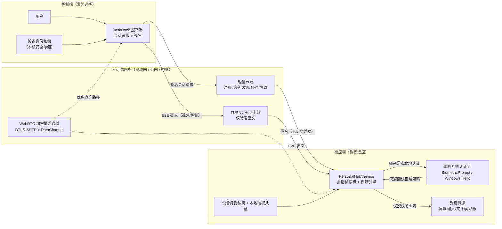

# Personal Hub · 安全威胁模型

- 日期：2026-11-19
- 阶段：P0（模型与对策设计；**不含实现与实测**），**已按架构基线对齐**
- 唯一架构事实源：[ARCHITECTURE_BASELINE_v1.0.md](ARCHITECTURE_BASELINE_v1.0.md)
- 前置：[02-current-state-audit.md](02-current-state-audit.md)
- 配套：[03-architecture.md](03-architecture.md)、[07-local-auth-design.md](07-local-auth-design.md)、[14-test-plan.md](14-test-plan.md)

> 本模型不声称"任何设计能解决所有安全问题"。**如果控制端或被控端设备已被恶意软件完全控制，或用户被实时按键记录/屏幕录制，本产品无法保证控制指令与屏幕内容不被窃取。** 此限制属剩余风险 R0，必须进入产品文案与测试报告。

---

## 1. 信任边界与数据流

### 1.1 信任域划分

### 1.2 关键信任假设

- **A1**：设备身份私钥从不离开本机，云端只持有公钥与签名（现状缺口：Android 无设备私钥，见 C2）。
- **A2**：系统认证 UI（BiometricPrompt / Windows Hello）由 OS 提供，应用只接收结果码，不接触 PIN/生物特征/密码。
- **A3**：信令服务器即使被完全攻破，也只能看到公钥、设备 ID、会话 ID、签名与密文，无法签发被控端授权（授权只在被控端经本地认证后产生）。
- **A4**：中继只转发密文，无法解密控制指令或视频。
- **A5**：配对二维码/邀请码含 nonce + 过期时间 + 签名，**不含**任何长期令牌、私钥或远控许可。

---

## 2. 安全属性与对应机制

| 安全属性 | 机制 | 规格条款 |
|---|---|---|
| 端到端身份验证 | 设备 Ed25519 身份签名 + 双向确认（显示名称/类型/指纹） | §3.3 |
| 通信机密性/完整性 | WebRTC DTLS-SRTP 视频 + DTLS DataChannel；TURN 只转密文；同步面复用 XSalsa20-Poly1305 + SPKI 固定 | 基线 §3.B/§7 |
| 会话密钥轮换 | 每会话 X25519 协商 + 短时密钥，会话结束即弃 | §6 |
| 防重放 | 会话随机数 + 消息序号 + 单调计数 + 过期时间 | §2.2 |
| 设备撤销 | 被控端维护撤销表，连接每次校验；撤销即时失效 | §3.2 §7 |
| 最小权限 | 能力级独立授权（屏幕/输入/键盘/剪贴板/音频/文件/管理） | §2.2 |
| 本地强制认证 | 每次新会话必须本机系统认证，签发一次性短时凭证 | §2.1 |
| 审计 | 只记安全事件 + 脱敏信息，禁记密码/私钥/完整令牌/生物特征 | §6 |
| 安全失败关闭 | 任何认证失败/权限不足/超时/身份不匹配 → 安全失败态，不跳过 | §2.3 |
| 异常断开 | 网络中断即关闭控制通道并撤销会话授权 | §5 |

---

## 3. 15 项威胁逐条分析

> 每条包含：攻击入口 / 攻击条件 / 可能后果 / 防御机制 / 检测机制 / 测试方法 / 剩余风险。
> 「防御机制」若依赖尚未实现的能力，明确标注 **[待建设]**。

### T1 — 网络流量被监听

- **攻击入口**：公共 Wi-Fi / 局域网嗅探 / 恶意路由器。
- **攻击条件**：攻击者能观察控制端↔被控端之间的链路。
- **后果**：若明文，泄露屏幕画面、键鼠输入、文件、令牌。
- **防御**：全链路 E2E 加密（WebRTC DTLS-SRTP + DTLS DataChannel，TURN 只转密文）；同步面 TLS-only + SPKI 固定（现有基础）；禁明文降级（fail-closed）。
- **检测**：抓包确认无明文；TLS 指纹不匹配即断连。
- **测试**：抓包审计（[14-test-plan.md](14-test-plan.md) §安全测试 S1）。
- **剩余风险**：端点被攻陷时 E2E 无效（R0）；FLAG_SECURE 画面在 MediaProjection 下为黑（已知限制）。

### T2 — 二维码泄露

- **攻击入口**：二维码图片在远程分享/截屏/聊天中泄露。
- **条件**：攻击者在有效期内拿到二维码图像。
- **后果**：若二维码是长期凭证，可无限配对。
- **防御**：二维码只含服务发现地址 + 邀请 ID + nonce + 过期时间 + 协议版本 + 签名；**不含私钥/令牌/永久授权**；默认 5 分钟有效、一次性、用后即失效（[05](05-identity-and-pairing.md)）。
- **检测**：邀请状态机记录 use/revoke/expire；重复消费告警。
- **测试**：邀请码过期、重复使用测试（[14](14-test-plan.md) §配对测试 P2/P3）。
- **剩余风险**：泄露窗口内 + 攻击者物理靠近可尝试抢配（由双向身份确认 + 一次性缓解）。

### T3 — 邀请码被盗用

- **攻击入口**：一次性邀请码/6 位码被肩窥或截获。
- **条件**：邀请未过期、攻击者能发起配对请求。
- **后果**：未授权设备入网。
- **防御**：短 TTL（现有 120s，规格建议 300s 内）、尝试次数上限（现有 5 次）、一次性消费、双向身份确认（显示设备名/类型/指纹，远程分享二维码需独立确认步骤）。
- **检测**：失败尝试计数与告警；同 nonce 多次提交。
- **测试**：非授权设备申请、伪造身份测试（P4/P5）。
- **剩余风险**：社工骗取用户确认（需用户教育，列为产品文案）。

### T4 — 第三台手机伪装成已配对设备

- **攻击入口**：攻击者克隆 device_id / 令牌。
- **条件**：拿到某已配对设备的标识与令牌。
- **后果**：冒充已信任设备访问服务。
- **防御**：设备身份私钥签名（Ed25519）+ 每次请求校验签名（不只凭 device_id）；令牌只存哈希、明文仅配对响应一次；设备 uid 去重、同 uid 重配对撤销旧授权（现有基础 + [待建设] 签名校验）。
- **检测**：签名验证失败、device_uid 冲突、异常 IP/位置。
- **测试**：冒充控制端、替换控制端设备测试（S3/S7）。
- **剩余风险**：设备物理丢失 + 未锁屏（对应 T8）。

### T5 — 中间人攻击（MITM）

- **攻击入口**：伪造服务发现地址 / 伪造 TLS 证书 / ARP 欺骗。
- **条件**：攻击者位于配对或连接路径中。
- **后果**：窃听或篡改会话。
- **防御**：SPKI 指纹固定（现有，二维码携带 `tls=` 64 hex pin）+ 证书 fail-closed + 设备身份双向确认 + E2E 签名（即便中继/发现被劫持也无法伪造授权）。
- **检测**：指纹不匹配（`E_PIN_MISMATCH`）即断连并告警。
- **测试**：伪造证书/替换二维码地址测试（P5、S1）。
- **剩余风险**：首次配对若用户误扫恶意二维码 TOFU（手动输码路径），需 UI 强提示。

### T6 — 信令服务器被入侵

- **攻击入口**：云端信令/发现服务被攻破。
- **条件**：攻击者获得服务器完全控制权。
- **后果**：篡改信令、诱导连接、窃听元数据。
- **防御**：A3 信任假设——服务器只见公钥/签名/密文，**无签发授权能力**；授权只在被控端本地产生；控制指令 E2E 加密，服务器无法伪造（[待建设] 轻量云端）。
- **检测**：签名校验失败、会话参数被篡改（绑定 session_id + nonce + 过期）。
- **测试**：中继/信令伪造控制指令测试（S6）。
- **剩余风险**：元数据（谁在何时连接）泄露；拒绝服务（不可信环境下的可用性风险）。

### T7 — TURN 中继被入侵

- **攻击入口**：TURN/Hub 中继被攻破。
- **条件**：攻击者控制中继节点。
- **后果**：篡改/窃听转发流量。
- **防御**：中继只转发密文；DTLS-SRTP / 加密 DataChannel 的完整性校验；中继无会话密钥。
- **检测**：AEAD 认证失败、序号异常。
- **测试**：中继注入/篡改报文测试（S6）。
- **剩余风险**：流量分析（时长/大小）；中继可作 DoS。

### T8 — 控制端设备丢失

- **攻击入口**：丢失/被盗的控制端手机或电脑。
- **条件**：拾得者能解锁设备或利用已登录会话。
- **后果**：以合法控制端身份发起远控。
- **防御**：被控端每次会话强制本地认证（即便控制端合法也要求被控端本机确认，§2.1）；设备撤销机制；控制端令牌受 Keystore/DPAPI 保护；控制端本地认证解锁令牌（[待建设]）。
- **检测**：异常时间/地点连接、审计告警、用户主动撤销。
- **测试**：已撤销设备继续连接测试（S5）。
- **剩余风险**：被控端无人值守时合法控制端可发起请求，但因无本机认证被拒（符合严格模式，牺牲无人值守可用性）。

### T9 — 被控端设备丢失

- **攻击入口**：丢失的被控端设备。
- **条件**：拾得者解锁设备。
- **后果**：本地数据泄露、被用作控制端。
- **防御**：Android Keystore 保护令牌 + 强制本地认证门禁（[待建设]）；Windows 锁屏即锁保险箱（现有）；设备撤销可从 Hub 移除。
- **检测**：异常心跳/位置；用户远程撤销。
- **测试**：锁屏状态请求远控测试（A6）。
- **剩余风险**：设备解锁后无额外认证则可访问本地业务数据（C2 缺口）；需产品明确“解锁即信任本地数据，但远控仍需独立认证”。

### T10 — 私钥被盗

- **攻击入口**：从磁盘/内存/备份窃取设备私钥。
- **条件**：设备被攻陷或备份泄露。
- **后果**：冒充设备身份。
- **防御**：Windows 用 DPAPI/受保护存储，Android 用 Keystore（尽可能硬件支持）；**私钥不进备份**（现有 `BACKUP_TABLES` 敏感表空 section 策略）；密钥用途分离（身份/会话/WebRTC DTLS 各自独立，v1.0 不生成 WireGuard 私钥）；zeroize。
- **检测**：证书/密钥指纹异常、审计。
- **测试**：日志/备份私钥泄漏审计（S2）。
- **剩余风险**：设备 root/管理员权限下 Keystore 可被绕过（R0）；release 用 debug keystore 削弱完整性（C2）。

### T11 — 历史会话被重放

- **攻击入口**：录制并回放旧会话报文/授权凭证。
- **条件**：攻击者拿到历史流量或凭证。
- **后果**：重放建立会话或注入指令。
- **防御**：会话随机数 + 消息序号 + 过期时间 + 一次性授权凭证（绑定 session_id + controller_id + nonce，不可跨设备/跨会话复用）；授权短时有效；撤销/过期即失效。
- **检测**：重复 nonce/序号回退、过期凭证。
- **测试**：旧会话凭证重放、换会话 ID 复用授权测试（A10、S4/S8）。
- **剩余风险**：时钟不同步影响过期判定（需时间源策略）。

### T12 — 设备被撤销后继续连接

- **攻击入口**：已撤销设备利用已有连接/隧道。
- **条件**：撤销未即时传播到数据面。
- **后果**：撤销后仍可访问。
- **防御**：被控端维护撤销表，每次请求/每段连接校验（不只握手时）；撤销时主动终止会话 + 关闭 WebRTC PeerConnection 与 DataChannel + 撤销云端撤销状态同步（基线 §6.3/§7.4）；控制通道断线即重校验，重连必须先同步撤销状态。
- **检测**：撤销设备的心跳/连接尝试告警。
- **测试**：已撤销设备继续连接测试（S5）。
- **剩余风险**：离线设备的撤销需重连后生效（最终一致性，需在产品说明）。

### T13 — Windows 服务权限提升

- **攻击入口**：利用后台服务的高权限或 IPC 提权。
- **条件**：服务以 SYSTEM/高权限运行且接口可被滥用。
- **后果**：本机提权、绕过认证、操作安全桌面。
- **防御**：PersonalHubService 以最小权限运行；本地 IPC/API 受保护（鉴权 + Origin 校验 + 限流，参考现有 `agent_access/rest.rs`）；不允许经普通远控通道操作 Windows 安全桌面；认证 UI 由 OS 提供独立进程；服务停止保护 + 配置持久化防篡改。
- **检测**：异常 IPC 调用、服务崩溃/重启审计。
- **测试**：恶意应用调用本地远控 API 测试（S9）、安全桌面保护测试。
- **剩余风险**：本机管理员权限可对抗任何用户态保护（R0）；服务形态已由基线 D2 锁定为独立普通用户进程 + Named Pipe，无 SYSTEM 提权面（ADR-0005）。

### T14 — Android 无障碍服务滥用

- **攻击入口**：恶意 App 滥用 AccessibilityService 或诱导用户开启。
- **条件**：攻击者让恶意无障碍服务获得输入注入能力。
- **后果**：模拟点击/输入，绕过本应用的认证 UI 或全局操作。
- **防御**：本应用的控制用 AccessibilityService 只在被控授权会话内激活，绑定 session_id；不提供通用无障碍能力；系统认证 UI（BiometricPrompt）不受应用无障碍服务控制；权限矩阵最小范围；会话结束即停用。
- **检测**：无障碍服务被意外启用的系统事件；会话外的注入尝试。
- **测试**：会话外注入被拒、认证 UI 不可被自动化点击。
- **剩余风险**：用户被社工开启恶意无障碍服务属系统级风险（超出应用边界，产品文案提示）。

### T15 — 恶意应用尝试调用本地远控 API

- **攻击入口**：本机恶意程序调用 Personal Hub 的本地 API/IPC。
- **条件**：本地 API 未鉴权或鉴权可绕过。
- **后果**：本机程序冒充控制端发起远控或读取状态。
- **防御**：本地 API 鉴权（token + 权限 scope + 常量时间比较 + 限流，参考现有 `agent_access/rest.rs:121/175/193`）；IPC 仅经 `bridge.ts`；能力位开关（写操作不靠 UI 隐藏）；任何本地调用仍不改变「被控端必须本机认证」的硬门槛。
- **检测**：未授权调用审计、限流触发告警。
- **测试**：未授权本地 API 调用被拒测试（S9）。
- **剩余风险**：本机管理员/root 可绕过（R0）。

---

## 4. 威胁→对策→测试 映射总表

| 威胁 | 核心对策 | 依赖现状 | 测试编号 |
|---|---|---|---|
| T1 监听 | E2E 加密 + SPKI 固定 | 部分（同步面有，控制面待建） | S1 |
| T2 二维码泄露 | 一次性短时邀请 + 签名 | 部分（配对码有，二维码协议待建） | P2/P3 |
| T3 邀请盗用 | TTL + 尝试上限 + 双向确认 | 部分 | P4/P5 |
| T4 伪装设备 | 身份私钥签名 + uid 去重 | 部分（uid 去重有，签名待建） | S3/S7 |
| T5 MITM | SPKI 固定 + fail-closed + 双向确认 | 有（同步面） | P5/S1 |
| T6 信令被入侵 | 服务器无签发能力 + E2E 签名 | 待建设 | S6 |
| T7 中继被入侵 | 中继无密钥 + AEAD 完整性 | 待建设 | S6 |
| T8 控制端丢失 | 被控端强制认证 + 撤销 | 待建设 | S5 |
| T9 被控端丢失 | Keystore + 认证门禁 | 待建设 | A6 |
| T10 私钥被盗 | 受保护存储 + 不进备份 + 用途分离 | 部分 | S2 |
| T11 会话重放 | nonce + 序号 + 一次性凭证 | 待建设 | A10/S4/S8 |
| T12 撤销后连接 | 每请求校撤销 + 主动终止 | 部分（软删除有） | S5 |
| T13 服务提权 | 最小权限 + 本地 API 鉴权 | 部分 | S9 |
| T14 无障碍滥用 | 会话内激活 + 最小范围 | 待建设 | S9 |
| T15 恶意本地 API | 鉴权 + 能力位 + 限流 | 部分 | S9 |

---

## 5. 剩余风险登记（R0 及全局）

| 编号 | 剩余风险 | 缓解 | 是否可接受 |
|---|---|---|---|
| R0 | 设备被完全攻陷 / 实时键鼠记录 / 屏幕录制 | 无法在应用内解决；OS 级安全 + 用户教育 | 必须披露，列为产品文案 |
| R1 | 首次配对 TOFU 误扫恶意二维码 | UI 强提示 + 远程分享独立确认步骤 | 需产品评审 |
| R2 | 离线设备撤销的最终一致性 | 重连即校撤销；产品说明 | 可接受 |
| R3 | 中继/信令元数据泄露与 DoS | 最小化元数据；不可用加密隐藏流量特征 | 需评审 |
| R4 | FLAG_SECURE / DRM 画面在 MediaProjection 下为黑 | 明确为已知限制，不承诺采集 | 需产品确认 |
| R5 | release 签名弱（debug keystore / R8 关闭） | 阶段 8 前必须修复，否则本地认证完整性不足 | **不可接受，列为阻断项** |
