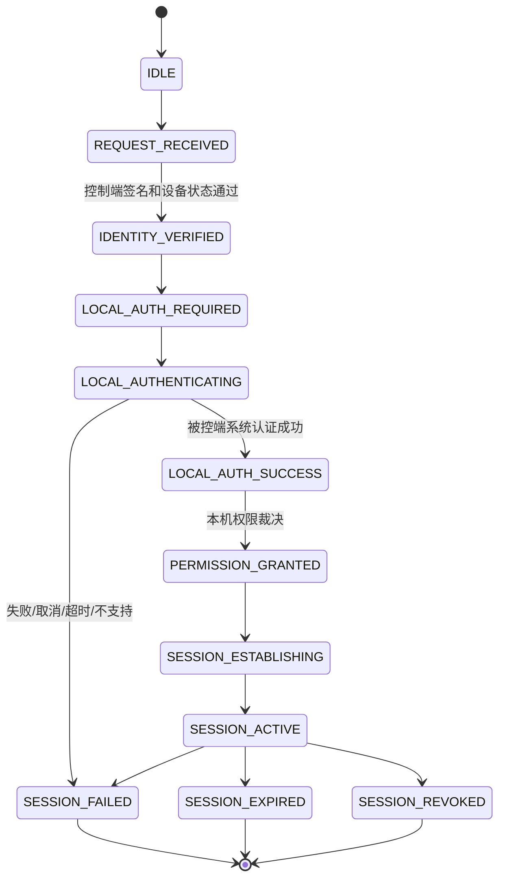

# Personal Hub · 远程控制本地强制认证设计

- 日期：2026-11-19
- 阶段：P0 设计，**已按架构基线与威胁模型对齐**
- 优先级：**本项目最重要的功能**（基线 §8 / 规格 §2）
- 唯一架构事实源：[ARCHITECTURE_BASELINE_v1.0.md](ARCHITECTURE_BASELINE_v1.0.md)
- 前置：[02-current-state-audit.md](02-current-state-audit.md)、[06-threat-model.md](06-threat-model.md)

> 修订记录（基线 D9/D10/D11/§8/§17）：**删除 `TD_LOCAL_GRANT` App PIN 自动降级路径**；
> Android 默认仅 `DEVICE_CREDENTIAL`（生物识别非默认）；grant ≤60s 且绑定 controller/target/session/nonce/scopes；
> Windows 系统凭据不可用 → 关闭远控并报告 BLOCKED，不退化自建 App PIN。

---

## 1. 强制认证的不变量（基线 §8.1，不可协商）

1. **每次新建远控会话，被控端必须在本机验证该设备自己的系统凭据**：手机被控验证手机，电脑被控验证电脑（D9）。
2. TaskDock **永不采集、保存、传输** Android 锁屏密码或 Windows 登录密码；只用 OS 提供的设备凭据验证 UI（D10）。
3. 认证结果只在**本机**转换成一次性短时凭证 `LocalAuthGrant`，绑定 controller/target/session/nonce/scopes，不可跨设备/跨会话复用（§8.3）。
4. 系统认证不可用、认证失败、用户取消、超时、身份不匹配 → 严格失败关闭，拒绝远控；**禁止自建密码框或跳过认证**（D11）。
5. 配对成功 ≠ 远控授权；加入私有连接 ≠ 远控授权；历史会话成功 ≠ 本次授权（§8.1）。
6. 被控设备锁屏/注销/无可交互桌面 → 远控失败关闭；不得绕过锁屏（§10.2）。
7. 屏幕采集（Android MediaProjection）系统授权是**独立门槛**，每次新采集会话独立授权（§5.2）。
8. **不允许 App PIN 或远程输入系统密码替代本机凭据认证**（D11 / 执行提示词 §二）。

---

## 2. 强制状态机（基线 §8.2）



**禁止任何跳过 `LOCAL_AUTH_REQUIRED` 的状态迁移**（基线 §8.2）。完整状态字段见 [08](08-permission-and-session.md)。

### 2.1 LocalAuthGrant（基线 §8.3，≤60 秒）

```
LocalAuthGrant {
  grant_id, controller_device_id, target_device_id,
  controller_identity_fingerprint, session_id, session_nonce,
  permission_scopes[], auth_method,
  issued_at, expires_at,
  single_use = true, local_signature
}
```

- 有效期 **≤60 秒**，必须在当前会话消费；单次使用。
- 绑定 controller、target、session、nonce 和权限集合。
- 认证成功后若控制端身份、会话 ID 或权限集合变化 → grant 立即失效。
- **不得发送到云端作为可复用凭证**；不跨设备/跨会话复用；不存成永久授权。
- 认证取消/失败不生成 grant。

### 2.2 会话时限（基线 §8.4）

- 一次本机认证只授权一个新会话；单次会话最长 **15 分钟**。
- 连续无输入/无活动 **5 分钟**自动暂停并要求重新认证。
- 高风险权限（文件写入、剪贴板读取、设备管理）独立确认或再次认证。
- 被控端随时立即停止。
- 连接中断超 **30 秒** → 关闭控制通道并销毁当前授权；恢复必须重新发起会话和本机认证。

---

## 3. Windows 被控端（基线 §4.2 / §10.2）

### 3.1 认证 UI 流程

1. Hub 收到远控请求 → 验证控制端身份和签名。
2. Hub 向 Tauri UI 发 `LocalAuthRequired` 事件。
3. Tauri UI 确认目标会话在当前登录用户交互桌面。
4. UI 通过原生 Windows API 发起 Windows Hello / 设备 PIN 验证。
5. 认证结果返回 Hub → Hub 本机签发一次性 `LocalAuthGrant` → 才允许建立控制通道。

### 3.2 桌面 API 可用性（实事求是）

| 事实 | 结论 | 来源 |
|---|---|---|
| UWP `RequestVerificationAsync(msg)` | **仅 UWP 适用**，桌面应用不得误用 | Microsoft Learn |
| 桌面路径 | 取真实 HWND → `IUserConsentVerifierInterop::RequestVerificationForWindowAsync(hwnd, msg)` | Microsoft Learn (UserConsentVerifier Class, Examples) |
| 结果枚举 | Verified / DeviceNotPresent / NotConfiguredForUser / DisabledByPolicy / DeviceBusy / RetriesExhausted / Canceled | Microsoft Learn (UserConsentVerificationResult) |
| windows-rs | 绑定在 `Win32::System::WinRT`，需 `Security_Credentials_UI` 等 feature；issue #1565 有 `0x80040154 Class not registered` 历史报告（页面 404 无法确认修复） | github.com/microsoft/windows-rs |

**必须做桌面 PoC**（P5）：真实 Tauri 窗口 HWND + 指定 interop，记录 OS 版本/打包方式/AUMID/错误码。

### 3.3 严格凭据策略（无 App PIN 降级）

| 层级 | 方式 | 条件 |
|---|---|---|
| 主路径 | Windows Hello（人脸/指纹/PIN，经 `RequestVerificationForWindowAsync`） | OS 支持、用户已配置、PoC 通过 |
| 系统凭据路径 | Windows 设备 PIN（同一 interop 的系统验证） | Hello 生物不可用但 PIN 已配置；仍是 OS 系统验证 |
| **不可用时** | **关闭 Windows 远控并报告 BLOCKED**，提交 PoC 命令/日志/环境/已尝试步骤 | API 不可用 / 组策略禁用 / 未配置凭据 |

**禁止**：收集/传输/保存 Windows 账户密码；仿 Windows 登录框；自建 App PIN 作为自动降级；因接口不可用跳过认证（基线 §4.2 / §8.1 / D11）。

### 3.4 屏幕采集（P6，仅在 P5 通过后）

优先 Windows Graphics Capture，先做目标 Windows 版本 PoC；仅当前用户交互桌面受控输入；不提权注入；不操作 UAC 安全桌面/登录桌面/Ctrl+Alt+Del；锁屏/注销/无交互桌面 → 失败关闭。

---

## 4. Android 被控端（基线 §5.3 / §10.1）

### 4.1 默认设备凭据认证

- v1.0 默认使用 Android 系统 `DEVICE_CREDENTIAL`：PIN / 锁屏密码 / 图案（系统支持时）。
- **默认不把指纹/人脸作为"输入密码"的替代**；将来若允许生物识别，必须作为独立的用户显式选项，不能默认打开（基线 §5.3）。
- API 28+：AndroidX BiometricPrompt，`DEVICE_CREDENTIAL`-only 系统配置；API 24–27：评估 `KeyguardManager.createConfirmDeviceCredentialIntent()` 兼容路径；每个 API 范围真机验证。
- 不自绘 PIN/密码输入框；不读取/保存/上传输入内容；只返回成功/失败/取消/超时/不支持结果码。
- 认证失败、取消、超时、不支持 → 拒绝会话。
- 实现载体：新增 Kotlin Expo Module `modules/local-auth`（D3）；JS 只做编排。

### 4.2 屏幕采集与输入（P6，仅在 P5 通过后）

- MediaProjection 每次新会话独立系统授权（`createScreenCaptureIntent()`）；前台服务仅在活动采集/远控会话期间运行并显示持续通知（基线 §5.2）。
- AccessibilityService 仅在用户显式启用后的活动 session 内执行，每条输入绑定 session_id/设备 ID/scope/消息序号，会话外拒绝；系统认证 UI / 安全 UI 不得被自动化点击（基线 §5.4）。
- 锁屏不得绕过；FLAG_SECURE/DRM/安全界面可能不可采集/操作，必须显示限制。

---

## 5. 阶段门与 PoC 清单

- **P5 前置 PoC**：A7 Windows Hello 桌面 interop（真实 HWND）；A8 Android DEVICE_CREDENTIAL 在 minSdk 24 / targetSdk 36 真机兼容。
- **阶段门铁律**：P5 全部认证测试通过前，禁止开发或启用 P6 屏幕采集与输入控制。
- **阻塞处理**：若 Windows 系统凭据 API 在本机确认不可用，标记 Windows 远控 `BLOCKED` 并提交原始证据，不自行换方案、不退化 App PIN。
