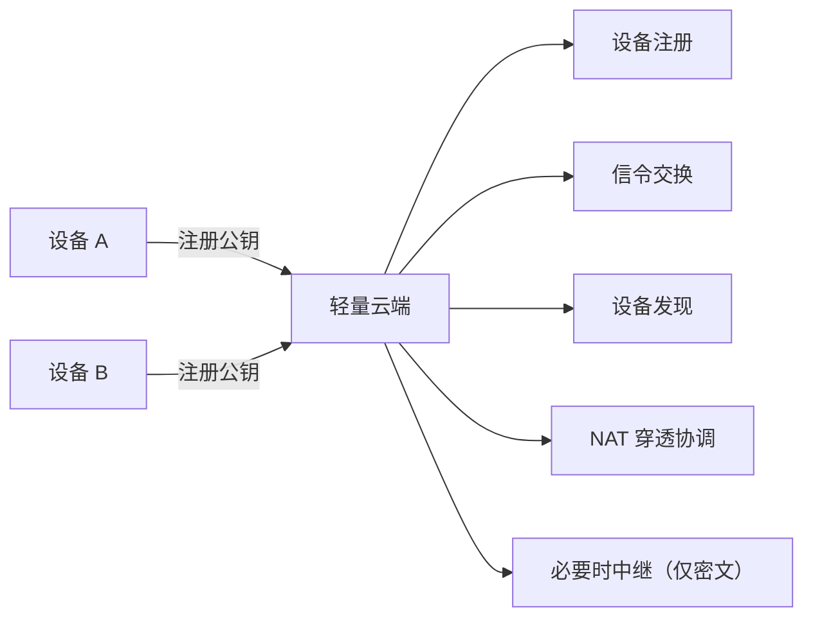

# Personal Hub · API 与通信协议 / 云端职责

- 日期：2026-11-19
- 阶段：P0 设计，**已按架构基线对齐**（**未实现 / 未真机测试**）
- 唯一架构事实源：[ARCHITECTURE_BASELINE_v1.0.md](ARCHITECTURE_BASELINE_v1.0.md)
- 前置：[04-network-topology.md](04-network-topology.md)、[09-data-model.md](09-data-model.md)

---

## 1. 协议分层

| 层 | 用途 | 安全 | 现状 |
|---|---|---|---|
| 配对面 | 邀请/配对/身份确认 | HTTPS + SPKI 固定 + 邀请签名 | 部分复用现有 `/v1/pair`（`mobile_sync`） |
| 信令面 | 会话请求/设备发现/NAT 协调 | 签名 + 绑定 session/nonce/过期 | 待建设（轻量云端） |
| 同步面 | 文件/任务数据 | TLS + SPKI + XSalsa20-Poly1305 + AAD | 有（现有 `/v1/changes` `/v1/ops` `/v1/files`） |
| 媒体面 | 屏幕视频/音频 | DTLS-SRTP / 加密 DataChannel | 待建设（P6，依赖 P5 通过） |
| 控制面 | 键鼠/触摸/剪贴板指令 | 加密 DataChannel + 序号 + 防重放 | 待建设（P6，依赖 P5 通过） |

---

## 2. 配对面端点（部分复用现有）

- `POST /v1/pair`（现有）—— 扩展携带设备公钥 + 身份签名。
- 二维码 `taskdock://pair?...&tls=<SPKI指纹>`（现有）—— 扩展含 invitation_id/nonce/expires/signature。
- 邀请一次性、5 分钟默认有效（[05](05-identity-and-pairing.md) §2）。

---

## 3. 会话请求结构（控制面入口）

```json
{
  "controller_device_id": "…",
  "target_device_id": "…",
  "session_id": "…",
  "requested_permissions": ["SCREEN_VIEW", "INPUT_TOUCH"],
  "session_nonce": "…",
  "expires_at": "…",
  "controller_signature": "…",
  "replay_guard": { "sequence": 1, "monotonic_counter": 42 }
}
```

- 被控端验签 → 校验撤销表 → 强制本地认证 → 签发 `LocalAuthGrant` → 权限裁决 → 建立通道（[08](08-permission-and-session.md)）。
- **未经认证的控制指令不得执行**（[06](06-threat-model.md) T5/T6）。

---

## 4. 控制消息与防重放

```text
ControlMessage {
  session_id, message_seq, timestamp,
  permission_required, payload, message_mac
}
```

- 每条消息带序号 `message_seq`（单调）+ `message_mac`（会话密钥 AEAD）；序号回退/重复 → 拒绝（[06](06-threat-model.md) T11）。
- 会话密钥每会话协商（X25519），会话结束即弃；高风险操作需再次认证标记。

---

## 5. 错误码约定

| 错误 | 语义 | 处理 |
|---|---|---|
| `INVALID_INVITATION` | 邀请过期/重复/签名错 | 拒绝配对，记审计 |
| `IDENTITY_MISMATCH` | 身份/指纹/签名不符 | 进入 `SESSION_FAILED` |
| `DEVICE_REVOKED` | 设备已撤销 | 拒绝 + 终止 |
| `LOCAL_AUTH_REQUIRED` | 未完成本机认证 | 拒绝控制指令，必须认证 |
| `PERMISSION_DENIED` | 权限不足 | 拒绝该项操作 |
| `SESSION_EXPIRED` | 会话过期 | 清理，需重建 |
| `REPLAY_DETECTED` | 序号/nonce 重复 | 立即终止会话并告警 |

---

## 6. TaskDock 云端 Control Plane 职责（基线 §3.A/§7.4，D6）

> 云端为 v1.0 **必需项**（非可插拔/延后）；技术栈锁定 Node 22 + TS + Fastify 5 + WebSocket + PostgreSQL + coturn。
> 只存公钥与最小元数据；无签发授权能力；TURN 只转密文（D6/D7）。



**云端只做**：设备注册、信令交换、设备发现、NAT 穿透协调、必要的中继。
**云端不做**：不默认承担视频/文件/控制数据；不持有设备私钥；不能直接获得远控权限；信令服务器被攻破也不能签发被控端授权（[06](06-threat-model.md) T6/A3）。

> P0 审计时项目无此云端；2026-11-19 实现进度更正：`services/personal-hub-control-plane/`
> 已有服务实现，真实部署未验证。现有 "Relay" 是本地 Agent 编排（`docs/RELAY_INTEGRATION.md`），
> 与本云端无关；运维仍遵循 ADR-0007。

## 7. 2026-11-19 云端 WebSocket 连接与投递实现

- `/v1/signaling` 路由在 WebSocket 插件安装后注册，避免升级请求按普通 HTTP 处理而返回 500。
- 同一 `AppDeps` 服务实例共享已认证连接表，服务实例之间隔离；一台设备可以有多个连接。
  `signal.forward` 将完整签名信封作为 `signal.deliver.payload` 投递到该实例中的目标设备连接，
  密文与签名不变；发送者回执仍为 `{ id?, ok, data }`，**回执成功不代表目标在线或已确认收到**。
- 首帧认证成功后，`signal.forward.fromDeviceId` 和其他操作的 `deviceId` 必须等于连接认证身份；
  不符返回 `IDENTITY_MISMATCH`，不执行操作。并发首帧认证返回 `AUTH_IN_PROGRESS`，不切换身份。
- `revocation.publish` 的既有自撤销语义不变，事件向同服务已认证连接广播；这不等于
  PC 撤销任意已配对手机的跨端撤销链路已完成。
- 关闭连接后从连接表移除；同设备仍有连接时不标离线；最后一个连接关闭才标离线。
  认证等待期间关闭不得遗留连接或晚到成功回执；并发请求的错误回执关联各自 `id`。
- Breaking Change: **No**。端点、请求/成功响应字段、签名算法与数据模型不变；新增错误码只用于
  原本应拒绝的连接身份替换和并发认证请求。无数据库迁移；云端信令不授予任何远控权限。
- 实测边界：内存仓储 + 模拟 socket / Fastify `injectWS`；未验证 TLS、真实 PG、跨进程路由、
  STUN/TURN、跨网络或端侧 WebRTC。多服务进程间的投递尚无本轮验证依据。
