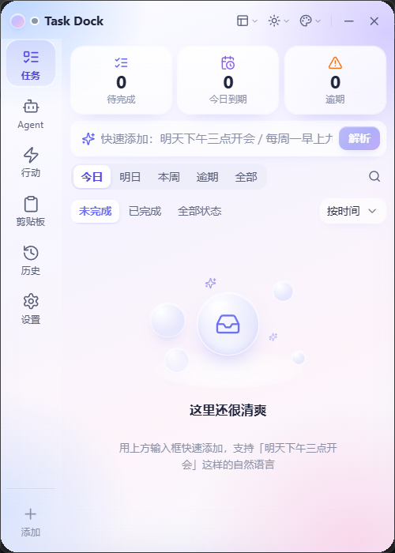
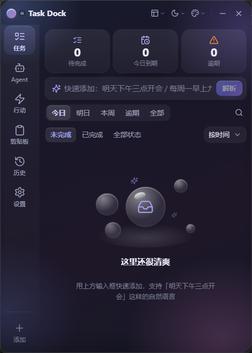
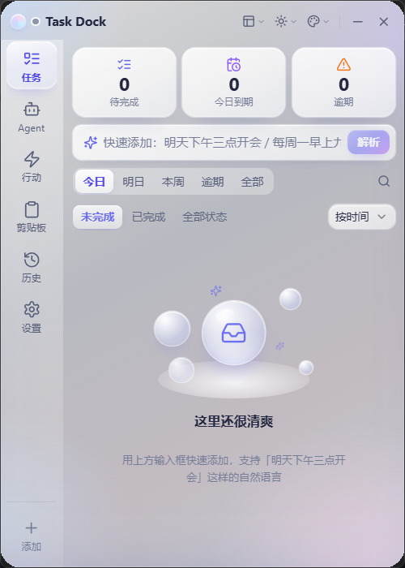
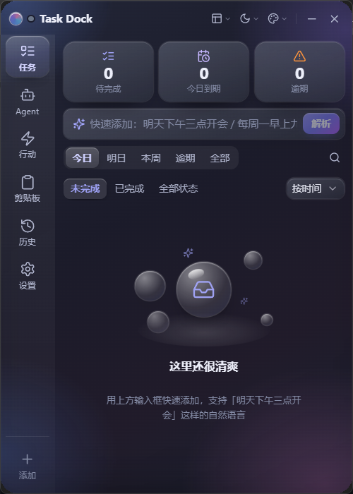
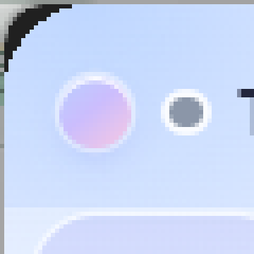
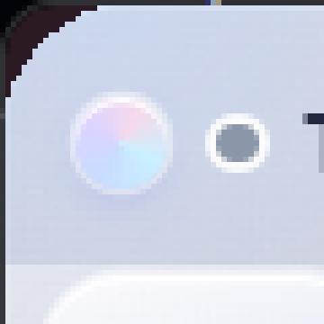

# 07 · 视觉验收（实际运行截图与证据）

> 原则：**视觉验收的第一依据是需求给出的两张效果图**，业务行为的第一依据是现有代码与测试。
> 本文只记录**真实产生的截图**与其可复现的判定方法，不做无证据的结论。

---

## 1. 证据类型说明

| 类型 | 目录 | 说明 | 可否作为原生窗口验收 |
| --- | --- | --- | --- |
| 浏览器 harness 截图 | `docs/screenshots/v06/*.png`（非 `native-` 前缀） | 真实 `dist` 产物 + IPC mock + 模拟壁纸，2× 缩放 | ❌ 只能验证 CSS 布局与配色 |
| **原生窗口截图** | `docs/screenshots/v06/native-*.png` | 真实 Release 程序的 Win32 窗口，**桌面合成像素** | ✅ 可验证圆角、材质、层级 |
| 圆角几何校验 | `scripts/check-corners.py` 输出 | 角点像素 vs 窗口外桌面像素的差值 | ✅ 客观判定 |

原生截图环境：**Windows 11（build 26100）· 125% DPI · 1920×1440 逻辑分辨率的 2560×1440 屏幕 · Release 构建**。

> **两类截图必须分开看**：harness 图是「Web 内容渲染结果」，用于检查布局、配色、
> 弹层层级与交互状态；原生图是「真实 Win32 窗口的桌面合成像素」，额外用于检查
> 圆角裁剪、原生材质透出与窗口层级。harness 图**不能**替代原生验收，
> 原生图也**不能**覆盖同分辨率下的 CSS 细节走查。

---

## 2. 原生窗口证据（核心）

### 2.1 梦幻渐变 · 浅色



- 左侧垂直导航（任务/Agent/行动/**剪贴板**/历史/设置）+ 底部「添加」
- 标题栏：品牌球 + Agent 状态点 + 模式/明暗/预设三组菜单 + 最小化 + 关闭
  （**完整模式不再有剪贴板按钮**，剪贴板入口在左侧导航第 4 项）
- 三张统计卡（图标语义色）、快速添加（渐变「解析」按钮）、日期/状态筛选、排序
- 空状态玻璃气泡插画

### 2.2 梦幻渐变 · 深色



### 2.3 液态玻璃 · 浅色



窗口可见桌面透出（右下角带出壁纸的暖色调），卡片为半透明玻璃面 + 顶部内高光。

### 2.4 液态玻璃 · 深色



### 2.5 极简模式（原生窗口自身绘制内容）


极简模式保持原有用途：**待办数 / 下次到期 / 全局空闲状态**一行三块，
标题栏只保留品牌、剪贴板、最小化、关闭（明暗与预设菜单按需隐藏，避免 280px 宽度溢出）。
紧凑/极简没有左侧导航，剪贴板入口仍由标题栏按钮提供。
圆角同样生效。

> 注：原生窗口在「隐藏状态下切换尺寸」时，本机观察到 WebView2 子窗口尺寸未跟随外框
> （外框 500×700，内容按极简尺寸 350×175 绘制）。这是 v0.5 既有行为，与本次视觉重构无关，
> 已列入第 6 节未验证项；harness 侧的极简/紧凑布局截图见第 4 节。

---

## 3. 四角黑色直角：修复证据

### 3.1 判定方法（两层客观证据）

**第一层：直接读 Win32 窗口区域**（与 z-order、与截图无关）

`scripts/native-verify.ps1` 调用 `GetWindowRgn` + `PtInRegion`，直接问系统
「窗口的四个角点还在不在窗口里」：

| 截图 | `region_probe` | 区域边界框 | 含义 |
| --- | --- | --- | --- |
| `native-dream-light.png` | `00001` | `0,0,500,700` | 四个角点**都在区域外**（被裁掉），中心在区域内，区域尺寸=窗口尺寸 |
| `native-glass-light.png` | `00001` | `0,0,500,700` | 同上 |
| `native-glass-dark.png` | `00001` | `0,0,500,700` | 同上 |
| `native-dream-dark.png` | `00001` | `0,0,500,700` | 同上 |

> 「角点不在窗口区域里」= 那些像素根本不属于这个窗口 → **DWM 的系统背景（Mica/Acrylic）
> 不可能在那里绘制**，v0.5 的黑色直角在几何上被排除。
> 附带的 `ontop_check`（屏幕中心像素 vs `PrintWindow` 中心像素）差值为 0，
> 说明抓到的确实是应用本身而不是别的窗口。

**第二层：桌面合成像素比对**

`native-*.png`（窗口矩形）与 `native-*-context.png`（同一次整屏抓取中窗口周边 60px）
来自**同一帧**截图，因此「窗外桌面像素」就是「透过圆角裁剪应该看到的像素」。
`scripts/check-corners.py` 比较四个 6×6 角块：

| 截图 | 四角平均差 | 判定 |
| --- | --- | --- |
| `native-dream-light.png` | 0.0 / 0.0 / 0.0 / 0.0 | ✅ PASS |
| `native-glass-light.png` | 0.0 / 0.0 / 0.0 / 0.0 | ✅ PASS |
| `native-glass-dark.png` | 0.0 / 0.0 / 0.0 / 0.0 | ✅ PASS |
| `native-dream-dark.png` | 0.0 / 0.0 / 0.0 / 0.0 | ✅ PASS |

**差值为 0 意味着角点像素与窗外桌面逐像素完全一致** → 四角是「被裁掉的透明区域」，
而不是 v0.5 那种一整块与桌面无关的深色直角。

> 取证前置条件（已写入脚本注释）：验收数据目录需 `snap_enabled=false` 且清理 `snap_state`，
> 否则贴边吸附可能在光标靠近屏幕边缘时把窗口滑出屏幕（只留 6px 触发条），
> 抓到的是别的窗口。这正是 v0.5 期间「原生截图时好时坏」的真实原因之一。

### 3.2 放大图（6×）





可以看到窗口边缘呈圆弧过渡，弧外是桌面本身（深色壁纸），弧内是窗口内容；
**没有出现直角黑块**。

### 3.3 复现命令

```powershell
powershell -ExecutionPolicy Bypass -NoProfile -File scripts/native-verify.ps1 `
  -Out docs/screenshots/v06/native-dream-light.png -WaitSeconds 12
python scripts/check-corners.py docs/screenshots/v06/native-dream-light.png
```

---

## 4. 浏览器 harness 走查矩阵

| 截图 | 预设 / 明暗 / 材质 / 宽度 | 验证点 |
| --- | --- | --- |
| `dream-light-400.png` | 梦幻 / 浅 / glass / 400 | 基线布局 |
| `dream-dark-400.png` | 梦幻 / 深 / glass / 400 | 深色层级 |
| `glass-light-400.png` | 液态 / 浅 / glass / 400 | 玻璃语言 |
| `glass-dark-400.png` | 液态 / 深 / glass / 400 | 深色玻璃 |
| `dream-light-400-solid.png` | 梦幻 / 浅 / solid / 400 | 原生不可用时的回退 |
| `glass-light-400-solid.png` | 液态 / 浅 / solid / 400 | 玻璃语义的**不透明**版本 |
| `dream-light-340.png` | 梦幻 / 浅 / glass / 340 | 导航收敛为仅图标 |
| `glass-light-320.png` | 液态 / 浅 / glass / 320 | 极窄窗 |
| `dream-empty-400.png` | 梦幻 / 浅 / glass / 400 | 空状态插画 |
| `glass-empty-400.png` | 液态 / 浅 / glass / 400 | 空状态 + 玻璃 |
| `dream-empty-dark.png` | 梦幻 / 深 / glass / 400 | 深色空状态 |
| `glass-many-400.png` | 液态 / 浅 / glass / 400 | 60 条任务的密度 |
| `settings-presets.png` | 梦幻 / 浅 / glass / 400 | 设置页预设选择卡 |
| `glass-light-tasks.png` | 液态 / 浅 / glass / 400 | 常规任务列表 |
| `dream-minimal-280.png` | 梦幻 / 浅 / glass / 280 | 极简模式未受影响 |
| `glass-compact-400.png` | 液态 / 浅 / glass / 400 | 紧凑模式未受影响 |

自动化判定（`scripts/visual-themes.mjs`）：16 个场景全部
`scrollWidth - clientWidth = 0`、关键元素无越界、运行期 0 错误。

### 4.1 v0.6 交互场景走查（`scripts/visual-v06.mjs`）

需求点名的七个场景，**两套预设 × 明暗**各出图：

| 场景 | 梦幻渐变 · 浅 | 梦幻渐变 · 深 | 液态玻璃 · 浅 | 液态玻璃 · 深 |
| --- | --- | --- | --- | --- |
| 任务页 + 排序菜单展开 | `dream-light-tasks-sort-menu.png` | `dream-dark-tasks-sort-menu.png` | `glass-light-tasks-sort-menu.png` | `glass-dark-tasks-sort-menu.png` |
| 设置页 + 主题下拉展开 | `dream-light-settings-theme-select.png` | `dream-dark-settings-theme-select.png` | `glass-light-settings-theme-select.png` | `glass-dark-settings-theme-select.png` |
| 日期时间选择浮层 | `dream-light-datetime-overlay.png` | `dream-dark-datetime-overlay.png` | `glass-light-datetime-overlay.png` | `glass-dark-datetime-overlay.png` |
| 剪贴板主页面 | `dream-light-clipboard-page.png` | `dream-dark-clipboard-page.png` | `glass-light-clipboard-page.png` | `glass-dark-clipboard-page.png` |
| 剪贴板关联抽屉 | `dream-light-clipboard-link-drawer.png` | `dream-dark-clipboard-link-drawer.png` | `glass-light-clipboard-link-drawer.png` | `glass-dark-clipboard-link-drawer.png` |
| 深色主题菜单 | `dream-dark-titlebar-menu.png` | — | `glass-dark-titlebar-menu.png` | — |
| 320px 窄布局 | `dream-light-320-narrow.png` | — | `glass-light-320-narrow.png` | — |

> 剪贴板**主页面**与**关联抽屉**分别出图：v0.6 起两者是不同形态
> （页面 = 侧边栏第 4 项；抽屉 = 任务关联的临时面板），
> 合并成一张图会掩盖两者的层级差异。

### 4.2 v0.6 布局回归走查（`scripts/layout-regression.mjs`）

37 个组合的审计产物：`docs/screenshots/v06/layout-audit.json` + `layout-*.png`。
断言见 [05-test-plan.md](05-test-plan.md) 第 2.3 节（六个入口可达、快速添加不被遮挡、
无横向溢出、运行期 0 错误）。

---

## 5. 与效果图的对照

| 效果图特征 | 实现情况 | 说明 |
| --- | --- | --- |
| 左侧竖排导航，图标在上、文字在下 | ✅ 一致 | 宽度按 400px 基线压缩到 62px |
| 选中项有淡色底 + 左侧竖条 | ✅ 一致 | 梦幻渐变用淡紫药丸；液态玻璃用玻璃胶囊 |
| 顶部标题栏：品牌 + 右侧图标组 | ✅ 一致 | 增加了预设切换入口与 Agent 状态点 |
| 三张统计卡（图标/数字/标签） | ✅ 一致 | 语义色只作用于图标与逾期标签 |
| 快速添加 + 渐变主按钮 | ✅ 一致 | 按钮走 `--accent-gradient` |
| 筛选药丸 + 搜索 + 排序 | ✅ 一致 | 容器与选中态分离，减少重复背景 |
| 空状态气泡插画 | ⚠️ 近似 | 纯 CSS/SVG 静态实现，无实时折射 |
| 窗口外有明显投影 | ❌ 未实现 | 窗口区域裁剪后 DWM 不绘制外部阴影（03 文档说明） |
| 玻璃卡片更透 | ⚠️ 取舍 | 为保证文字对比度，浅色卡片不透明度提到 74–86% |

---

## 6. 未验证项（明确标记，不虚构通过）

| 项 | 原因 | 复现方法 |
| --- | --- | --- |
| Windows 10 真机 | 本机仅 Windows 11 | 在 Win10 上执行 03 文档第 8 节的取证脚本 |
| 100% / 150% DPI | 本机显示缩放为 125% | 改显示缩放后重跑取证脚本，并核对 `--radius` 与 CSS 半径一致 |
| Dev 模式（`npm run tauri dev`） | 本轮只验证 Release | 执行 `npm run tauri dev` 后人工核对 |
| 拖动 / 贴边吸附 / 缩放的交互回归 | 当前环境无法稳定模拟桌面拖拽 | 手工：拖动窗口至屏幕边缘，确认收起条与展开；拖动改尺寸，确认圆角与内容同步 |
| 隐藏状态下切换窗口模式后 WebView2 子窗口尺寸跟随 | 本机观察到外框 500×700 而内容按 350×175 绘制（v0.5 既有行为） | 切换到紧凑/极简后观察窗口外框与内容尺寸是否一致 |
| 托盘菜单 / 全局热键 | 需要人工点击托盘 | 托盘右键切主题、切模式；`Ctrl+Alt+T` 显示/隐藏 |
| 长时间常驻的内存与 GPU 曲线 | 需要长时间挂机观察 | 挂机 8 小时后查看任务管理器与性能计数器 |
| 真实彩色壁纸下的主观玻璃观感 | 桌面壁纸不可控 | 在 colorful 壁纸上人工评估（可参考 harness 的模拟壁纸图） |

---

## 7. 结论

- 需求给出的两张效果图所定义的**结构**（左侧竖排导航、图标+文字、三统计卡、快速添加主入口、
  药丸筛选、空状态插画、标题栏图标组）已在两套预设中一致实现，并有实际运行截图。
- v0.5 的**四角黑色直角**已通过 Win32 窗口区域裁剪修复，客观证据为四角像素与桌面完全一致（diff = 0.0）。
- 两套预设、明暗、材质三种维度可任意组合且即时生效、重启恢复；
  原生材质不可用时自动回退且保持一致视觉语言。
- 性能实测：空闲近零开销、0 个 `backdrop-filter`、无常驻动画。
- 未验证项已在第 6 节逐条列出，均给出可执行的复现步骤，不以推测代替结论。
