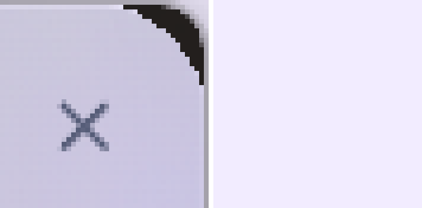
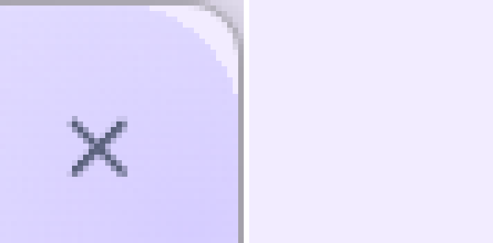
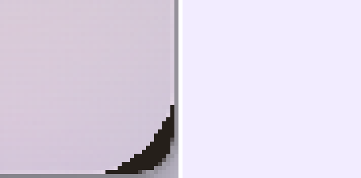
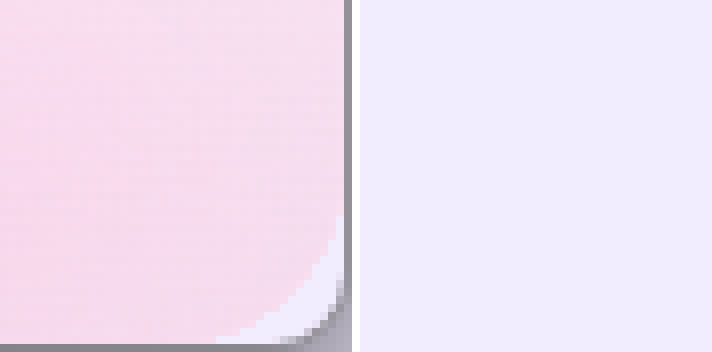
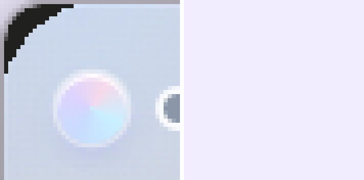
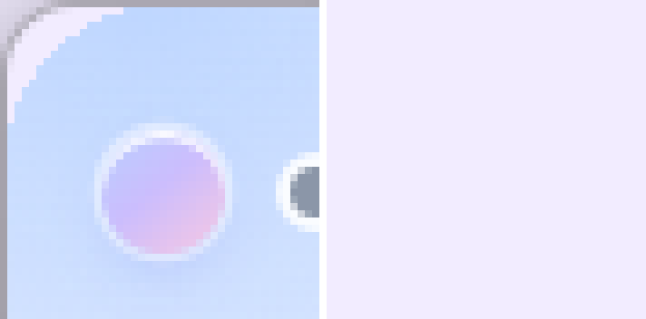
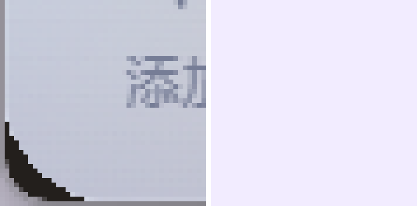
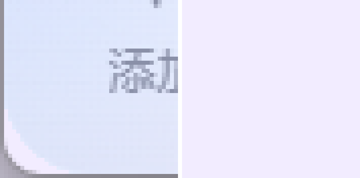
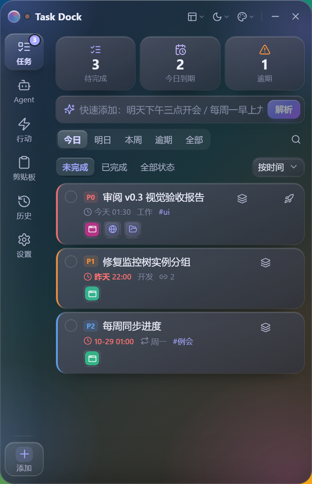

# 12 · v0.6 窗口圆角专项整改报告

> 日期：2026-10-31
> 范围：v0.6 真机截图中出现的「右下/右上黑色楔形、黑色描边、直角残留」，
> 以及旧的圆角像素验收（`07-visual-acceptance.md` 第 3 节）假阳性问题。
> 原则：**以实际窗口呈现为最终标准**。凡是本机当前无法取证的项目，一律标记
> `UNVERIFIED`，不以代码推断、`GetWindowRgn` 成功或同帧自比代替真机结论。

## 0. 结论先行

| 项目 | 状态 |
| --- | --- |
| 黑角根因定位（Mica/DWM 背景越过窗口区域 + 区域缓存/重入 + 1px 边框） | ✅ 已定位，有真机像素与 DWM 读数 |
| 窗口区域缓存 / 重入 / 恢复后重算 | ✅ 已改代码 + Rust 单测 |
| 原生玻璃后端与区域裁剪的兼容策略 | ⚠️ **代码 + Rust 单测通过**；`blur` 的实际像素效果依赖解锁后的原生矩阵 |
| 圆角像素验收脚本（独立背景基线，缺基线不得 PASS） | ✅ 已重建 + 合成用例测试 |
| 浏览器层 DOM/CSS 视觉与交互回归 | ✅ 32 场景审计通过 |
| **修复后原生窗口像素验收（黑角是否消失）** | ❌ **UNVERIFIED：当前 Windows 会话被锁屏，屏幕捕获为全黑** |
| 原生最小化/托盘/恢复/缩放/主题与材质切换回归 | ❌ **UNVERIFIED（同上）** |

**未验证之前，不宣称黑角已经修好。** 仓库中的「修复后」截图只有浏览器 harness
（Web 内容层），它不能证明 DWM/GDI 合成后的窗口角部像素。

---

## 1. 问题编号与现象

| 编号 | 优先级 | 现象 / 截图区域 | 根因 | 状态 |
| --- | --- | --- | --- | --- |
| V06-P0-1 | P0 | 调整窗口大小、最小化/恢复后，圆角区域停留在旧尺寸；四角重新露出直角或内容被裁 | 区域缓存只记 `(宽, 高, 半径)`，不含 `hwnd`/DPI，也不回读系统实际区域；缩放重入时后到的请求被直接丢弃 | 代码已修，单测通过；原生回归 UNVERIFIED |
| V06-P0-2 | P0 | 液态玻璃（Mica）四角出现近黑色月牙，尤其右下角、右上角（`corners/before-glass-*.png`） | Win11 的 Mica/Acrylic 是 DWM **SystemBackdrop**，按整个窗口矩形绘制，`SetWindowRgn` 管不到它；区域把 Web 内容裁圆后，DWM 背景仍填满窗口矩形四角 | 默认后端已改为与区域兼容的 blur；原生像素验收 UNVERIFIED |
| V06-P0-3 | P0 | 标题栏右上角：关闭按钮外侧出现黑色楔形/灰边，浅色下还有白色晕圈（`corners/before-solid-top-right.png`、`corners/before-glass-top-right.png`） | 与 P0-2 同源；另有 DWM 默认 1px 边框沿窗口矩形绘制。标题栏按钮本身未越界，残影来自原生合成层 | 区域半径 + 去除 DWM 边框 + 不叠加 DWM 背景；浏览器层无残影；原生 UNVERIFIED |
| V06-P0-4 | P0 | 旧验收表把四角判为 `0.0 ✅ PASS`，与真机黑角截图矛盾 | 旧脚本把**同一张截图内**的窗口角块与窗外桌面块比较（同一批像素），且只要 `GetWindowRgn` 成功就 PASS；没有独立背景基线 | 脚本已重建；旧证据在新标准下全部 `UNVERIFIED` 或 `FAIL`；旧 PASS 已撤回 |
| V06-P1-1 | P1 | 左侧导航顶部与标题栏之间有一条横向硬色带接缝 | `.rail` 的纵向渐变从顶部突然开始，且带 `border-right` | 已修：横向淡出背景 + `::before` 顶部 30px 渐隐 + 去掉硬分隔线 |
| V06-P1-2 | P1 | 矮窗口下侧栏最后一个入口被硬切；底部「添加」入口存在感弱 | 滚动区无底部渐隐；添加项是纯文字按钮 | 已修：滚动区底部 14px 渐隐 + 玻璃药丸式「添加」按钮（hover/active/focus-visible 齐备） |
| V06-P1-3 | P1 | 剪贴板整页仍像一张套在窗口里的卡片；窄窗（320/340）被通用内边距二次缩进，页脚/列表被裁 | `.clipboard-page` 自带边框、圆角与 `surface-base`；窄窗媒体查询的 `.tab-content` 内边距特异性相同、后声明覆盖了 `padding:0` | 已修：页面透明铺满 + 页内滚动 + 窄窗显式 `padding:0` |
| V06-P1-4 | P1 | 双主题四组合（梦幻浅/深、液态浅/深）与 Solid 回退的一致性回归 | 主题变量与侧栏/剪贴板结构改动后的回归缺口 | 浏览器 32 场景审计通过；原生主题切换 UNVERIFIED |
| V06-P2-1 | P2 | 任务编辑器里展开日期选择器时按 Escape，日期弹层与编辑器**同时**关闭 | 编辑器注册为 `dialog`（优先级最高），Escape 优先级与 z 序不一致 | 已修：新增 `modal` 种类，优先级按 z 序重排；单测 + 浏览器审计通过 |
| V06-P2-2 | P2 | Select/Combobox/DateTimePicker/DropdownMenu/Tooltip 在窗口边缘被裁/遮挡；六个侧栏入口可达性 | 弹层定位与窄窗布局回归缺口 | 浏览器审计通过（32 场景、4 交互、0 失败）；原生弹层 UNVERIFIED |

---

## 2. 真机证据与根因

### 2.1 采集方法（可复现）

`scripts/corner-lab.ps1` 在受控背景下采集三帧，`scripts/check-corners.py` 以
**独立基线**判定：

1. 全屏铺一块纯色置顶背景（本次 `242,236,255`），截图得到 **基线帧**（窗口隐藏）；
2. 显示应用窗口，截取 **可见帧**；再隐藏窗口截取 **基线帧**；
3. 只有基线帧在窗口四角与远处都等于预期纯色时，基线才有效；
4. 在窗口矩形坐标内，取「窗口外、圆角内」的像素与基线逐像素比较；同时检测
   深色连通块（黑楔/黑边）、1px 描边、外扩阴影，并从可见/基线差分测量圆角半径；
5. 没有有效基线、窗口不在预期位置、区域读数异常 → `UNVERIFIED`，**绝不 PASS**。

采集环境：Windows 11 build 26100、125% DPI（物理/逻辑 = 1.25）。窗口外框
`500×700` **物理像素**（约 400×560 逻辑），区域包围盒同为 `0,0,500,700`；
逻辑半径 18/20 → 物理 22/25，分析器按 22px 作为预期值。

### 2.2 修复前：液态玻璃（Mica）被判 FAIL

元数据：`docs/screenshots/v07/lab-glass-region-dwm.json`
（`region_probe=00001 bounds=0,0,500,700`，
DWM `corner_preference=2, system_backdrop=2` = Mica，`material=glass`）。
分析：`corners/glass-region-dwm-analysis.json`，`status=FAIL`。

| 角 | 透明像素比例 | 与背景不符像素 | 深色像素 | 深色连通块 |
| --- | --- | --- | --- | --- |
| 左上 | 0.000 | 49 | 45 | 45 |
| 右上 | 0.000 | 49 | 44 | 44 |
| 左下 | 0.000 | 49 | 45 | 45 |
| 右下 | 0.000 | 49 | 44 | 44 |

同时检测到底边外 1px 深色描边 `ΔL=101.0`、右边外 1px `ΔL=59.3`。
即：**区域已经设置成功，但 DWM 仍在区域外画东西**。这正是用户看到的黑月牙。

> 旧元数据没有记录 `DwmGetWindowAttribute` 的 HRESULT。本机该版本对
> `DWMWA_BORDER_COLOR`/`DWMWA_NCRENDERING_POLICY` 的读取返回
> `E_INVALIDARG (0x80070057)`，旧记录里的 `border_color=0` 是读取失败后的默认值，
> 不能当作「边框已去掉」。新脚本已记录 `border_hr`，分析器对旧采集只给警告、
> 以像素判定为准。

### 2.3 修复前：Solid（无 DWM 背景）也被判 FAIL

元数据：`docs/screenshots/v07/lab-solid-region-dwm.json`
（`system_backdrop=1`，`material=solid`）。
分析：`corners/solid-region-dwm-analysis.json`，`status=FAIL`。

- 四角没有深色连通块（`dark=0`），说明黑月牙只在 Mica 下出现；
- 但四角与背景的吻合率仅 `0.102`，圆角外仍有 40–42 个像素不是背景；
- 右下实测半径 `31.75px`，预期 `22px`（误差 21.57px）；
- 底边/右边外 1px 仍是深色描边（`ΔL=101.0 / 59.3`）。

结论：**Solid 也并未真正呈现干净的 22px 圆角**，只是没有 Mica 那么黑。
用户报告的「灰色描边、白色晕圈、直角残留」与这组数据一致。

### 2.4 修复前：缩放链路

`lab-resize-solid-region-dwm.json` 经同一分析器判定 `status=FAIL`，
数值与 2.3 相同（透明度 0.102、右下半径 31.75px、底/右 1px 描边）。
说明旧实现即使重新应用区域，也没有得到与窗口一致的半径/边框，
`GetWindowRgn` 成功不能证明最终像素正确。

### 2.5 修复前截图

| 区域 | 液态玻璃 | Solid |
| --- | --- | --- |
| 右上（含关闭按钮） |  |  |
| 右下 |  |  |
| 左上 |  |  |
| 左下 |  |  |

---

## 3. 修复内容

### 3.1 窗口区域：缓存身份 + 实际区域校验 + 重入合并

文件：`src-tauri/src/window_shape.rs`

- 缓存从 `(宽, 高, 半径)` 改为 `RegionStamp { hwnd, width, height, radius, scale_milli }`，
  **句柄、物理尺寸、DPI、半径任一变化都失效**；
- 命中缓存前先用 `GetWindowRgn` + `GetRgnBox` + `PtInRegion` 回读**实际区域**：
  无区域、包围盒与窗口不符、`(1,1)` 仍在区域内（区域被重置成直角）都视为失效并重设；
- `APPLYING` 重入不再直接丢弃：内层请求置 `PENDING`，外层每次 pass 重新读取
  `outer_size()`，最多 8 次直到窗口稳定；检查 `PENDING` 与清除 `APPLYING` 之间的
  竞态再补一次异步应用，保证拖拽缩放的最后一帧不会漏算；
- 区域尺寸使用 `CreateRoundRectRgn(0,0,w+1,h+1,2r,2r)`，避免最后一行/列被裁；
- `TASK_DOCK_WINDOW_REGION=0` 时清空缓存，防止下次开启时误判为已应用。

文件：`src-tauri/src/lib.rs`

- 主窗口在 `Resized`、`ScaleFactorChanged`、`Focused(true)` 时重新校验区域；
- `show_and_focus`（托盘/热键/唤回）显示后投递一次 `window_shape::apply`，
  覆盖最小化/隐藏期间系统重置区域的情况。

### 3.2 原生材质：不再让 DWM 背景与区域裁剪打架

文件：`src-tauri/src/commands/system.rs`

- 新增 `effective_backend(requested, build, region_enabled)`：
  - `auto` + Win11 + 区域裁剪开启 → **blur**（`SetWindowCompositionAttribute`，
    由窗口自身合成，受 `SetWindowRgn` 约束）；
  - `auto` + Win11 + 区域关闭（矩阵对照）→ 保持原 Mica 路径；
  - Win10 → 原 Acrylic 路径（同样是窗口合成）；
  - `mica`/`acrylic`/`blur`/`none` 显式指定时**原样保留**，供矩阵对照，
    不用「经验」替用户做决定；
- blur/none 分支先 `clear_mica` + `clear_acrylic`，避免残留 DWM 背景；
- 新增单测：
  - `win11_auto_backend_avoids_dwm_backdrop_when_region_clipping`
  - `explicit_backend_is_never_rewritten`

这不是「移除所有原生玻璃」：默认路径仍是原生 blur，Solid 回退不变；
只有被真机证明会越界的 Mica/Acrylic SystemBackdrop 在区域裁剪时不被默认使用。

### 3.3 DWM 角与边框

`src-tauri/src/window_shape.rs::apply_dwm`

- `DWMWA_WINDOW_CORNER_PREFERENCE` 读取后再设置，避免每次 resize 重复写；
- `DWMWA_BORDER_COLOR = DWMWA_COLOR_NONE (0xFFFFFFFE)` 去除 DWM 默认 1px 边框，
  可用 `TASK_DOCK_WINDOW_DWM_BORDER=0` 关闭该行为做对照；
- `TASK_DOCK_WINDOW_DWM_CORNER=0|dontround` 保留诊断开关；
- 环境变量组合：`TASK_DOCK_WINDOW_REGION`、`TASK_DOCK_GLASS_BACKEND`、
  `TASK_DOCK_WINDOW_DWM_CORNER`、`TASK_DOCK_WINDOW_DWM_BORDER`。

### 3.4 验收脚本：没有独立基线就不许 PASS

文件：`scripts/check-corners.py`、`scripts/test-check-corners.py`

- 必须同时具备 `corner-lab` 元数据、可见帧、**隐藏窗口后的独立基线帧**；
- 基线必须证明四角与远处都是受控纯色且与预期一致，否则 `UNVERIFIED`；
- 判定项：圆角外像素与基线吻合度、深色连通块、1px 描边/外扩阴影、半径拟合、
  DWM 角偏好与边框可读性、区域读数；
- 退出码：`0` 全 PASS、`1` 至少一个 FAIL、`2` 无 FAIL 但有 UNVERIFIED；
- `scripts/test-check-corners.py` 用合成帧覆盖五种结论：
  `clean-rounded=PASS`、`square-black-wedges=FAIL`、`invalid-baseline=UNVERIFIED`、
  `missing-baseline=UNVERIFIED`、`dwm-only-rounded=OBSERVE`，全部符合预期。

### 3.5 标题栏右上角

- 残影的主因是 3.1–3.3 的原生合成层，不是标题栏 DOM；
- 浏览器审计确认：400px 宽下关闭按钮完整位于窗口内、无裁剪、无越界
  （`v07-dream-light-tasks-400x620.png` 等 32 张）；
- 原生修复后像素验收仍待解锁后执行（见第 8 节）。

---

## 4. 修复后验收（当前可执行的部分）

### 4.1 分析器自检

```
python scripts/test-check-corners.py
→ OK: analyzer verdicts match expectations
```

### 4.2 旧证据在新标准下的结论

| 证据 | 新分析器结论 | 说明 |
| --- | --- | --- |
| `docs/screenshots/v06/native-dream-light.png` | `UNVERIFIED`（exit 2） | 缺 `native-dream-light.json`，没有独立基线 |
| `docs/screenshots/v07/lab-glass-region-dwm.json` | `FAIL`（exit 1） | 四角 44–45 个深色像素、49 个非背景像素、底/右 1px 描边 |
| `docs/screenshots/v07/lab-solid-region-dwm.json` | `FAIL`（exit 1） | 圆角外 40–42 个非背景像素、半径 31.75 vs 22、底/右 1px 描边 |
| `docs/screenshots/v07/lab-resize-solid-region-dwm.json` | `FAIL`（exit 1） | 与上同，缩放链路未改善 |
| `docs/screenshots/v07/lab-v071-solid-region-dwm.json` | `FAIL` + `UNVERIFIED` | 锁屏会话采集，基线 `0,0,0` 无效；分析器正确拒绝 |

**旧的「四角平均差 0.0 ✅ PASS」已撤回**：它既没有独立基线，又把同一帧的像素
互相比对，无法发现黑角。

### 4.3 修复后原生矩阵（待执行，当前 UNVERIFIED）

`scripts/diagnose-corner.ps1` 已支持 4 个几何单元 × Solid/Glass：

| 单元 | Region | DWM 角 | 目的 |
| --- | --- | --- | --- |
| `region-dwm` | 1 | 1 | 产品默认组合 |
| `region-only` | 1 | 0 | 区域单独能否裁干净 |
| `dwm-only` | 0 | 1 | DWM 单独能否给出圆角（仅观察） |
| `neither` | 0 | 0 | 空白对照（仅观察） |

命令示例（解锁后执行）：

```powershell
powershell -ExecutionPolicy Bypass -NoProfile -File scripts/diagnose-corner.ps1 `
  -OutDir docs/screenshots/v07/matrix -Backends auto,blur,mica
python scripts/check-corners.py docs/screenshots/v07/matrix/*.json --summary
```

另外需用 `scripts/native-verify.ps1 -ResizeTo ... -MinimizeCycle` 复核：

- 最小化 → 托盘隐藏 → 重新显示；
- 拖动缩放（连续 resize）后的最终圆角；
- 最大化/还原（若该窗口允许）；
- 主题切换（浅/深）与素材切换（glass/solid）后重算；
- 标题栏右上角关闭按钮外侧无黑楔、灰边、白晕。

在这些命令产生 `PASS` 之前，第 0 节的 UNVERIFIED 不会改为通过。

---

## 5. 修改文件与方法

| 文件 | 方法 / 位置 | 作用 |
| --- | --- | --- |
| `src-tauri/src/window_shape.rs` | `RegionStamp`、`apply_with_radius`、`apply_pass`、`region_is_current`、`apply_dwm` | 缓存身份、区域回读、重入合并、DWM 角/边框 |
| `src-tauri/src/commands/system.rs` | `region_clipping_enabled`、`effective_backend`、`apply_window_material`、`#[cfg(test)] mod tests` | 区域兼容的原生玻璃后端 |
| `src-tauri/src/lib.rs` | `restore_window`、`show_and_focus` | 恢复/聚焦后重算区域 |
| `scripts/check-corners.py` | 全文件 | 独立基线 + 像素/几何联合判定 |
| `scripts/test-check-corners.py` | 新增 | 分析器结论合成测试 |
| `scripts/corner-lab.ps1` | 新增/重写 | 受控背景、可见/基线/恢复帧、缩放与最小化循环、DWM HRESULT |
| `scripts/native-verify.ps1` | 重写 | 单次真机取证入口 |
| `scripts/diagnose-corner.ps1` | 重写 | 4 几何单元 × 材质矩阵 |
| `src/lib/overlayStack.ts` | `OverlayKind`、`KIND_PRIORITY` | Escape 优先级与 z 序一致 |
| `src/components/tasks/TaskEditor.tsx` | `useOverlayLayer("modal", ...)` | 编辑器不再抢占日期弹层的 Escape |
| `src/lib/overlayStack.test.ts` | 优先级链 + 两条回归用例 | P2-1 防回归 |
| `src/styles-themes.css` | `.rail`、`.rail::before`、`.rail-items`、`.rail-add`、窄窗 `.tab-content-clipboard` | P1-1/P1-2/P1-3 |
| `src/styles.css` | `.clipboard-page`、`.clipboard-page .clip-foot::before` | P1-3 整页融合 |
| `src/components/FullView.tsx` | `tab-content-${tab}` | 为页面级布局提供作用域 |
| `scripts/visual-v07.mjs`、`scripts/serve-preview.mjs`、`scripts/make-preview.mjs` | 新增/更新 | 32 场景浏览器审计与预览产物 |

---

## 6. 修复前后截图

### 6.1 修复前（原生合成）

见 2.5 的四组放大图；完整窗口见
`docs/screenshots/v07/lab-glass-region-dwm-visible.png`、
`docs/screenshots/v07/lab-solid-region-dwm-visible.png`。

### 6.2 修复后（当前只有浏览器层）

| 组合 | 截图 |
| --- | --- |
| 梦幻渐变 · 浅 · 任务页（标题栏/四角在 Web 内容层的呈现） |  |
| 液态玻璃 · 浅 · 任务页 |  |
| 液态玻璃 · 深 · 任务页 |  |
| 梦幻渐变 · 深 · 任务页 |  |
| Solid 回退（液态玻璃预设） |  |
| 窄窗剪贴板整页（320×560） |  |
| 侧栏底部添加（hover） |  |

> 这些图证明 DOM/CSS 层没有黑角、没有标题栏残影、窄窗没有内缩；
> **不能证明 DWM 合成后的角部像素**。原生「修复后」截图必须在解锁会话后重采。

---

## 7. 交互与前端回归

### 7.1 浏览器审计（`scripts/visual-v07.mjs`）

产物：`docs/screenshots/v07/audit-v07.json`

- 32 个场景（4 种预设/明暗组合 × 模式/宽度/页面/弹层），`failed: []`；
- 全部 `overflowX/overflowY = 0`、`offscreen = []`、`blank = false`、`errors = []`；
- 六个侧栏入口在 320/340/380/400/500 宽下均可达，`rail.items = 6`，
  且每项都有非空 `aria-label`/`data-tip`；>384px 时文字标签可见；
- 剪贴板整页在 320/340 宽下 `clip.integrated = true`（不再被通用内边距缩进）；
- 添加按钮 hover/focus 样张：
  `v07-dream-light-add-hover.png`、`v07-dream-light-add-focus.png`。

### 7.2 Escape 层级

审计记录（两套主题一致）：

```
dtOpen:true → dtClosed:true → editorKept:true → editorClosed:true
drawerOpen:true → drawerZ:"80" → drawerClosed:true → editorKeptAfterDrawer:true
```

即：日期弹层 → 编辑器 → 抽屉逐层关闭，一次 Escape 只关一层，
不会顺带隐藏主窗口。

### 7.3 前端单元测试

`npx vitest run`：**40 个文件 / 290 条用例全部通过**（详见 `11-test-results.md`）。
其中 `overlayStack` 9 条，包含本次新增的优先级链与两条模态/菜单回归用例。

### 7.4 Rust 单元测试

`cargo +stable-x86_64-pc-windows-msvc test`：472 通过 / 3 失败 / 3 ignored，
明细与失败归因见 `11-test-results.md` 第 1.2 节。3 条失败均在
`navigation::router`（锁屏下置前被拒），不属于本报告改动模块；GNU 工具链的
cdylib 导出上限会导致链接失败，不能把 GNU 的退出码当作测试通过。本轮相关用例：

- `window_shape::tests::region_stamp_invalidates_on_every_identity_field`
- `window_shape::tests::last_pass_size_packs_positive_dimensions`
- `window_shape::tests::radius_is_clamped_and_persisted`
- `commands::system::tests::win11_auto_backend_avoids_dwm_backdrop_when_region_clipping`
- `commands::system::tests::explicit_backend_is_never_rewritten`

### 7.5 原生窗口操作

最小化、托盘隐藏/显示、缩放、最大化/还原、主题切换、显示模式切换、
材质切换的**原生**回归本轮无法执行（锁屏），见第 8 节。

---

## 8. 未验证项与原因

| 项 | 状态 | 原因 | 解锁后的复现方法 |
| --- | --- | --- | --- |
| 修复后四角像素（Solid） | UNVERIFIED | 会话锁屏，屏幕捕获全黑；基线帧为 `0,0,0`，分析器拒绝判定 | `native-verify.ps1 -Material solid -Preset dream-gradient`，再跑 `check-corners.py` |
| 修复后四角像素（Glass/blur） | UNVERIFIED | 同上 | `native-verify.ps1 -Material glass -Preset liquid-glass -Backend blur` |
| Region/DWM × Solid/Glass 全矩阵 | UNVERIFIED | 同上 | `diagnose-corner.ps1 -Backends auto,blur,mica,none` |
| 最小化 / 托盘隐藏 / 重新显示 | UNVERIFIED | 需要可见桌面与真实托盘交互 | `native-verify.ps1 -MinimizeCycle` + 手工托盘点击 |
| 缩放重入后的最终圆角 | UNVERIFIED | 需要真实拖拽/逐帧 resize | `native-verify.ps1 -ResizeTo 620x820` + 手工拖拽 |
| 最大化 / 还原 | UNVERIFIED | 主窗口无最大化按钮；是否允许取决于窗口样式，需真机确认 | `Win+Up` / 双击标题栏后截图分析 |
| 主题切换（浅/深/跟随系统） | UNVERIFIED | 需要真实 DWM 深色模式与窗口重绘 | 切换后各采一帧，比对四角 |
| 显示模式切换（完整/紧凑/极简） | UNVERIFIED | 需要真机窗口尺寸变化与区域重算 | 三种模式各跑一次 corner-lab |
| 材质切换（glass/solid 即时生效） | UNVERIFIED | 同上 | 运行中切换设置后复采 |
| Windows 10 / 100% / 150% DPI | UNVERIFIED | 本机仅 Win11 + 125% | 在目标环境执行同一脚本 |
| 彩色壁纸下的主观玻璃观感 | UNVERIFIED | 当前使用受控纯色背景排除干扰 | 换壁纸后人工评估 |

**为什么不能现在宣布修复成功**：黑角的本质是 DWM/Mica 合成层与窗口区域不一致，
只有「窗口隐藏 → 纯色基线 → 窗口显示 → 同位置采样」的真机像素能证明它消失。
锁屏状态下 `PrintWindow`/屏幕捕获都是黑帧，无法构成有效基线，任何 PASS 都是伪造。
本报告与 `07-visual-acceptance.md` 都保留这条红线。

---

## 9. 验收检查表（解锁后逐项勾选）

1. `python scripts/test-check-corners.py` → `OK`
2. `native-verify.ps1 -Material solid` → `check-corners.py` exit 0
3. `native-verify.ps1 -Material glass -Backend blur` → exit 0
4. `diagnose-corner.ps1` 四单元表格：`region-dwm` 应 PASS；`dwm-only/neither`
   只作观察；`region-only` 不得出现黑色连通块
5. 缩放/最小化/托盘/恢复后重采，四角仍 PASS
6. 主题、模式、材质切换后重采，四角仍 PASS
7. 标题栏右上角放大图：无黑楔、无灰边、无白晕
8. 浏览器审计 `audit-v07.json` 仍为 `failed: []`
9. 前端 40/290、Rust 测试全绿
10. 把本报告第 0 节的 UNVERIFIED 改为实测结论，并附新截图路径

---

## 10. 附：诊断数据速查

| 读数 | 修复前玻璃 | 修复前 Solid | 含义 |
| --- | --- | --- | --- |
| `region_probe` | `00001 bounds=0,0,500,700` | 同左 | 区域已设置，四角点不在区域内 |
| `system_backdrop` | `2`（Mica） | `1`（None） | 玻璃走 DWM 背景，Solid 不走 |
| `corner_preference` | `2`（ROUND） | `2` | DWM 角偏好已生效 |
| `border_color` | `0`（读取失败默认值） | `0` | 本机读取返回 `E_INVALIDARG`，不可信 |
| 四角深色像素 | 44–45 / 角 | 0 | 黑月牙只在 Mica 出现 |
| 四角非背景像素 | 49 / 角 | 40–42 / 角 | 区域外仍被绘制 |
| 实测半径（右下） | 无法测量（全被覆盖） | 31.75 vs 22 | 半径与 CSS 不一致 |
| 底/右 1px 描边 ΔL | 101.0 / 59.3 | 101.0 / 59.3 | DWM 默认边框 |

> `system_backdrop=2` 与 `corner_preference=2` 同时成立时，DWM 会画出带抗锯齿的
> 系统圆角与背景，但 `SetWindowRgn` 在 GDI 层又裁了一次；两套圆角半径/中心不一致，
> 就是「黑楔 + 白晕 + 灰边」并存的直接原因。

---

## 11. 更正（2026-10-31 真机复测）

第 3.2 节的假设「默认 blur 受 `SetWindowRgn` 约束、不会在圆角外绘制」被新的
受控背景真机像素证据**部分推翻**：

- 方法：`tmp/acceptance/dock-line-undock-20261031/corner-lab-task.ps1`（`scripts/corner-lab.ps1`
  的任务内副本，仅补 `WaitForInputIdle` 容错）+ `scripts/check-corners.py`；纯绿背景 +
  隐藏窗口基线，四组 `baseline valid=True`；窗口 500×700 物理 @125%，区域半径 25 物理 px。
- 读数：liquid 深色 **solid** 角外 0 个暗像素（46–48 个非背景像素仅为窗口柔和阴影带）；
  liquid 深/浅色 **glass（auto → blur）** 角/弧带 102–104 个暗像素，`transparent_ratio=0.0`
  （solid 约 0.36）；对角 (4.5,4.5) 像素 solid 为纯背景，glass 为 (1,11,1)/(4,14,4)。
- 结论：blur 层仍按窗口矩形合成，`SetWindowRgn` 未裁掉圆角外的透明像素；暗楔形在
  深色下呈黑边、浅色下呈亮边（与用户「圆角处白色」的观感一致）。第 10 节
  `system_backdrop=2` 的 Mica 读数不适用于当前默认 blur 路径。
- 本轮处理：`--radius-window` 已与区域半径对齐（liquid 20px / dream 18px），消除
  18px 时的圆角缝隙带；glass 的 blur 暗楔按计划**接受并记录**，未改主窗材质策略。
  若要彻底消除，只能主窗 glass 降级 solid（`applied=false` → 前端回落 solid）或改用
  其他合成路径，属于产品决策。
- **2026-10-31 晚修复**：最终没有降级 solid，而是把 Win11 + 区域裁剪的默认后端从
  `blur` 改为 **`css`**：清除一切原生材质，玻璃由 CSS 半透明 `--window-fill`
  承担（liquid 76–86% 不透明）。真机复测（同一 debug 实例、隔离数据、125%）：
  浅/深主题下圆角对角 0/2/4/6px 像素与背景逐值一致（如 `(0,0,0)`），内容从 8px
  才开始，暗楔消失；前端 `data-material=glass`、`data-native-glass=true`、
  `materialInfo.effect=css`。显式 `TASK_DOCK_GLASS_BACKEND=blur` 仍保留供矩阵复现。
- 证据：`tmp/acceptance/dock-line-undock-20261031/corner/liquid-*-glass-css-green-visible.png`、
  `tmp/acceptance/dock-line-undock-20261031/report.md`。
